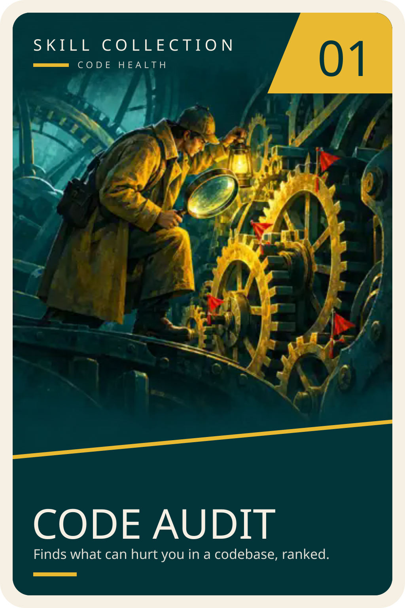
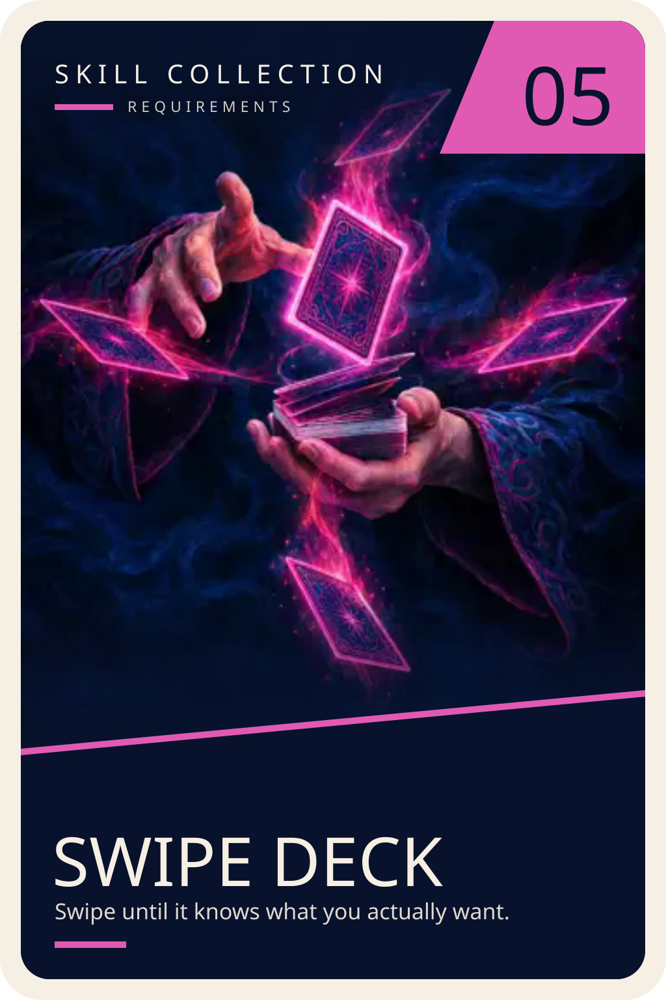
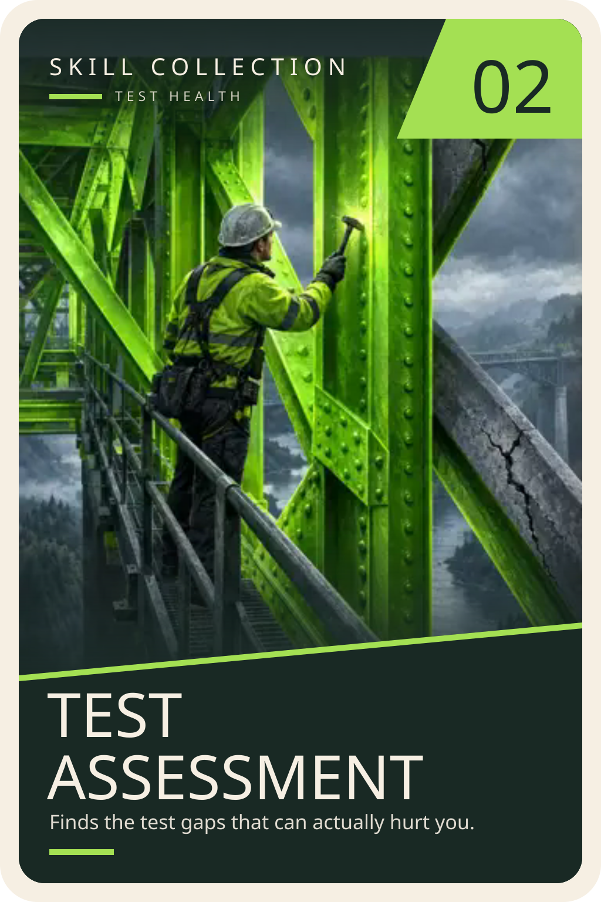
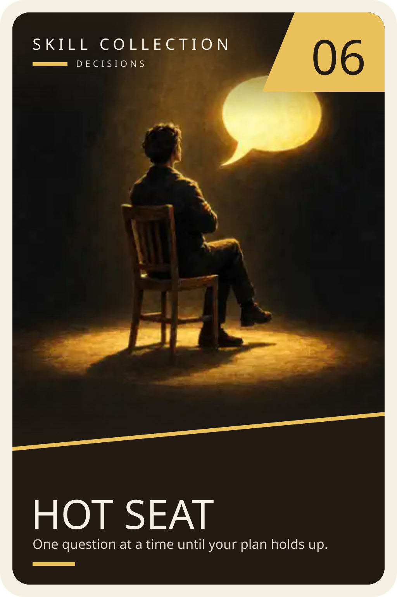
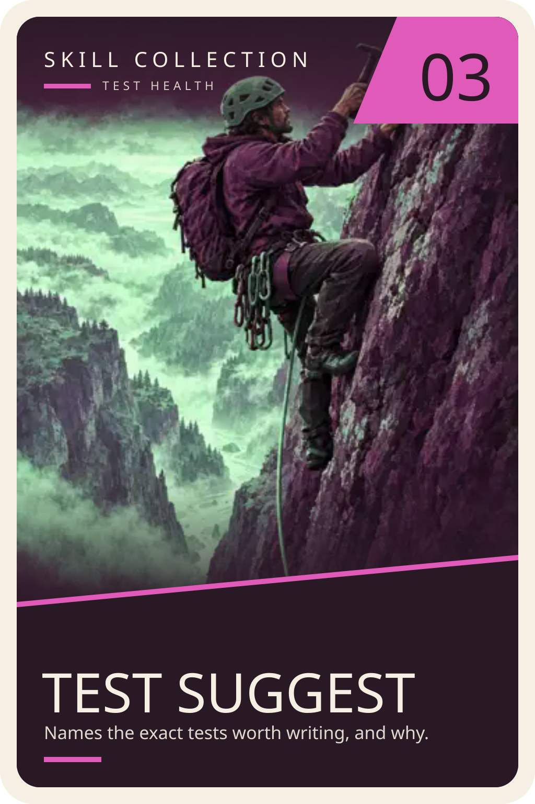
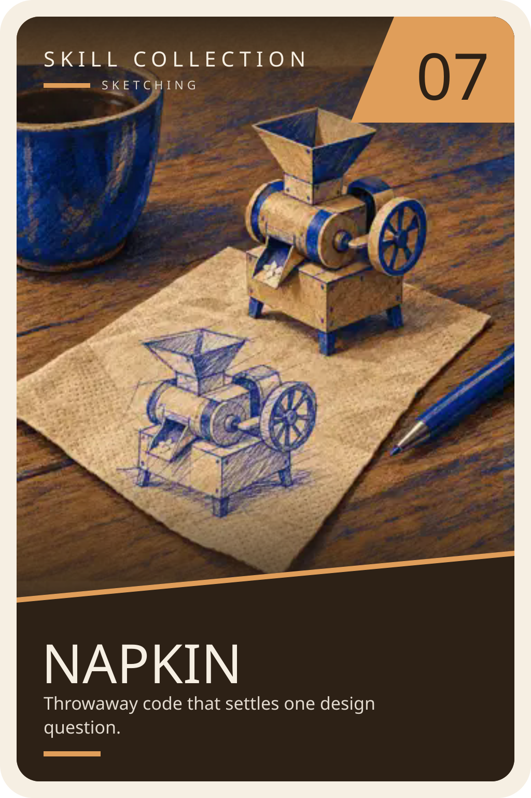
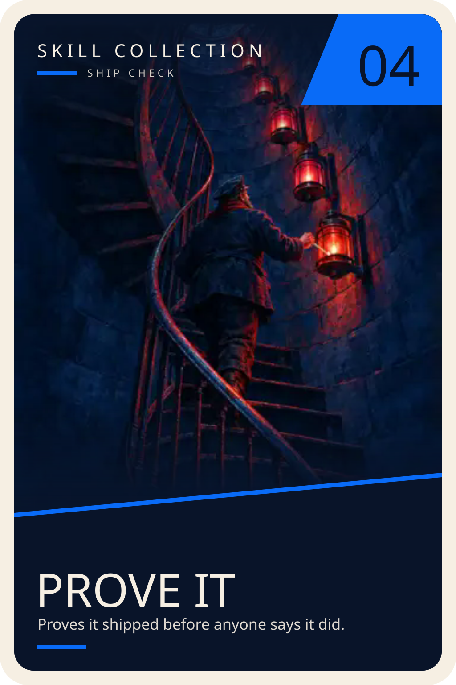
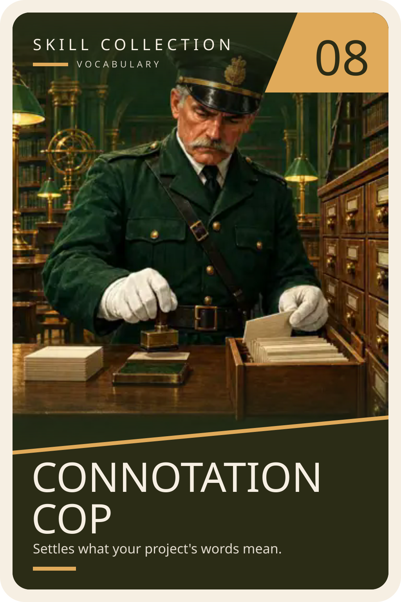

# Gallery spacing test

## A current

<table>
<tr>
<td valign="top" align="center">
 

</td>
<td valign="top" align="center">
 

</td>
<td valign="top" align="center">
 

</td>
<td valign="top" align="center">
 

</td>
</tr>
</table>

## B align=top, br, no newlines

<table>
<tr>
<td valign="top" align="center"> </td>
<td valign="top" align="center"> </td>
<td valign="top" align="center"> </td>
<td valign="top" align="center"> </td>
</tr>
</table>

## C no br, no whitespace, td width

<table>
<tr>
<td valign="top" width="180"></td>
<td valign="top" width="180"></td>
<td valign="top" width="180"></td>
<td valign="top" width="180"></td>
</tr>
</table>

## D align=top + br, width 196

<table>
<tr>
<td valign="top" align="center"> </td>
<td valign="top" align="center"> </td>
<td valign="top" align="center"> </td>
<td valign="top" align="center"> </td>
</tr>
</table>
