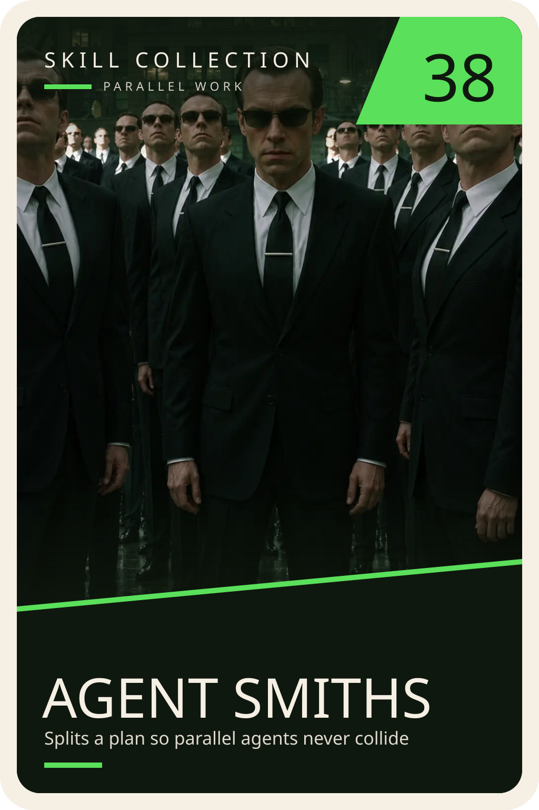
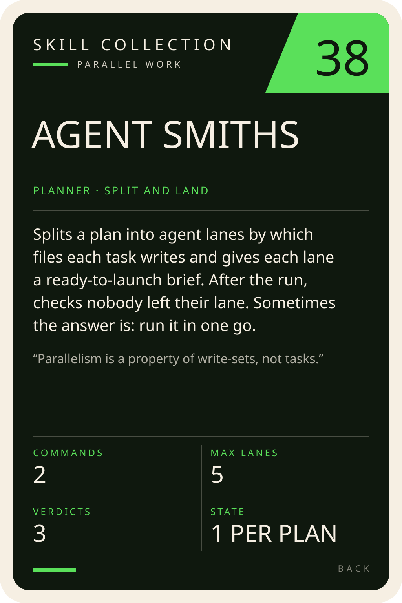
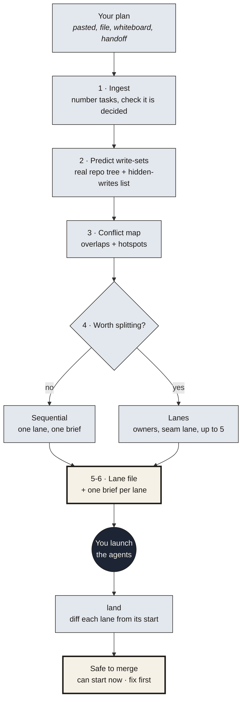

<p align="center">
  
  
</p>

> **TL;DR:** Give it a plan and it works out which tasks can run at the same time without two agents editing the same file, then writes one brief per agent, or tells you to run it in one go. When they're done, it checks that each one stayed in its own files.

## Say this

`/agent-smiths split` · `/agent-smiths land` · `parallelize a plan` · `can these run in parallel` · `will the agents step on each other` · `fan work out` · `agents keep working over each other` · `two agents touched the same file` · `was this worth parallelizing`

A bare `/agent-smiths` shows a menu and runs nothing.

## Commands

| Command | What it does | Writes |
|---|---|---|
| **split** | Splits a plan into lanes with declared write-sets, plus one brief per lane, or a reasoned "run it sequentially" | Creates `.agent-smiths/<plan>.json` |
| **land** | Checks what each lane actually changed against what it declared, flags collisions and violations, says what can merge or start next | Only `landed_check` and `status` in that file |

**The core idea:** two tasks can run at once only if they can't change the same file or resource. Reads are free; writes get divided up. A task whose writes can't be pinned down runs alone.

## How it runs



If the plan still has open decisions ("TBD: which payment provider"), split names the blocked tasks and stops short of guessing.

## What you get

The split report leads with the verdict. Each lane's brief follows in its own code block, ready to paste.

```markdown
**Verdict:** partial. 3 lanes, est. ~35% faster than one agent.
**Why:** L-001 and L-002 share no files; routes/index.ts is owned by L-003, which runs last.

| Lane | What | Writes | Confidence | Starts |
|---|---|---|---|---|
| L-001 | Reset-password API | src/api/auth/reset.ts, its test | high | now |
| L-002 | Reset email template | src/emails/reset/** | high | now |
| L-003 | Wire routes + deps (seam) | routes/index.ts, package.json, lockfile | high | after L-001, L-002 |

**Conflicts found:** T1 and T4 both edit routes/index.ts → moved to seam lane L-003.
**Suggested plan changes:** (only if any)
**Lane file:** .agent-smiths/auth-refactor.json
**Next:** launch L-001 and L-002 now. When they finish, run `/agent-smiths land`.
```

<sub>Illustrative example. The auth-refactor plan is fictional; the layout is copied from <a href="references/split.md"><code>references/split.md</code></a>, Phase 6.</sub>

<details>
<summary><b>What a land report looks like</b></summary>

```markdown
**Land check: auth-refactor**: 2 landed, 1 violated, 1 open
**Safe to merge now:** L-002
**Fix before merging:** L-001

**Collisions**
- src/routes.ts: changed by L-001 and L-003 (owner: L-003)

**Per lane**
| Lane | Status | Changed | Outside its lane |
|---|---|---|---|
| L-001 | violated | 4 files | src/routes.ts (collision) |
| L-002 | landed | 3 files | none |
| L-003 | landed | 2 files | yarn.lock (predictable miss) |
| L-004 | open | none yet | n/a |

**Still owed:** route registration for /reset (L-001 asked for it, L-003 should do it)
**Can start now:** L-004 (its dependencies L-002 and L-003 have landed)
**Merge order (suggested):** L-002, L-003, then L-001 once the collision is sorted
**Next:** fix L-001's routes.ts change (move it to L-003, or drop it), then run `/agent-smiths land` again.
```

<sub>Fictional plan; layout from <a href="references/land.md"><code>references/land.md</code></a>, Phase 5. "Landed" means the lane stayed in bounds, not that the code works.</sub>

</details>

## How land sorts a stray file

| Class | Test | Severity |
|---|---|---|
| **collision** | Two lanes running at the same time changed the same file | Highest. The merge will conflict or silently clobber |
| **violation** | The file belongs to another lane, or is a shared file another lane owns | High |
| **predictable-miss** | Nobody declared it, but it follows from the lane's own work, like a lockfile after adding a dependency | Medium. The next split should catch it |
| **stray** | Nobody declared it and it has nothing to do with the lane's tasks | Medium. Needs a human look before merge |

## Stat sheet

| | |
|---|---|
| **Input** | A plan from anywhere (pasted, a plan file, a whiteboard snapshot, a handoff doc) and ideally the repo it applies to |
| **Output** | `.agent-smiths/<plan>.json` plus one self-contained brief per lane; land adds a per-lane check and a merge order |
| **Verdicts** | `parallel` · `partial` · `sequential`. Sequential is a real answer, not a failure |
| **Lane cap** | Five running at the same time. Wider plans get grouped or run in waves |
| **Hidden writes** | Every task is checked for lockfiles, migrations, generated code, route registries, i18n, config, global styles, shared fixtures |
| **In Claude Code** | Each brief sets up its own git worktree and branch, so parallel agents never share a working tree |
| **Never** | Runs plan tasks, launches agents, merges branches, edits code, or edits the source plan |
| **Ships with** | `references/routing.md`, `split.md`, `land.md`, `write-set-analysis.md` |

## Plays well with

- **[whiteboard](../whiteboard/)**: a whiteboard snapshot is a ready plan to split
- **[handoff](../handoff/)**: a handoff doc works as the plan too
- **[hot-seat](../hot-seat/)**: settles the open decisions that block a split
- **[prove-it](../prove-it/)**: after land says "landed", proves the merged work actually ships and works

## Not for

Creating plans (use [whiteboard](../whiteboard/)) or writing handoff docs (use [handoff](../handoff/)). It decides how work splits and whether the split held; it never does the work itself.

---

<sub><a href="../../README.md#skill-index">← All skills</a> · <a href="SKILL.md">Read the SKILL.md</a></sub>
