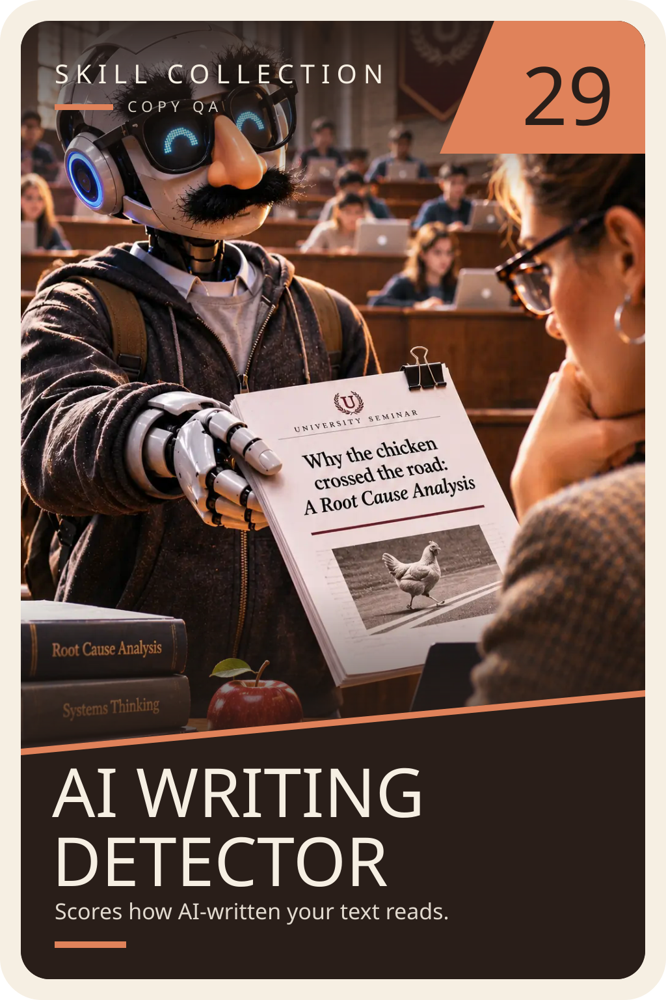
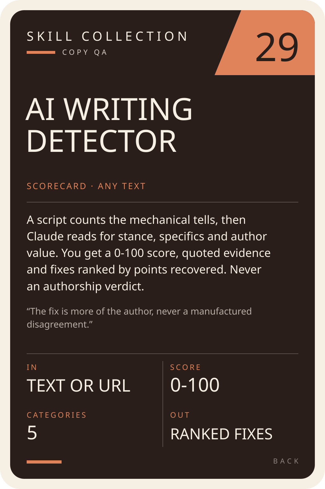
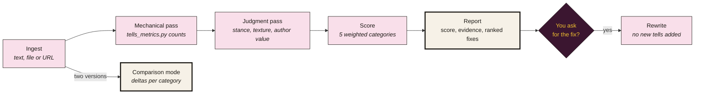

<p align="center">
  
  
</p>

> **TL;DR:** Paste some writing and ask if it sounds like AI. You get a 0 to 100 score for how many AI-style habits it shows, the exact lines that gave it away, and the fixes that would help most. It never claims to know who wrote it.

## Say this

`does this sound AI-written` · `run this through the AI detector` · `score this writing` · `check this for AI tells` · `would this pass as human` · `humanize check`

Or paste text, a file or a URL and ask how it reads, or whether it's too "ChatGPT-ish".

## How it runs



Under about 150 words it warns that the score is noisy and skips the rhythm category; the other weights renormalize. Without code execution it estimates the counts by reading and says so.

## How it's scored

The strongest tells are **absences**: no stance, no texture, no evidence trail. A text with zero banned words can still score badly.

| Category | Weight | What it looks at |
|---|---:|---|
| **Substance & stance** | 35% | Does the author commit to anything? Would swapping the name cost the text nothing? |
| **Texture & specificity** | 25% | Numbers, dates, prices, named tools and failure modes vs. adjectives and placeholder people |
| **Rhythm & structure** | 20% | Uniform paragraphs and sentences, evenly sized sections, a conclusion that restates the intro |
| **Constructions & tics** | 12% | Triads, em dashes, "not just X but Y", bold and colon density, bullet share |
| **Lexicon** | 8% | Banned-phrase hits per 1,000 words |

| Band | Range | Reads as |
|---|---|---|
| **Clean** | 0–20 | A person who knows the subject |
| **Light tells** | 21–40 | Publishable, minor cleanup |
| **Noticeable** | 41–60 | An attentive reader will clock it |
| **Strong** | 61–80 | Reads generated |
| **Template-grade** | 81–100 | Swap the name and nothing changes |

Higher is more tell-like. Lexicon hits alone can't push a text with real stance and texture above 40, and clean mechanics can't rescue a text that fails the author-value check.

## What you get

```markdown
## AI Tells Score: 59/100 — noticeable

| Category | Score | Weight | Key evidence |
|---|---:|---:|---|
| Substance & stance | 70 | 35% | No pick between the three loaves; nothing only this bakery could say |
| Texture & specificity | 60 | 25% | No prices, bake times or named flours |
| Rhythm & structure | 50 | 20% | Five sections of near-identical length; conclusion restates the intro |
| Constructions & tics | 55 | 12% | 6 triads, 5 em dashes in 600 words |
| Lexicon | 40 | 8% | "elevate", "crucial", "when it comes to" |

### Flagged evidence
- [Substance & stance] "Whether you prefer sourdough or rye, there's a loaf for everyone." — weighs every option equally
- [Texture & specificity] "Our bread is made with care and the finest ingredients." — no detail anyone could check
- ...

### Top fixes, ranked by score impact
1. Say which loaf you'd hand a first-timer and why (Substance & stance, about 10 points)
2. Add the real numbers: hydration, proof time, price per loaf (Texture & specificity, about 6 points)
3. ...

*This measures tell density, not authorship. Human writing can score high;
edited AI output can score low. Use it as an editorial QA signal.*
```

<sub>Illustrative example. The bakery post is fictional; the layout and the closing disclaimer come from the report format in <a href="SKILL.md">the SKILL.md</a>.</sub>

## Stat sheet

| | |
|---|---|
| **Input** | Pasted text, a file path, or a URL (fetched, navigation and boilerplate stripped). Two versions for comparison mode |
| **Output** | Score and band, a per-category table, 5 to 10 flagged quotes worst first, fixes ranked by points recovered, and a standing disclaimer. In chat; a file only if asked |
| **Two passes** | A script counts what's countable; Claude judges stance, texture, audience fit, the author-value check and structural intent |
| **Quotes** | One sentence max each. The report analyzes the text, it doesn't reproduce it |
| **Never** | Says "this was written by AI", or suggests fake typos, invented anecdotes, manufactured disagreement or detector-evasion tricks |
| **Fixes add** | Stance the writer actually holds, specifics and asymmetry. A stance fix is worth more than deleting every "delve" |
| **Ships with** | `scripts/tells_metrics.py`: lexicon, signposts, hedges, construction densities, rhythm CVs and reference thresholds as JSON. It gives no overall score of its own |

## Plays well with

- **[seo-blog-writer](../seo-blog-writer/)**: writes the draft this scores
- **[who-let-the-blogs-out](../who-let-the-blogs-out/)**: the full blog system, whose `review` runs the same kind of tells scoring
- **[slop-scan](../slop-scan/)**: the same question for a website's look instead of its words

## Not for

Deciding who wrote something, or helping text slip past a detector. It reports tell density and evidence only.

---

<sub><a href="../../README.md#skill-index">← All skills</a> · <a href="SKILL.md">Read the SKILL.md</a></sub>
