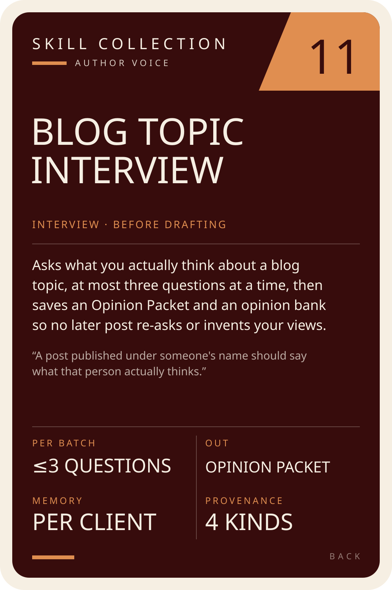
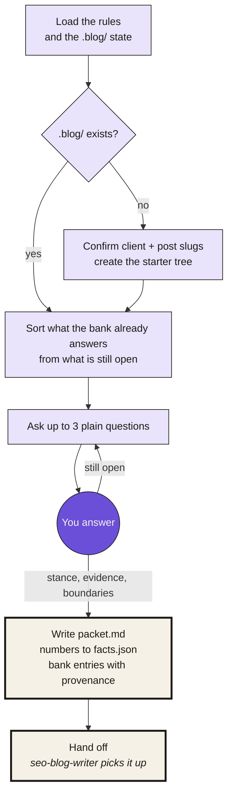

<p align="center">
  
  
</p>

> **TL;DR:** Before a blog post goes out under your name, Claude asks what you actually think: your stance, real stories, numbers, and what must never be said. It saves your answers so the writer uses your views, and no later post asks the same thing twice.

## Say this

`interview me about this topic` · `get my take first` · `ask me what I think before you write` · `update my opinion bank`

## How it runs



When the bank already covers the topic, the interview may be one question or none. Signs of confusion make the next question shorter, not longer. Two confused answers in a row and it stops asking and lists the rest as gaps.

## What you get

**1. The Opinion Packet** at `.blog/posts/<slug>/packet.md`, always these sections in this order:

```markdown
# Opinion Packet — <topic>
Client: <client-slug> · Post: <post-slug> · Interviewed: YYYY-MM-DD

## Thesis
## Business purpose
## Defensible stances
## First-hand evidence
## Specifics
## Voice notes
## Boundaries — do not say
## Gaps
## Suggested angle
```

**2. Opinion bank entries**, one file per client, each with a provenance line. An example for a made-up pressure-washing business:

```markdown
### Sealing right after washing (P-004, 2026-09)
*Provenance: stated — asked what he tells clients about sealing, 2026-09 interview.*

"Wash it, let it dry two full days, then seal. Seal it wet and you've wasted the money."
```

<sub>Packet layout from <a href="references/interview.md"><code>references/interview.md</code></a>; entry format from <a href="assets/opinion-bank-template.md"><code>assets/opinion-bank-template.md</code></a>. The business, position and quote are fictional.</sub>

**3. A short chat reply:** the thesis in your words, what it got (in sentences, not counts), anything still open, and the next step.

## What can go in the bank

Every position (`P-###`) and story (`S-###`) needs one of four provenance values. Nothing else may become an entry.

| Provenance | What it means |
|---|---|
| **stated** | You wrote the position yourself |
| **selected** | You picked an option that stated it |
| **confirmed** | Claude proposed a wording and you clearly agreed |
| **demonstrated** | You gave an example that plainly carries it |

Never allowed: Claude's inference, a research conclusion, its own recommendation, "probably believes", silence, or anything you pasted for it to read.

## Stat sheet

| | |
|---|---|
| **Input** | The topic, your live answers, and the project's `.blog/` folder if it exists |
| **Output** | `posts/<slug>/packet.md`, new opinion-bank entries, dated facts in `facts.json`, `post.json` set to `interviewed`, `registry.json` |
| **No `.blog/` yet** | Creates the same starter tree as who-let-the-blogs-out's `brand`, with an empty brand profile |
| **Question limit** | At most 3 at once, plain enough to need no explanation, and never one the bank already answers |
| **Numbers** | Prices, timelines and results go to `facts.json` with a verified date and a re-verify date |
| **Never** | Drafts, researches search results, or writes anything into its own skill folder |
| **Ships with** | Copies of who-let-the-blogs-out's `references/interview.md`, `governing-rules.md`, `state.md`, `reporting.md`, `evidence-rules.md` and `assets/opinion-bank-template.md`, checked against the originals in CI |

## Plays well with

- **[seo-blog-writer](../seo-blog-writer/)**: picks up from `packet.md` to write the brief and the draft
- **[ai-writing-detector](../ai-writing-detector/)**: scores the finished draft
- **[who-let-the-blogs-out](../who-let-the-blogs-out/)**: the full system this step comes from; same files, so nothing needs migrating

## Not for

Emails, docs, proposals or social posts. Blog and article topics only. It doesn't write the article either; that's [seo-blog-writer](../seo-blog-writer/).

---

<sub><a href="../../README.md#skill-index">← All skills</a> · <a href="SKILL.md">Read the SKILL.md</a></sub>
