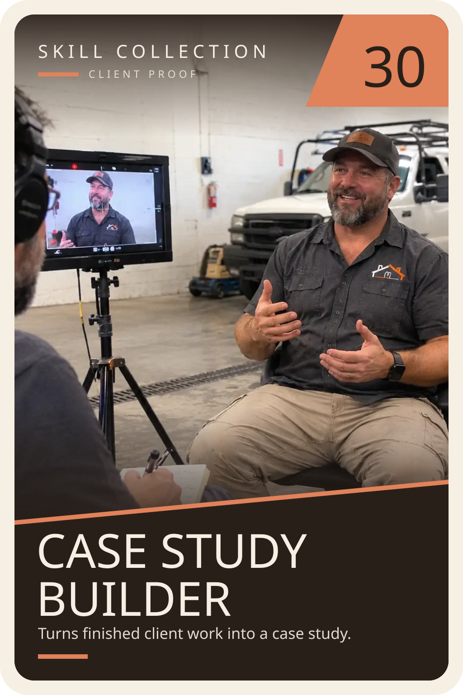
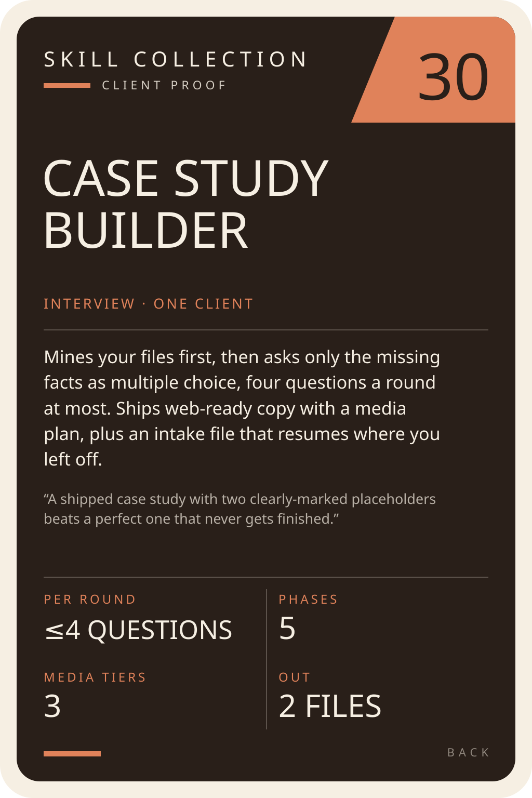
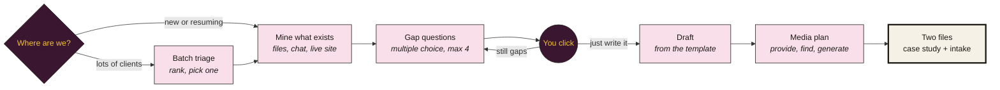

<p align="center">
  
  
</p>

> **TL;DR:** Name a client you did good work for and hand over whatever files you have. Claude digs the facts out first, asks only what's missing as quick multiple choice, and writes a ready-to-publish case study with a list of the pictures it needs.

## Say this

`write up what we did for [client]` · `I need a case study` · `client success story` · `portfolio write-up` · `results page` · `I should really do a case study for X` · `I want to show off the work we did for that gym`

It also fires when you mention having clients but no case studies.

## How it runs



Files can show up at any point. Each one gets mined right away and logged in the intake notes before the next question.

## The interview, at a glance

| Rule | What it means for you |
|---|---|
| **Options come pre-guessed** | 2 to 4 likely answers per question. You mostly confirm instead of remembering |
| **Small rounds** | At most 4 questions, then a one-line progress marker |
| **Escape hatch always open** | "skip", "idk" or "just write it" end the questions. No "just one more" |
| **Never re-asked** | Anything a file or earlier message answered counts as answered |
| **Results and the before-state first** | Of the five question phases, those two carry the story |
| **Running unattended** | No stalling and no invented answers: a draft with placeholders plus questions for later |

## What you get

```markdown
---
title: How a Family-Run Dog Groomer Filled Its Weekday Calendar After a Website Rebuild
slug: tidy-tails-case-study
meta_description: A small dog-grooming shop rebuilt its site and roughly doubled online bookings.
client: Tidy Tails Grooming
industry: Pet grooming
services: [Website rebuild, Online booking]
---

# How a family-run dog groomer filled its weekday calendar

Bookings only came by phone, and weekdays sat half empty. A new site changed that.

**Online bookings roughly doubled**

## Meet Tidy Tails
...

## The problem
The old site didn't work on phones, and the "Book" button opened an email form nobody answered.

## What we did
...

## The results
Online bookings roughly doubled within two months. [NEED: weekday fill rate before and after]

> "[QUOTE]"
> — [Name, role, company]
```

Plus a media plan table at the bottom (every visual gets a provide, find or create, and generate fallback) and a second file, the intake notes:

```markdown
# Tidy Tails Grooming — case study intake
Updated: [date]  ·  Status: awaiting client OK

## Numbers
- Online bookings: roughly doubled — confidence: client-said

## Permissions
- Name/logo use: [CONFIRM: client OK to be named]
- Quote: requested
```

<sub>Illustrative example. Tidy Tails Grooming is fictional; the structure and placeholders follow <a href="references/template.md"><code>references/template.md</code></a>.</sub>

## Stat sheet

| | |
|---|---|
| **Input** | The client, any files (emails, proposals, analytics exports, screenshots, invoices, chat logs), their live site, and short answers |
| **Output** | `<client-slug>-case-study.md` (web copy with a media plan) and `<client-slug>-intake.md` (facts with sources, open questions, permissions, a ready-to-send quote request) |
| **Truth rules** | No invented metrics, quotes, timelines or names. A number from memory stays "roughly doubled", never "104%" |
| **Placeholders** | `[NEED: …]`, `[QUOTE]`, `[CONFIRM: …]`. Loud and greppable, so the draft ships instead of stalling |
| **Media** | Provide → find or create → generate, per visual. Results charts come from real numbers or don't exist |
| **Resumes from** | The intake file, so the next session asks nothing twice |
| **Batch mode** | A short ranked table of your clients, then one recommended start: best story for the effort |
| **Ships with** | `references/question-bank.md` (five phases in priority order), `references/template.md` (both file skeletons and the quote request) |

## Plays well with

- **[ai-writing-detector](../ai-writing-detector/)**: checks the finished copy for AI tells before it goes live
- **[who-let-the-blogs-out](../who-let-the-blogs-out/)**: the blog-post system, which leaves case studies to this skill

---

<sub><a href="../../README.md#skill-index">← All skills</a> · <a href="SKILL.md">Read the SKILL.md</a></sub>
