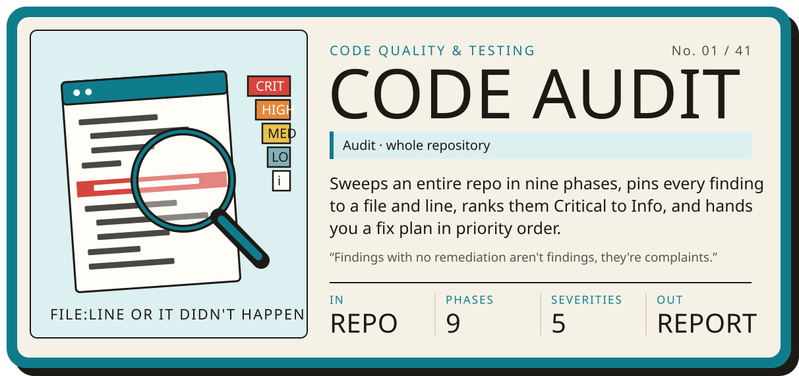
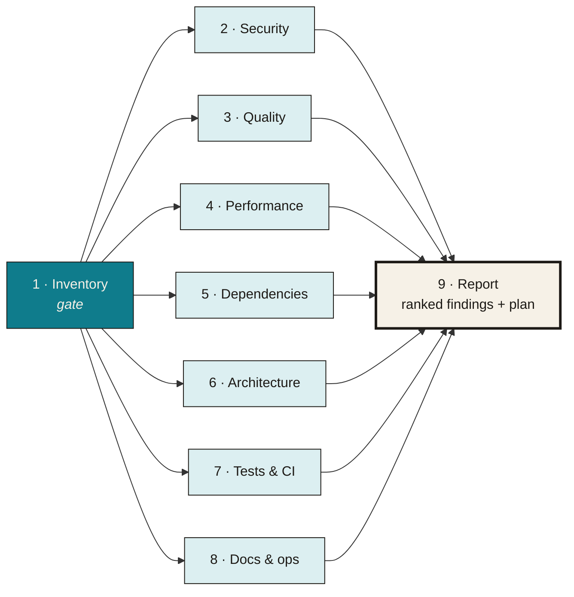
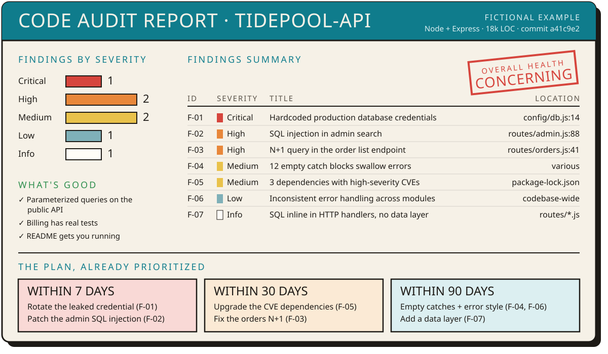

<p align="center">
  
</p>

> **TL;DR:** Point it at a repo. You get a report that ranks every problem by how much it can hurt you, with the file and line for each one and a plan for what to fix first.

## Say this

`audit this codebase` · `review this repo` · `security review` · `what's wrong with this codebase` · `due diligence on this project` · `can you eyeball my repo?`

## How it runs

Phase 1 is a gate: nothing gets judged until the inventory exists. On repos over about 100k lines, phases 2, 3 and 5 run as parallel subagents.



## What you get

<p align="center">
  
</p>
<sub>Illustrative example. The project is fictional; the layout follows <a href="assets/report-template.md"><code>assets/report-template.md</code></a>.</sub>

<details>
<summary><b>What one expanded finding looks like</b></summary>

```markdown
### F-01 — Hardcoded production database credentials in source

**Severity:** Critical
**Category:** Security
**Location:** `config/db.js:14`

**Why it matters**
Anyone with read access to the repo has the production database password,
and git history keeps it even after the line is deleted.

**Recommendation**
1. Rotate the credential immediately.
2. Read it from an environment variable; fail at boot if unset.
3. Add a pre-commit secret scanner.
4. Scan git history, not just HEAD.

**Effort to fix:** S
```

</details>

## Stat sheet

| | |
|---|---|
| **Input** | A repo path, a URL to clone, or an uploaded file tree |
| **Output** | Executive summary, findings table, expanded findings with evidence and a fix, a "what's good" section, and a 30/60/90-day plan |
| **Severity scale** | Critical · High · Medium · Low · Info. Inflation is called out as a failure: a lint issue is never Critical |
| **Rule it lives by** | Every finding cites `file:line` and gets verified first. No speculative alarms |
| **Big repos** | Over ~100k lines or 2,000 files it samples (entry points, auth code, the 10 most-changed files) and says what it skipped |
| **Without a shell** | Still works by reading files; the scripted checks become manual |
| **Ships with** | `scripts/inventory.sh`, `scan_secrets.sh`, `find_smells.sh`, `deps_check.sh`, six reference checklists, the report template |

## Plays well with

- **[test-assessment](../test-assessment/)**: when the audit says "tests are thin", this finds exactly where
- **[test-suggest](../test-suggest/)**: turns a gap into specific test cases

## Not for

Reviewing a diff or pull request (use the built-in `code-review` or `security-review`), or a single function.

---

<sub><a href="../../README.md#skill-index">← All 41 skills</a> · <a href="SKILL.md">Read the SKILL.md</a></sub>
