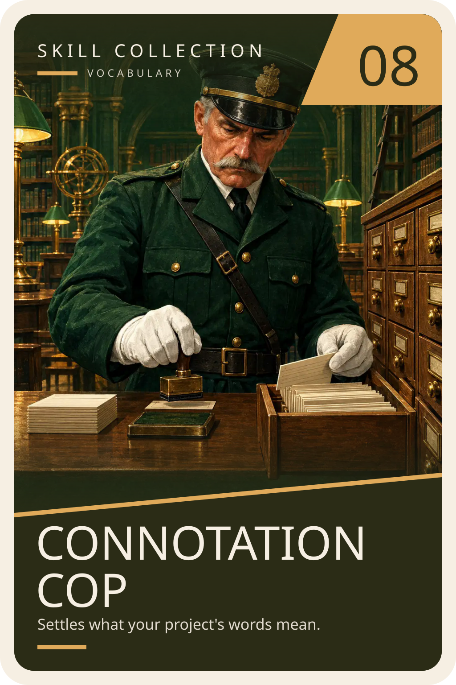
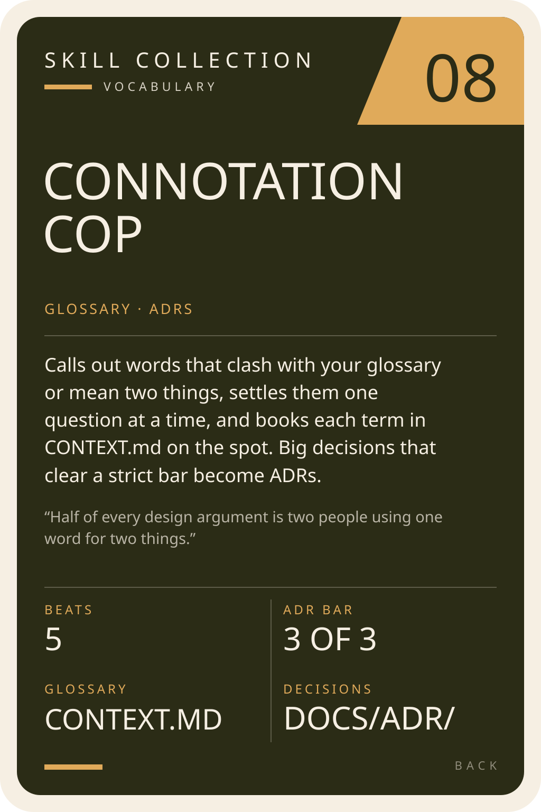
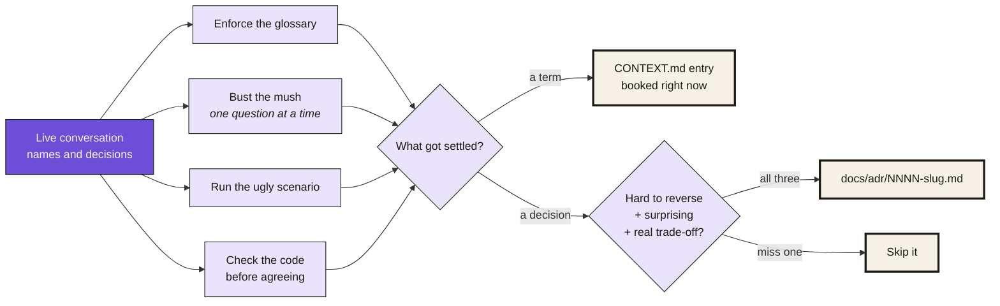

<p align="center">
  
  
</p>

<!-- skill-family:start -->
> **Part of [Whiteboard](../whiteboard/).** It works alongside Whiteboard and can also be installed on its own.
<!-- skill-family:end -->

> **TL;DR:** Half of every design argument is two people using one word for two things. This catches it, settles the word with you, writes it into a glossary right away, and records the big, hard-to-undo decisions as short ADRs.

## Say this

`what should we call this`

Or ask to pin down terminology, ask for a decision to be recorded, or just argue about a name. It also gets called by [hot-seat](../hot-seat/) and [whiteboard](../whiteboard/) when a decision clears the ADR bar.

## How it runs



## The beat

| Move | What it sounds like |
|---|---|
| **Enforce the glossary** | "Your glossary says *cancellation* means X — you're using it as Y. Which is it?" |
| **Bust the mush** | "You keep saying *account* — Customer or User? Different things here." |
| **Run the ugly scenario** | "Customer cancels after the shipment left but before delivery — what state is the Order in?" |
| **Check the code before you nod** | "Code cancels whole Orders. You just said partial cancellation exists. Which is right?" |
| **Book it immediately** | Term settled means a glossary entry now, mid-conversation. Batching means skipping |

<sub>Quoted lines come from <a href="SKILL.md">the SKILL.md</a>.</sub>

## What you get

A glossary entry in `CONTEXT.md` at the repo root:

```md
## Language

**Order**:
A confirmed request from a customer to buy specific items.
_Avoid_: purchase, transaction
```

And, only when a decision clears the bar, a numbered ADR in `docs/adr/`. The whole template is a title and one to three sentences:

```md
# Ordering and Billing communicate via events, not synchronous HTTP

Checkout was waiting on invoice generation. Ordering now emits `OrderPlaced`
and Billing consumes it to open an invoice draft, so a slow Billing can't
block a sale.
```

<sub>Illustrative example for a fictional shop. Formats follow <a href="references/context-format.md"><code>references/context-format.md</code></a> and <a href="references/adr-format.md"><code>references/adr-format.md</code></a>.</sub>

## The ADR bar: all three, or skip it

| Test | Why it's there |
|---|---|
| **Hard to reverse** | Easy-to-reverse just gets reversed |
| **Surprising without context** | Unsurprising never gets questioned |
| **A real trade-off** | No alternative means it records nothing but "we did the obvious thing" |

An ADR folder full of trivia trains everyone to ignore it, and then the one ADR that matters dies unread.

## Stat sheet

| | |
|---|---|
| **Input** | The live naming or decision conversation, any existing `CONTEXT.md` and `docs/adr/`, and the code to check claims against |
| **Output** | `CONTEXT.md` entries (term, one or two sentence definition, `_Avoid_` list) and sequentially numbered `docs/adr/NNNN-slug.md` |
| **Multiple contexts** | A root `CONTEXT-MAP.md` pointing at each context's own glossary, only when a repo genuinely has more than one |
| **Files** | Created lazily: the first settled term creates `CONTEXT.md`, the first real decision creates `docs/adr/` |
| **CONTEXT.md holds** | A glossary, full stop. No implementation details, specs, table names, libraries or scratch notes |
| **Questions** | One at a time, hot-seat rules |
| **Ships with** | `references/context-format.md`, `references/adr-format.md` |

## Plays well with

- **[hot-seat](../hot-seat/)**: a decision-log line that clears the bar becomes the ADR's seed
- **[whiteboard](../whiteboard/)**: a ticket resolution that clears the bar gets an ADR plus a one-line pointer on the board
- **[napkin](../napkin/)**: an ADR is one place a napkin's answer can outlive the code
- **[whiteboard-help](../whiteboard-help/)**: the cheat sheet, including the solo "connotation-cop: [term fight]" phrase

## Not for

Just reading the glossary for vocabulary. It runs only when the words or decisions are being changed.

---

<sub><a href="../../README.md#skill-index">← All skills</a> · <a href="SKILL.md">Read the SKILL.md</a></sub>
