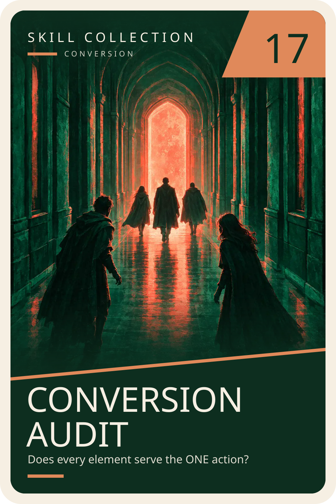
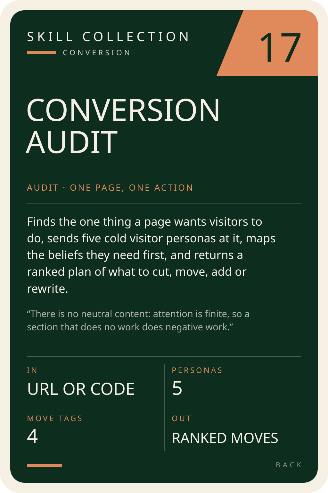
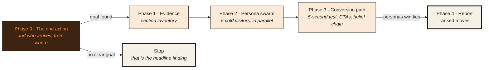

<p align="center">
  
  
</p>

> **TL;DR:** Point it at a landing page. It works out the one thing the page wants visitors to do, sends five pretend visitors at it cold, and hands back a ranked list of what to cut, move, add or rewrite.

## Say this

`what do we want people to do on this page` · `is this page converting` · `critique this landing page` · `why would someone book/buy/sign up here` · `audit the funnel on X page`

Or ask for strategic critique of a page's content and structure (not visual polish).

## How it runs



The persona agents get only the page and their persona. They are never told the page's goal or Claude's hypotheses, and where they disagree with Claude's own read, they win.

## What you get

The report always has these six parts, in this order:

```markdown
## 1. The one thing
This page wants the visitor to book a free quote call.

## 2. Verdict
A cold visitor gets the offer in five seconds but leaks at proof:
there is nothing showing the work was ever done for a home like theirs.

## 3. What's working
- The hero headline names the service and the town in eight words.

## 4. Prioritized moves
### Leaks
1. REWRITE · Hero button "Get started" → "Book a free quote call".
   The ready-to-act persona didn't know what the button would do.
2. CUT · The newsletter signup above the fold. It competes with the booking ask.
### Drag
3. MOVE · Reviews up, above pricing. The skeptical buyer hit the price first and bailed.
### Polish
4. ADD · Repeat the booking button after the reviews section.

## 5. Belief-chain map
real company → covered
has done homes like mine → missing
booking a call is low-risk → weak

## 6. What I couldn't verify
Traffic sources and conversion rate: no analytics were provided.
```

<sub>Illustrative example for a fictional window-cleaning company. The six sections and the CUT / MOVE / ADD / REWRITE and leaks → drag → polish grouping come from Phase 4 of <a href="SKILL.md">the SKILL.md</a>; it has no fixed template beyond that.</sub>

## The cold-visitor panel

| Persona | What they're hunting for |
|---|---|
| **5-second skimmer** | Headline, subhead and whatever is loud. Stay or leave? |
| **Skeptical buyer** | Every reason NOT to trust the page, and whether it answers them |
| **Ready-to-act visitor** | How many scrolls and clicks until they can actually act |
| **Wrong-fit visitor** | Whether the page tells them it's not for them |
| **Comparison shopper** | What they'd remember in ten minutes, with three competitor tabs open |

Each one returns the same fields: `first_impression`, `would_do_next`, `bail_points`, `unanswered_questions`, `strongest_moment`, `weakest_moment`. The panel can be adjusted to the site's audience.

## Stat sheet

| | |
|---|---|
| **Input** | Frontend code in a repo, a live URL via browser tools, or pasted copy and screenshots |
| **Output** | The one thing, a verdict, what's working, tagged moves, a belief-chain map, and what couldn't be verified |
| **Move tags** | CUT · MOVE · ADD · REWRITE, ordered by conversion impact, not ease |
| **Phase 3 checks** | Five-second test, CTA inventory, belief-chain coverage, top 5 objections, momentum and friction, post-click integrity |
| **Stops when** | No goal can be found. "A page with no discernible goal cannot be optimized, only decided" |
| **Scales** | Quick pass skips the swarm but still writes the belief chain and CTA inventory. Multi-page builds an intent map first |
| **Never** | Fabricates analytics, traffic sources or conversion data |
| **Ships with** | `SKILL.md` only |

## Plays well with

- **[ux-audit](../ux-audit/)**: flow usability and friction, which this skill leaves alone
- **[secret-shopper](../secret-shopper/)**: a regular customer trying the real tasks, in plain words
- **[slop-scan](../slop-scan/)**: whether the page looks AI-made, the visual side this skill skips
- **[website-audit](../website-audit/)**: the whole-site crawl and scored report

## Not for

Flow usability and friction (use [ux-audit](../ux-audit/)) or visual and aesthetic quality (the SKILL.md points to the impeccable critique and audit skills, which aren't in this repo). The output is a verdict and a list of moves, not a redesign.

---

<sub><a href="../../README.md#skill-index">← All skills</a> · <a href="SKILL.md">Read the SKILL.md</a></sub>
