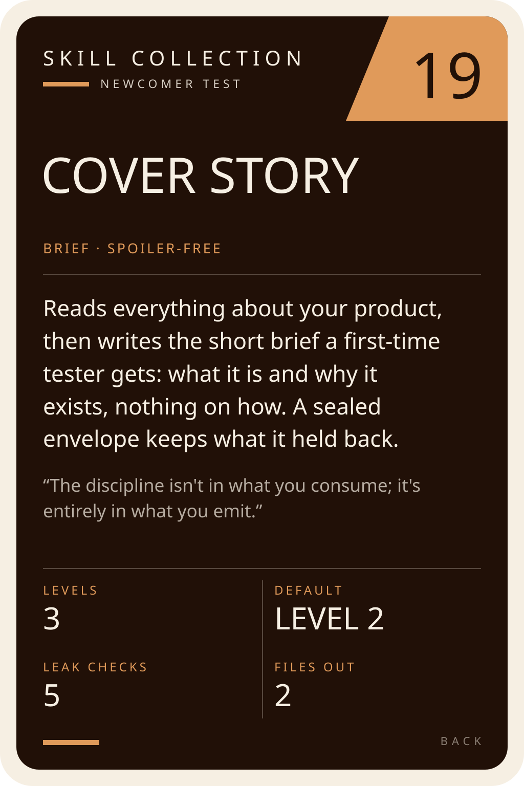
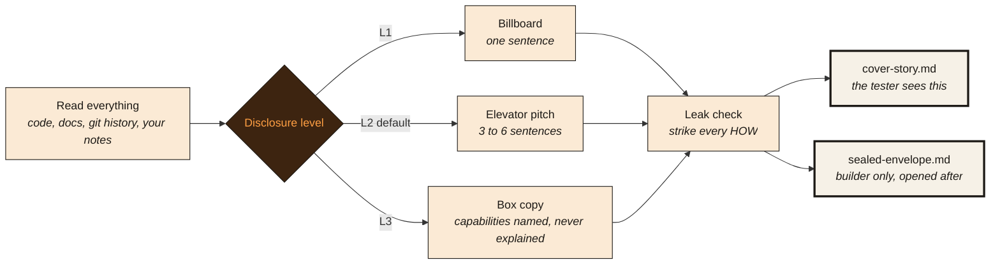

<p align="center">
  
  
</p>

<!-- skill-family:start -->
> **Part of [Fresh Eyes](../fresh-eyes/).** It works alongside Fresh Eyes and can also be installed on its own.
<!-- skill-family:end -->

> **TL;DR:** Before a newcomer test, it writes the short note a tester gets going in: what the product is and why it exists, but nothing about how to use it. Everything it held back goes in a separate sealed envelope, so afterwards you can check the tester's questions against its predictions.

## Say this

`describe my app without giving anything away` · `write the context card for the tester` · `explain what it is but not how to use it` · `set up the newcomer test` · `what would the tester be told going in?`

Or ask for the briefing a new tester, new hire or evaluator should get before first contact.

## How it runs



The scenario picks the level: "my friend told me about it" is Level 1, "they read our landing page" is Level 3.

## What you get

Two files, never combined. Here is the shape:

```markdown
<!-- cover-story.md · Level 2 (elevator pitch) -->
The email from your manager said:
"A teammate built a little terminal app for keeping a todo list. It's for
developers who live in the command line and lose small tasks between
meetings. Take a look and tell me if you'd use it."
```

```markdown
<!-- sealed-envelope.md · builder only, open after the test -->
| Withheld insider fact            | Predicted naive question             |
|----------------------------------|--------------------------------------|
| Tasks are organized into boards  | "What's a board? Do I need one?"     |
| Setup step before the first task | "Why does adding a task fail?"       |
```

<sub>Illustrative example for a fictional todo app, built on the terminal-todo-app example in <a href="SKILL.md">the SKILL.md</a>. The SKILL.md describes both files but has no fixed template: the brief is plain second person with its level stated, and the envelope pairs each withheld fact with the question it predicts.</sub>

After the test, predictions that came true confirm the product isn't explaining itself. Ones the tester never hit may mean the test didn't reach them.

## The line it holds

| WHAT (goes in the brief) | HOW (never goes in) |
|---|---|
| Purpose, the problem it solves | Commands, steps, setup, prerequisites |
| Who it's for | Where things are in the UI |
| What category of thing it is | Definitions of the product's own words |
| Why someone would want it | Order of steps, warnings, troubleshooting, how features work |

The test for every sentence: **"Does this answer a question the tester should have to ask?"** If yes, it's cut.

## Stat sheet

| | |
|---|---|
| **Input** | Full insider access (code, docs, git history, your explanation), plus the disclosure level and the tester's scenario |
| **Output** | `cover-story.md`, the only thing the tester sees, and `sealed-envelope.md`, for the builder's eyes only |
| **Levels** | L1 Billboard · L2 Elevator pitch (default) · L3 Box copy |
| **Leak check strikes** | Named commands, files, buttons or screens · defined terms · sequencing · warnings and hints · explained capabilities (or any named ones at L1 and L2) |
| **Accuracy** | Describes the honest purpose, not what the marketing wishes it were |
| **Ships with** | `SKILL.md` only |

## Plays well with

- **[fresh-eyes](../fresh-eyes/)**: runs the test, with this brief as its starting information
- **[eli5-features](../eli5-features/)**: for when you do want the how written down as real docs

## Not for

Running the test itself (that's [fresh-eyes](../fresh-eyes/)), or anything that explains how to use the product: "If it would merely make their session harder, it goes — that difficulty is the data."

---

<sub><a href="../../README.md#skill-index">← All skills</a> · <a href="SKILL.md">Read the SKILL.md</a></sub>
