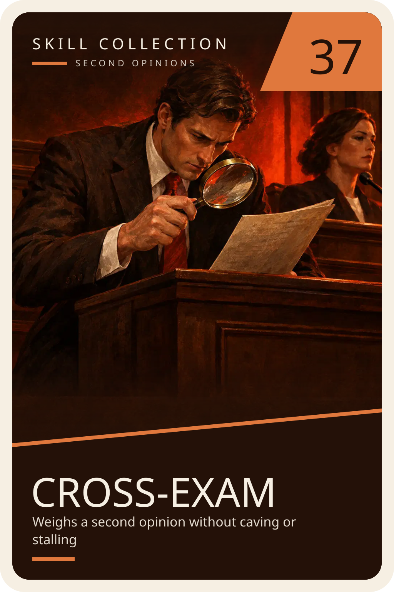
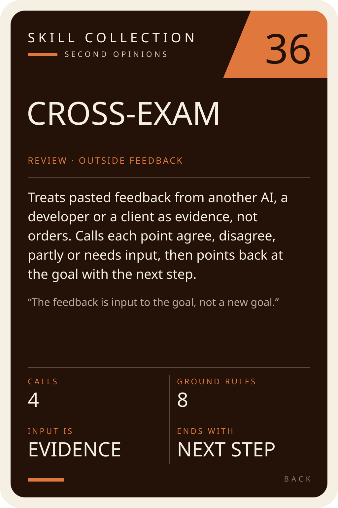
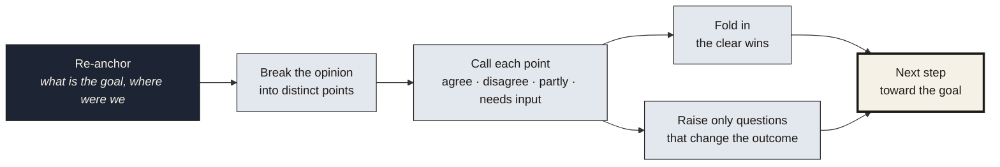

<p align="center">
  
  
</p>

> **TL;DR:** Paste what ChatGPT, your developer or a client said about the work. Claude goes through it point by point, says plainly where they're right and where they're wrong for this project, and then gets back to finishing the job.

## Say this

`cross-exam` · `/cross-exam` · `second opinion` · `here's what ChatGPT said` · `another LLM suggested` · `my dev thinks` · `feedback from` · `someone said` · `research says` · `thoughts on this`

Or just paste a critique, review, or alternative version of earlier work, even without saying what to do with it.

## The two ways this goes wrong

| Failure | What it looks like | What the skill does instead |
|---|---|---|
| **Caving** | Claude assumes you agree with the paste and rewrites everything to match | Treats the paste as evidence. You haven't endorsed it unless you said so |
| **Drifting** | The feedback becomes its own topic and the real task stops moving | Every reply ends with how this moves the original goal and the next step |

## How it runs



Checkable facts (API behavior, versions, prices, stats) get verified with tools when they're available, not guessed.

## What you get

The worked example from the SKILL.md. Context: a small internal tool, with an export button up next. The pasted feedback said to switch to Postgres, add Redis, and fix error handling in `fetchUser`.

```markdown
**Goal:** Ship the internal tool. Export button is next.

**TL;DR:** #3 is a real bug. #1–2 are overkill unless this goes multi-user.

| # | Their point | Call | Why |
|---|---|---|---|
| 1 | Postgres over SQLite | ❌ Disagree | One user, local, zero setup was the goal. |
| 2 | Add Redis | ❌ Disagree | No load problem to solve. |
| 3 | fetchUser swallows errors | ✅ Agree | Bare `catch {}` hides failures. My miss. |

**Worth discussing:** Will this ever be multi-user? If yes, #1 flips to a yes and it's easier to switch now.

**Next:** Fixing #3 and then building the export button. Say the word on multi-user if that changes the plan.
```

<sub>Copied from the example in <a href="SKILL.md">the SKILL.md</a>; the tool is fictional. The full format also has a 🟡 Partly and a ❓ Needs input call. Two small notes get a sentence each and a Next line instead of a table.</sub>

## Edge cases

| You say or paste | It does |
|---|---|
| **"Apply this" or "do it their way"** | That's an instruction. It does it, raising any real problem in one line |
| **"Just assess"** | Gives the assessment and stops |
| **A mostly right opinion** | Says so and moves to applying it |
| **A mostly wrong opinion** | Says so in a line or two and keeps going on the current path |
| **Several opinions** | One table with a column per source, one combined recommendation |
| **A full alternative version** | Compares section by section and says which version wins each part |
| **The same point circling back** | Names the loop, restates the goal, gives a final pick, and lets you decide |

## Stat sheet

| | |
|---|---|
| **Input** | An outside opinion on work in progress: another LLM, research, a developer, a client, an article |
| **Output** | Goal line, TL;DR, a point-by-point table, only the points worth discussing, and a Next step |
| **No bias either way** | Its own earlier work gets no special credit; their confident tone isn't proof either |
| **Context gap check** | Flags advice that's fine in general but wrong for this situation |
| **Settled stays settled** | Decided points don't get reopened |
| **Ships with** | `SKILL.md` only |

---

<sub><a href="../../README.md#skill-index">← All skills</a> · <a href="SKILL.md">Read the SKILL.md</a></sub>
