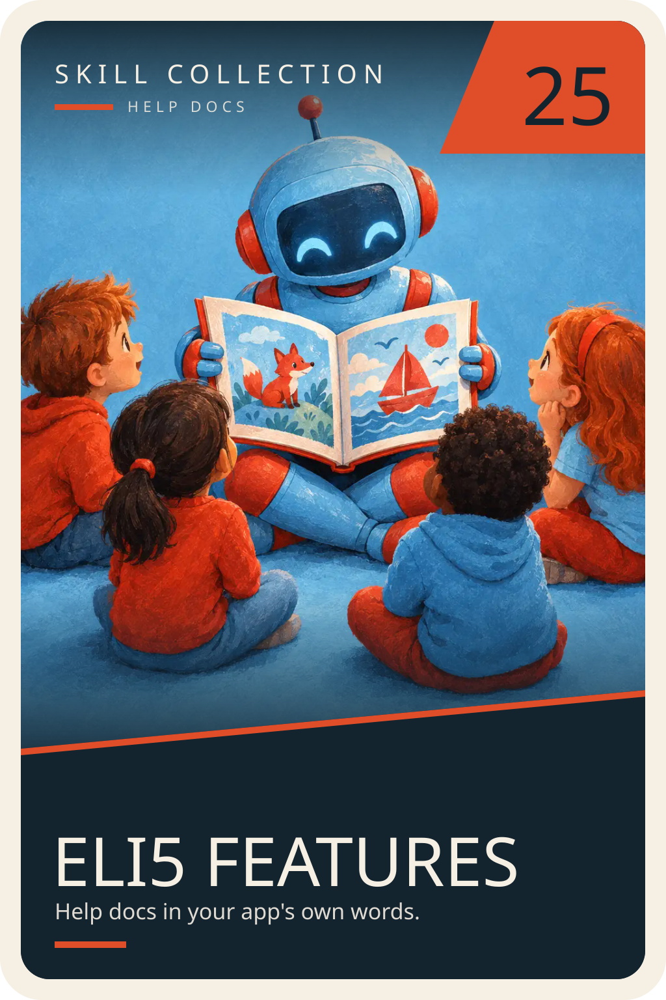
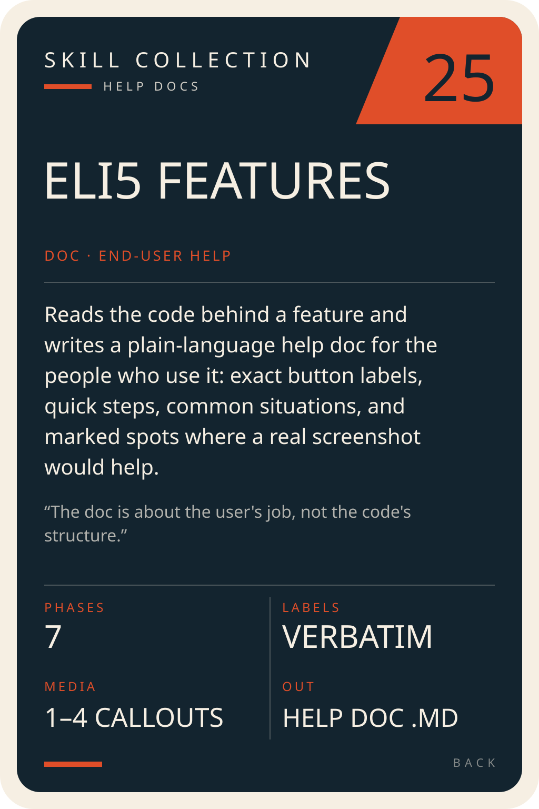

<p align="center">
  
  
</p>

> **TL;DR:** Point it at a feature in your app. It reads the code, learns what every button is actually called, and writes a friendly help article for the people who use the product, not the people who built it.

## Say this

`ELI5 the closeout flow` · `write user docs for the kanban view` · `make a help article for X` · `explain this feature to a customer` · `document this for end users` · `make a user doc for X`

## How it runs

```mermaid
flowchart LR
    G{"Style guide<br/>in docs?"} -->|yes| F["1 · Find the feature<br/><i>name, file, or code + description</i>"]
    G -->|no| N["Scaffold<br/>docs/.eli5-style.md"]
    N --> F
    F -->|several matches| A(("You pick<br/>asked once"))
    A --> V
    F --> V["2 · Scan UI wording<br/><i>button labels, titles, nav</i>"]
    V --> J["3 · Map the journey<br/>goal, trigger, path, result"]
    J --> M["4 · Mark media spots<br/>1 to 4 callouts"]
    M --> D["5 · Draft<br/>plain words, mild personality"]
    D --> W["6 · Write the doc<br/>path, preview, next step"]

    classDef step fill:#DFF1E3,stroke:#1D1A16,color:#1D1A16
    classDef you fill:#12371F,stroke:#1D1A16,color:#8BE3A8
    classDef out fill:#F6F1E7,stroke:#1D1A16,color:#1D1A16,stroke-width:3px
    class G,N,F,V,J,M,D step
    class A you
    class W out
```



The style-guide check runs every time. On a first run it scaffolds the guide with defaults and keeps going: you get your first doc without stopping to customize anything.

## What you get

A help doc at `docs/features/<feature-slug>.md` (or wherever your style guide says). This is part of one, from the skill's own examples:

```markdown
# Closing out a ticket

*How to hand your finished work back to the client.*

## The quick version

1. Open the ticket you've been working on.
2. Click **Close Out** in the top right.
3. Fill in **Summary**, **What changed**, and **What the client should check**.
4. Click **Submit for review**.

That's it — the ticket goes to admin review, then back to the client.

## Step by step

### 2. Click **Close Out**

The button is in the top right of the ticket page. You'll only see it if the ticket
is in "In Progress" or "Resolved Review" ...

> 📸 **Screenshot opportunity:** ticket detail page with the Close Out button highlighted

## Common situations

### I don't see the Close Out button
...
```

<sub>Illustrative example. The ticketing app is fictional; the text is copied from <a href="references/structure.md"><code>references/structure.md</code></a> and the layout follows <a href="assets/feature-doc-template.md"><code>assets/feature-doc-template.md</code></a>.</sub>

<details>
<summary><b>The default sections</b></summary>

| Section | When it's used |
|---|---|
| **What is it** | Always. One paragraph that leads with the user's goal |
| **The quick version** | 3 to 6 numbered steps, just the actions |
| **Step by step** | The same steps expanded, with what to expect at each |
| **What you'll see** | Only when there are 3+ distinct controls worth cataloguing |
| **Common situations** | Questions phrased the way a user would search them |
| **What happens behind the scenes** | Optional: only for effects the user can't see, like who gets notified |
| **Need help?** | One line, with the contact from the style guide |

Tiny features get a title, a paragraph and three steps. Settings pages swap "Step by step" for a longer "What you'll see".

</details>

## The rules, at a glance

| Rule | What it means for you |
|---|---|
| **The app's own words** | If the button says "Close Out", the doc says "Close Out". Never a paraphrase |
| **The user's job, not the code** | `CloseoutForm.tsx` becomes "How to close out a ticket" |
| **No jargon** | No "endpoint", "schema", "API", "actor" or "DTO" |
| **Plain, not patronizing** | The reader is smart but busy. Humor only where it reduces friction, never in a heading |
| **No fake screenshots** | It marks where a screenshot, video, diagram or image would help, and the prose stands on its own |
| **Nothing that doesn't exist** | A feature it can't find, or a button wired to a `// TODO`, doesn't get documented as working |

## Stat sheet

| | |
|---|---|
| **Input** | A feature name, a file or folder, or code plus a description, with access to the repo |
| **Output** | One plain-language doc per feature, plus a short preview and the lines where media callouts sit |
| **First run** | Creates `docs/.eli5-style.md` from the template; edit it to tune voice, sections, wording and output folder |
| **Big features** | Over 20 files or 2,000 lines: follows the happy path and says which advanced options it left for later |
| **Without a shell** | Greps for buttons, `aria-label`, `title` and page titles by hand instead of running the scan script |
| **Ships with** | `scripts/init_style_guide.sh`, `scan_ui_vocabulary.sh`, `references/vocabulary-extraction.md`, `structure.md`, `voice.md`, `anti-patterns.md`, `assets/feature-doc-template.md`, `style-guide-template.md` |

## Plays well with

- **[teach](../teach/)**: the developer-facing "how it works" doc for the same feature
- **[walkthrough-gif](../walkthrough-gif/)**: records a real walkthrough you can drop into a 🎥 video callout

## Not for

Developer docs ([teach](../teach/)), release notes or feature announcements, API docs for external developers, or invented screenshots.

---

<sub><a href="../../README.md#skill-index">← All skills</a> · <a href="SKILL.md">Read the SKILL.md</a></sub>
