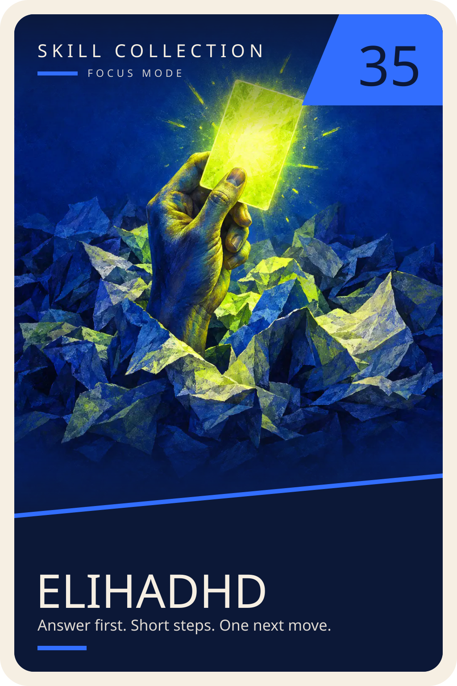
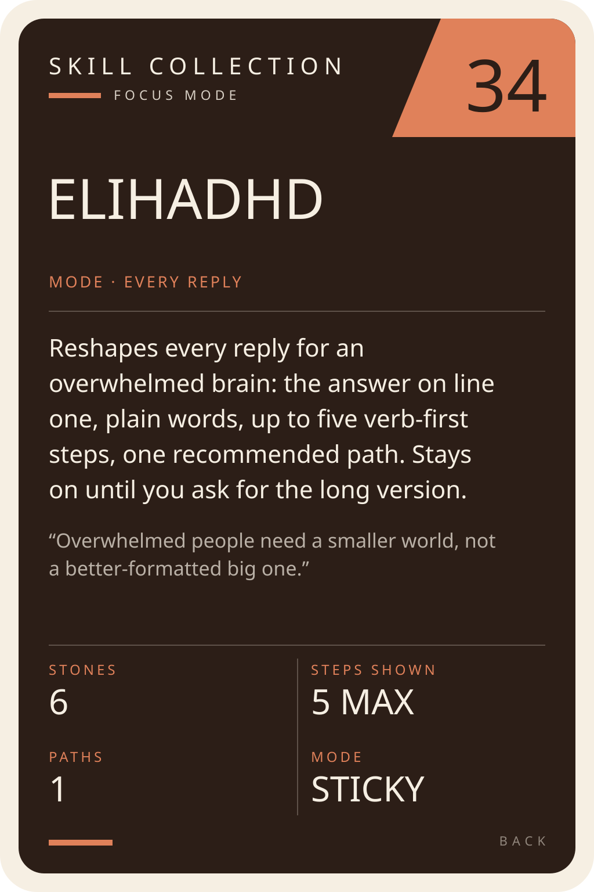
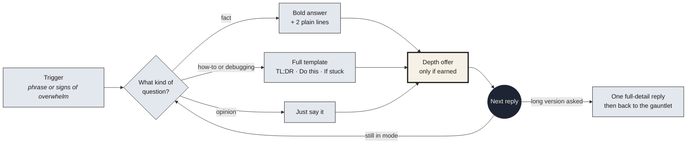

<p align="center">
  
  
</p>

> **TL;DR:** Turn it on and every answer starts with the answer, uses plain words, and gives you a few short steps with one clear path. It stays on for the rest of the chat until you ask for the long version.

## Say this

`elihadhd` · `adhd mode` · `tldr` · `eli16` · `eli5` · `too long` · `overwhelmed` · `shorter` · `just tell me what to do` · `break this down` · `snap it` · `gauntlet`

It also kicks in on signs of overwhelm (`wait what`, `I'm lost`, `too much`) and when you ask for the simple, quick or punchy version of anything.

## The six stones

Every reply gets all six while the mode is on.

| Stone | What it does to the reply |
|---|---|
| **TL;DR** | Line one is the answer in one sentence. Asked "X or Y?", the first word is X or Y |
| **ELI16** | Plain words for a sharp 16-year-old. A needed term gets defined once in six words or fewer |
| **Punchy Steps** | Verb first, one action per step, no if/then inside a step, five steps visible at most |
| **One-Thing** | One recommended path. Alternatives get one line at the end, if they matter at all |
| **Snap** | No preamble, no recap, no "in summary". Two or three bold words per section, short paragraphs |
| **Depth-on-Demand** | One "want the deep dive?" line, only when there is real depth underneath. Otherwise it just stops |

## How it runs



If two replies in a row would look the same and the content doesn't call for it, it changes the shape. Sameness is its own kind of noise: when every answer has the same skeleton, nothing stands out anymore.

## What you get

The fallback shape, used when the content earns it (debugging, how-to):

```markdown
**TL;DR:** [the answer, one sentence]

[2–4 short lines of the essential "why" or context — only if needed]

**Do this:**
1. Verb + action (time)
2. Verb + action
3. Verb + action

**If stuck:** [single most likely failure + fix, one line]

Want more depth on [X]? Ask.
```

<sub>The response template, copied from <a href="SKILL.md">the SKILL.md</a>.</sub>

| Situation | Shape |
|---|---|
| **Factual question** | One bold answer line and two plain lines. No headers |
| **Decision** | Its pick plus the one deciding factor. A trade-off table only if you ask |
| **Code** | The code with a one-line "what this does" above it. Only the non-obvious lines get explained |
| **Multi-part question** | A one-line answer per part first, then steps for the part that needs them |
| **Emotional overwhelm** | Less formatting, one genuine line of acknowledgement, one next action |

## Stat sheet

| | |
|---|---|
| **Input** | The conversation already in progress |
| **Output** | No file. Every reply after the trigger comes back reshaped |
| **Stays on** | For the rest of the chat. "Give me everything" or "long version" gets one full reply, then the mode snaps back |
| **Never** | Nested bullets, "Note:" or "Important:" blocks, a repeated TL;DR at the end, or dropping something you explicitly asked for |
| **Keeps** | Accuracy and warmth. It cuts decoration, not facts |
| **Ships with** | `SKILL.md` only |

---

<sub><a href="../../README.md#skill-index">← All skills</a> · <a href="SKILL.md">Read the SKILL.md</a></sub>
