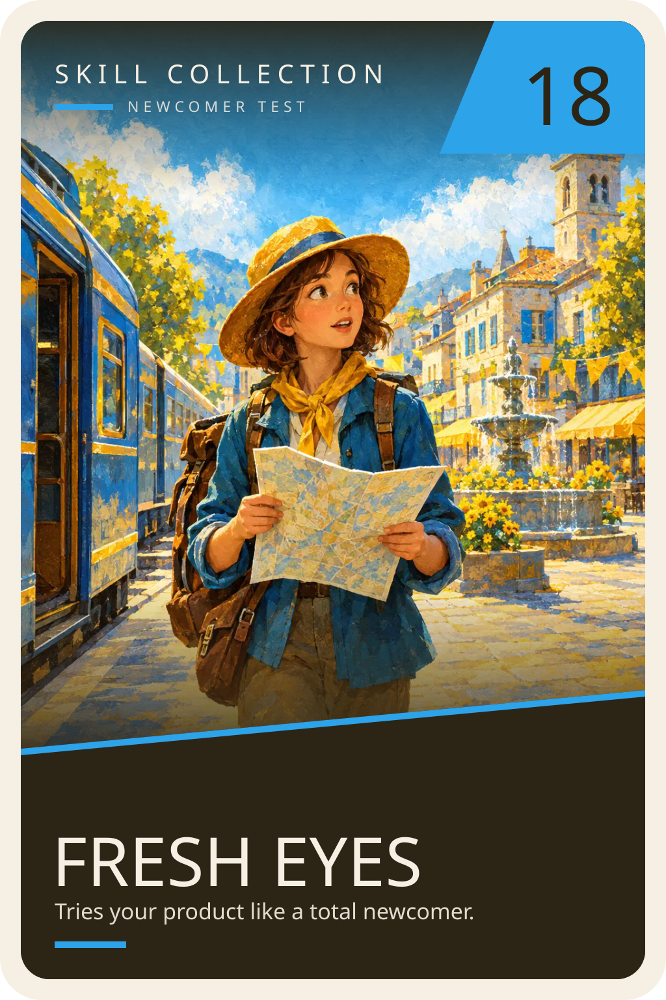
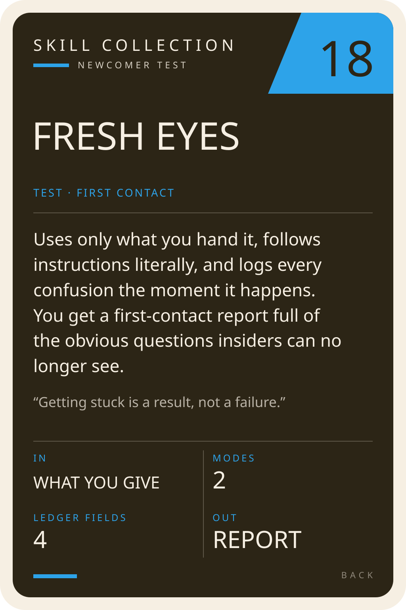
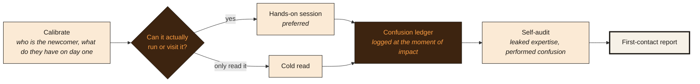

<p align="center">
  
  
</p>

<!-- skill-family:start -->
**The family:** these skills are parts of this one, each also installable on its own.

<p><a href="../../skills/cover-story/"></a></p>
<!-- skill-family:end -->

> **TL;DR:** Hand it your README, link or app and it tries the thing like someone who has never seen it, using only what you gave it. Every confusion gets written down before it's solved, so you see the questions you can no longer see yourself.

## Say this

`give me fresh eyes on this` · `pretend you've never seen this` · `would a new user get this?` · `test my app like a beginner` · `what would confuse someone new?`

Or ask for a first-time-user test, a naive walkthrough, or a cold read of your README, onboarding, docs or UI.

## How it runs



When it's unsure who the newcomer is, it picks the less knowledgeable plausible persona, because that direction finds more.

## What you get

```markdown
# First Contact: [product/thing name]

## Who I pretended to be
[persona + exactly what information I started with]

## What happened
[a short honest narrative of the session: what I tried, in order,
where it flowed, where I stalled, where I gave up or guessed]

## Where I got stuck
[the hard stops — each with what I tried, the exact error/screen, and
what a real newcomer would likely do at that point (retry? quit? email support?)]

## The obvious questions
[the full ledger of naive questions, ranked by how likely a real
newcomer hits it × how badly it derails them. Keep them in naive voice.]

## What worked
[things that were genuinely clear on first contact — insiders need to
know what NOT to break, too]

## If I could ask the builder three things
[the top three questions whose answers would have most changed my session]
```

<sub>The report format, copied from <a href="SKILL.md">the SKILL.md</a>. It's saved as a markdown file when the session is substantial, inline when brief.</sub>

<details>
<summary><b>What one ledger entry looks like</b></summary>

| Field | Entry |
|---|---|
| **What I was doing** | Running the setup command from step 2 of the README |
| **What I expected** | Some message saying it was done |
| **What actually happened** | The command finished with no output |
| **The question in my head** | "Did it work? Is it OK to run it again?" |

Illustrative example for a fictional command-line tool. The four fields come from the SKILL.md, and so does the "no output, did it work?" moment it tells the tester to log.

</details>

## The rules, at a glance

| Rule | What it means |
|---|---|
| **Protect the ignorance** | It consumes ONLY what you hand it. Once it understands something, it can never be confused by it again |
| **No source-diving** | The urge to open the source to resolve a confusion is itself the finding |
| **Follow instructions like a genie** | Missing steps don't get filled in from expertise |
| **Stuck counts** | "Getting stuck is a result, not a failure" |
| **No fake naivety** | No expert critique dressed as innocence, and no pretending not to get what the material explains fine |

## Stat sheet

| | |
|---|---|
| **Input** | Only what you explicitly provide: a README, a URL, an invite email, a repo to try |
| **Calibrations** | Who the newcomer is, and exactly what they have in hand on day one |
| **Modes** | Hands-on session (preferred: real stumbles beat imagined ones) or cold read |
| **Ledger** | Four fields per confusion, logged before it's resolved. The small stuff and the silences count |
| **Ranking** | How likely a newcomer hits it × how badly it derails them |
| **Live questions** | Welcome, and every one of them also goes in the ledger |
| **Output** | A first-contact report in six sections |
| **Ships with** | `SKILL.md` only |

## Plays well with

- **[cover-story](../cover-story/)**: writes the spoiler-free brief the tester starts with, plus a sealed envelope to compare against afterwards
- **[secret-shopper](../secret-shopper/)**: an informed regular customer instead of a total newcomer, on a live site

## Not for

Expert critique dressed up as innocence ("why doesn't this use OAuth PKCE?" is not a newcomer question), or source-diving to explain a confusion, unless you say the audience really is developers reading the source.

---

<sub><a href="../../README.md#skill-index">← All skills</a> · <a href="SKILL.md">Read the SKILL.md</a></sub>
