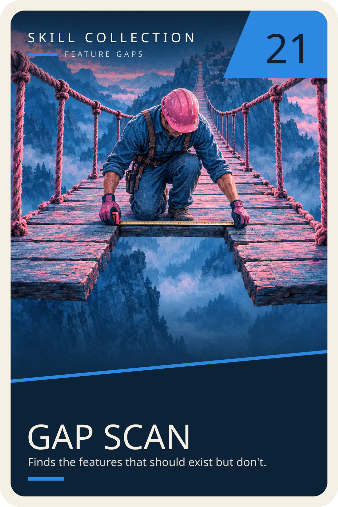
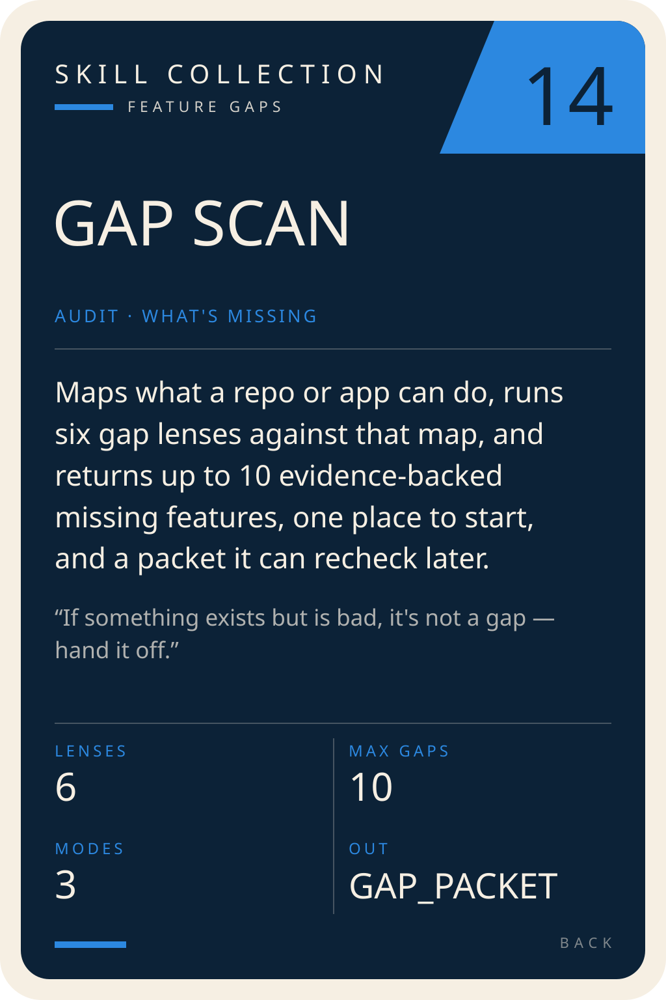
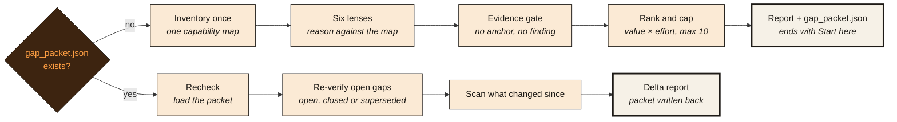

<p align="center">
  
  
</p>

> **TL;DR:** Point it at a repo or a live app and it finds the features users would expect that simply aren't there, each one backed by proof. You get a ranked list of up to 10, one clear place to start, and a file that lets it recheck later what got built.

## Say this

`what features are missing` · `what's this app lacking` · `find gaps` · `run gap-scan` · `feature audit` · `what's left to do` · `recheck the gaps` · `what got built since`

Or ask for proposal ammo from a prospect's app.

## How it runs



"What's left to do?" on its own is just a filter on `status == "open"` in the packet: a file read, not a fresh investigation.

## What you get

```markdown
# Gap-Scan: [target]
Mode: [PROSPECT | QA] · Category baseline: [what kind of product this is]

## Top gaps
### N. [Gap name]
- What's missing: [one sentence]
- Evidence: [file → symbol anchors / observed behavior — never line numbers]
- Why it matters: [one sentence, user-anchored]
- Effort: [S/M/L] — [one line on why, citing existing infra if S]
- Suggested MVP: [smallest version that closes the gap]

## Appendix: minor gaps (one line each)

## Out of scope (handoffs)

## Start here
[ONE gap, by name. The first concrete action to take on it. One line on why it beats the others.]
```

<sub>Report shape from <a href="SKILL.md">the SKILL.md</a>. PROSPECT mode adds a <code>## Proposal framing</code> section just before <code>## Start here</code>, which always comes last.</sub>

<details>
<summary><b>One gap in <code>gap_packet.json</code></b></summary>

```json
{
  "id": "bulk-actions-contacts",
  "name": "Bulk actions on contacts",
  "lens": "crud_symmetry",
  "value": "high",
  "effort": "S",
  "evidence": ["src/api/contacts.ts → listContacts", "src/components/ContactList.tsx → <ContactRow>"],
  "mvp": "Multi-select + bulk delete/tag on the contacts list",
  "status": "open",
  "first_seen_at": "ISO date",
  "closed_at": null,
  "closed_by": null,
  "supersedes": null,
  "superseded_reason": null
}
```

The sample entry from the SKILL.md, for a fictional contacts app. Gaps are never deleted from the packet: they move from `open` to `closed` (it got built) or `superseded` (the finding no longer holds, with a required reason).

</details>

## The six lenses

| Lens | The question it asks of the map |
|---|---|
| **CRUD symmetry** | Can you create but not duplicate, archive, export or bulk-edit? Big lists with no search, filter or sort? |
| **Dark data** | Fields or events collected but never shown anywhere |
| **Orphans** | Backend with no UI, UI with no backend, endpoints nothing calls |
| **Half-built** | TODOs, disabled controls, dead-end screens, flags stuck off |
| **Table stakes** | What this category of product normally has and this one lacks (category named first) |
| **Workflow dead ends** | Step N is done and there's no obvious step N+1 |

## Stat sheet

| | |
|---|---|
| **Input** | A repo path, or a live app or site to walk |
| **Modes** | PROSPECT: 5 to 8 gaps phrased for a client · QA: up to 10, file evidence required · RECHECK: starts from the existing packet |
| **Evidence** | Anchored to symbols, never line numbers, so a recheck can tell "moved" from "gone" |
| **Ranking** | User value High / Medium / Low × effort S / M / L. Hard cap of 10 |
| **Always ends with** | `## Start here`: exactly one gap, a first action you can start in 10 minutes, and why it comes first |
| **Packet** | `gap_packet.json` version 2, with per-gap `status`, `closed_at` and `closed_by` |
| **Never** | Features with no evidence anchor ("add AI", "add a mobile app") |
| **Ships with** | `SKILL.md` only |

## Plays well with

- **[code-audit](../code-audit/)**: for things that exist but are broken, slow or insecure
- **[ux-audit](../ux-audit/)**: for things that exist but confuse people
- **[conversion-audit](../conversion-audit/)**: for pages that exist but don't persuade
- **[what-would-bezos-do](../what-would-bezos-do/)**: for underexploited assets worth productizing

## Not for

Anything that exists but is bad. "If something exists but is bad, it's not a gap — hand it off." Broken code goes to code-audit, confusing flows to ux-audit, weak persuasion to conversion-audit, underexploited assets to a WWBD-style analysis.

---

<sub><a href="../../README.md#skill-index">← All skills</a> · <a href="SKILL.md">Read the SKILL.md</a></sub>
