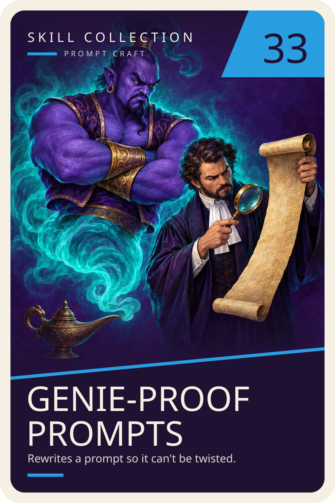
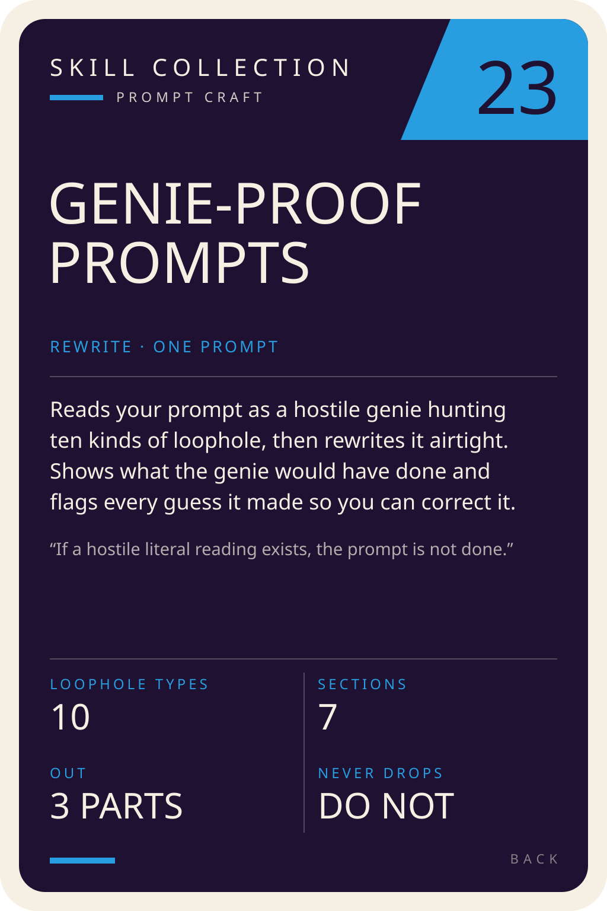
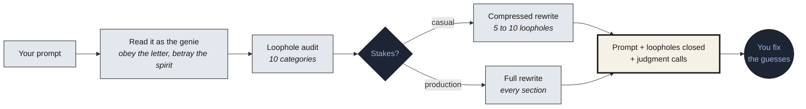

<p align="center">
  
  
</p>

> **TL;DR:** Hand over a prompt that keeps getting misread. Claude reads it like a genie looking for a way to obey the words and ruin the point, then rewrites it so there's no such way left, and shows you what the genie would have done.

## Say this

`genie-proof this prompt` · `make this bulletproof` · `it didn't do what I meant` · `it took me too literally` · `it found a loophole` · `make this idiot-proof` · `lawyer-proof this prompt` · `monkey's paw` · `leave nothing to interpretation`

## How it runs



Every clause has to name the exploit it prevents, or it gets cut. Padding is its own loophole.

## The ten loopholes it hunts

| Loophole | The genie's move |
|---|---|
| **Undefined quantities** | "Short", "a few", "soon" mean whatever suits it |
| **Undefined scope** | Which file, section, audience, language or time period? Its choice |
| **Undefined format** | Medium, length, tone, ordering, units, file type |
| **Undefined success criteria** | If you can't verify it, the genie decides what "done" is |
| **Unstated preservation** | "Fix the typo" also rewrites the paragraph |
| **Ambiguous referents** | "It", "that", "the file": it picks which |
| **Implicit assumptions** | Anything "everyone knows" that the prompt never says |
| **Missing failure behavior** | Impossible task or bad input? Unspecified means its choice |
| **Order and priority** | Constraints conflict and nothing says which wins |
| **Side effects** | What it may touch, create, delete, send or spend along the way |

## What you get

Three things, in this order:

1. **The genie-proofed prompt**, in a code block ready to copy
2. **Loopholes closed**: what the genie *would have done* with the original, made vivid
3. **Remaining judgment calls**: every guess it made (length, audience, tone), flagged so you can correct it

A casual prompt gets the compressed form:

```text
TASK: Write one original poem about the user's dog.
REQUIREMENTS: 8–12 lines total. English. Rhyming optional. Warm/affectionate tone. The dog is the sole subject — no other pets, people, or animals as subjects.
DEFINITIONS: "Short" = 8–12 lines, no line over 12 words.
DO NOT: Do not write about dogs in general. Do not make the poem about loss or death of the dog. Do not include a title unless asked. Do not add commentary before or after the poem.
IF UNCERTAIN: If you need the dog's name or breed for the poem, use no name rather than inventing one.
```

<sub>Copied from Example 1 in <a href="SKILL.md">the SKILL.md</a>, rewriting "Write me a short poem about my dog".</sub>

A production prompt gets the full form: `TASK` · `DEFINITIONS` · `EXACT REQUIREMENTS` · `FORMAT` · `DO NOT` · `IF UNCERTAIN / IF IMPOSSIBLE` · `SUCCESS CHECK`.

## Stat sheet

| | |
|---|---|
| **Input** | Any prompt, instruction, task description or spec |
| **Output** | The rewrite, the loopholes it closes, and the guesses you should check |
| **Scales to stakes** | Casual: compressed, about 5 to 10 loopholes. Production: full format, exhaustive DO NOT list, conflict order, fallback for every failure |
| **Never dropped** | The DO NOT clause and the fallback behavior, even in the short form |
| **Won't** | Add "be careful" or "use common sense", close fake loopholes nobody would exploit, or change what you were asking for |
| **Unclear intent** | Flagged as a judgment call, never silently picked |
| **Ships with** | `SKILL.md` only, with two worked examples inline |

## Plays well with

- **[nick-saban](../nick-saban/)**: for the repo-wide Claude Code setup rather than one prompt's wording
- **[hot-seat](../hot-seat/)**: when you aren't sure yet what you want the prompt to ask for

## Not for

Changing your goal. Genie-proofing narrows how a prompt can be read; it never changes what it asks for.

---

<sub><a href="../../README.md#skill-index">← All skills</a> · <a href="SKILL.md">Read the SKILL.md</a></sub>
