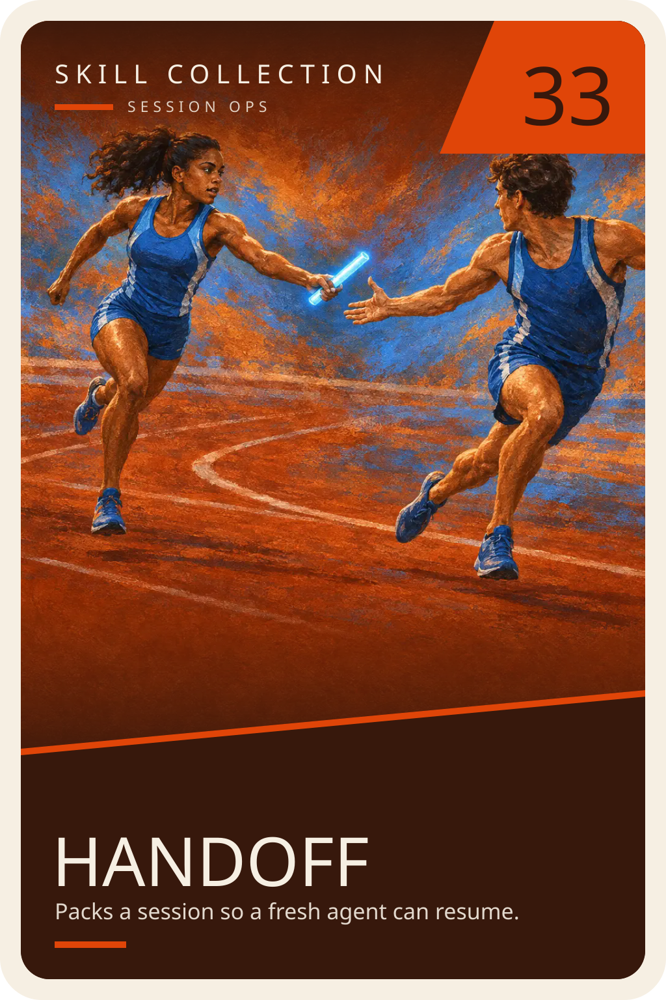
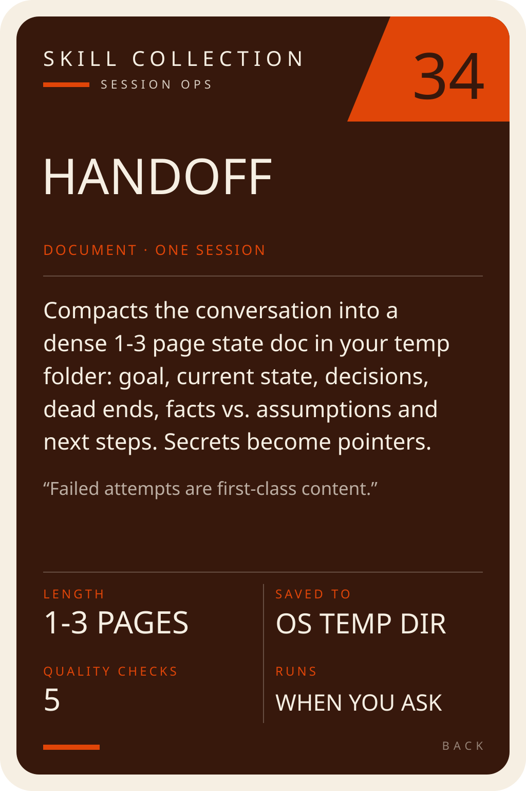
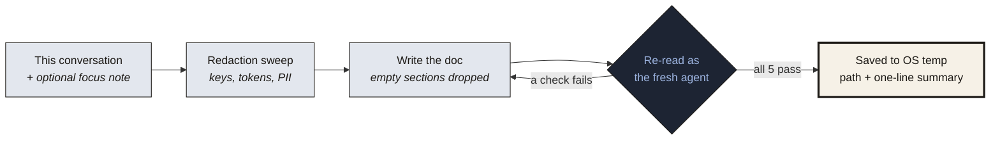

<p align="center">
  
  
</p>

> **TL;DR:** When a session is ending or running out of room, this writes a short document that lets a brand-new agent (or a teammate) pick up the work cold. It covers where things stand, what failed and why, and the exact next step, with no passwords or keys inside.

## Say this

`write a handoff` · `hand this off` · `summarize for the next session` · `compact this`

Add a note on what the next session is for and the document leans toward it. It only runs when you ask: the frontmatter sets `disable-model-invocation`.

## How it runs



## The four principles

| Principle | What it means |
|---|---|
| **Spend the reader's context wisely** | Dense, not thorough. Usually 1 to 3 pages, never a transcript |
| **Reference, don't duplicate** | If it lives in a PRD, plan, issue, commit or diff, link it. The handoff is a map |
| **Failed attempts are first-class** | What was tried, and why it didn't work, so nobody re-walks a dead end |
| **Facts apart from beliefs** | Verified things and assumptions are labelled separately |

## What you get

```markdown
# Handoff: Invoice export retries

**Date:** 2026-03-14 · **Session focus:** make failed exports retry · **Next session:** continue

## Goal
Failed invoice exports should retry on their own instead of waiting for someone to notice.

## Current state
Retry wrapper is on branch `export-retry`; unit tests pass. Not deployed.

## Dead ends
- Retrying inside the HTTP client: double-sent invoices, because the server had already accepted them.

## Facts vs. assumptions
- **Verified:** `npm test` passes on `export-retry`.
- **Assumed:** the provider allows 3 retries a minute. Check their docs first.

## Next steps
1. Add an idempotency key to the export request. Done when a repeated request returns the first result.

## References
- Connection string: [REDACTED — see .env DATABASE_URL]

## Open questions
- "Should a third failure email the account owner or just log it?"
```

<sub>Illustrative example. The project is fictional; the sections follow the template in <a href="SKILL.md">the SKILL.md</a>, and the redaction placeholder is copied from it. Saved as <code>handoff-&lt;project-or-topic-slug&gt;-&lt;YYYYMMDD-HHmm&gt;.md</code>.</sub>

The full template also has **Key decisions** and **Suggested skills**; any section with nothing real in it is left out.

## Stat sheet

| | |
|---|---|
| **Input** | The current conversation, plus an optional note on what the next session is for |
| **Output** | One markdown file in your OS temp folder (`$TMPDIR`, `/tmp` or `%TEMP%`), never the repo. Full path and a one-line summary in chat |
| **Redaction** | Keys, tokens, passwords and PII become pointers like `[REDACTED — see .env DATABASE_URL]`, so the next agent knows where to get the real value |
| **Quality bar** | Five checks on a re-read: first step startable now, nothing a reference already holds, no secrets, dead ends convincing, every assumption labelled |
| **Suggested skills** | Only ones that exist in the environment, with a note if one may be missing next session |
| **Leaves out** | Filler, praise, and a play-by-play of the session. It's about state, not story |
| **Ships with** | `SKILL.md` only |

## Plays well with

- **[agent-smiths](../agent-smiths/)**: takes a handoff doc as the plan to split across parallel agents
- **[whiteboard](../whiteboard/)**: a snapshot of the board can feed a handoff for the next session

## Not for

A transcript or a story of the session, or restating what already lives in a PRD, ADR, issue or commit.

---

<sub><a href="../../README.md#skill-index">← All skills</a> · <a href="SKILL.md">Read the SKILL.md</a></sub>
