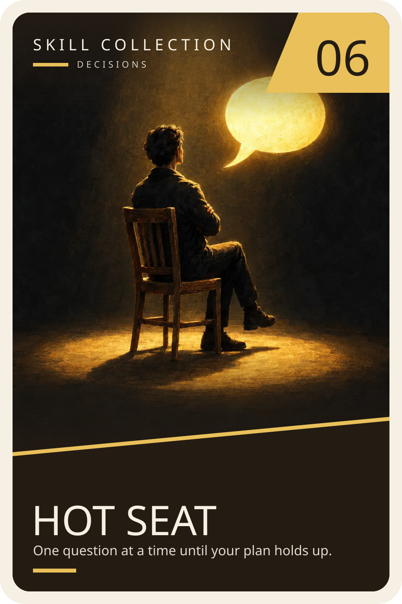
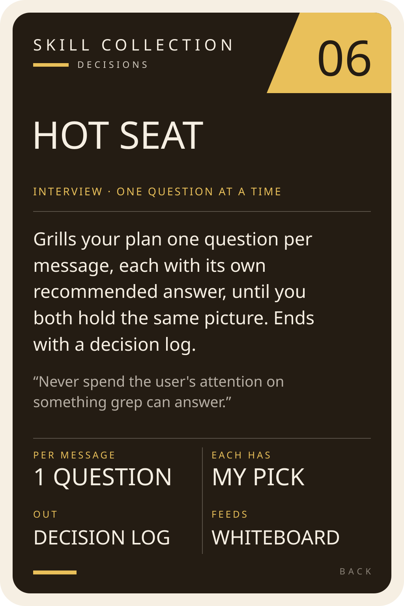
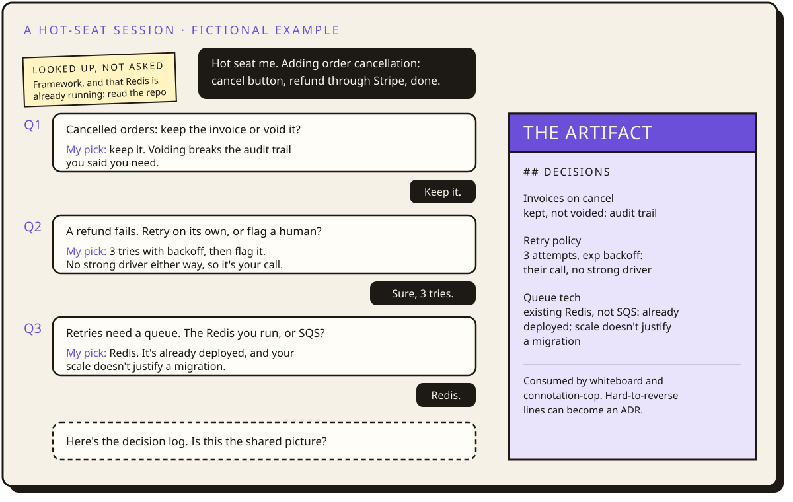
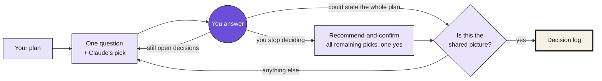

<p align="center">
  
  
</p>

> **TL;DR:** Drop a plan. Claude asks one question at a time, each with the answer it would pick, until it could state your whole plan and you'd sign it unchanged. You leave with a short decision log.

## Say this

`hot seat me` · `grill me` · `stress-test this` · `poke holes in this` · `am I missing anything`

Or just drop a plan and ask for it to be challenged.

## What a session looks like

<p align="center">
  
</p>
<sub>Illustrative example. The decision log lines come straight from <a href="SKILL.md">the SKILL.md</a>.</sub>

## The rules, at a glance

| Rule | What it means for you |
|---|---|
| **One question per message** | Your answer to question 1 shapes question 2. No batches |
| **Facts are Claude's job** | Anything findable in the code or docs gets looked up, not asked |
| **Decisions are yours** | Every real choice goes to you, even when Claude is sure |
| **Every question has a pick** | Disagree and it moves on. It only pushes back if you contradict yourself |
| **Upstream first** | It never asks B while pretending A is settled |

## How it runs



## What you get

```markdown
## Decisions

- **Invoices on cancel:** kept, not voided — audit trail
- **Retry policy:** 3 attempts, exp backoff — their call, no strong driver
- **Queue tech:** existing Redis, not SQS — already deployed; scale doesn't justify a migration
```

One line per decision, with the reason. Any line that's hard to reverse and a real trade-off gets offered as a permanent ADR through [connotation-cop](../connotation-cop/).

## Stat sheet

| | |
|---|---|
| **Input** | A plan, decision, or idea you want to survive contact |
| **Output** | A decision log, confirmed by you as the shared picture |
| **Done when** | Claude can state the whole plan and you'd sign it unchanged |
| **Won't** | Answer its own questions, quiz you on facts, or summarize every few questions |
| **Used by** | [whiteboard](../whiteboard/) tickets and [connotation-cop](../connotation-cop/) |

## Plays well with

- **[swipe-deck](../swipe-deck/)**: better when you don't know what you want yet
- **[napkin](../napkin/)**: when a question can only be settled by trying it in code
- **[whiteboard](../whiteboard/)**: runs hot-seat as one of its ticket types

---

<sub><a href="../../README.md#skill-index">← All skills</a> · <a href="SKILL.md">Read the SKILL.md</a></sub>
