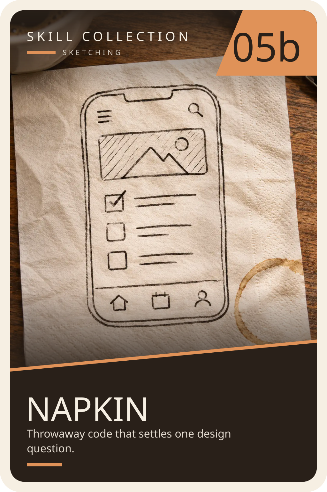
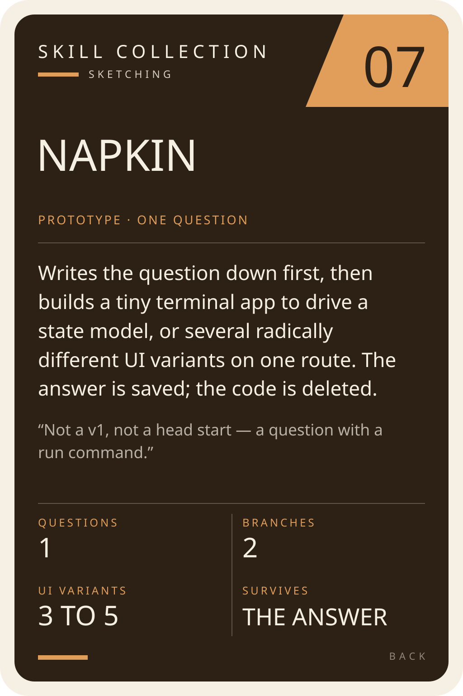
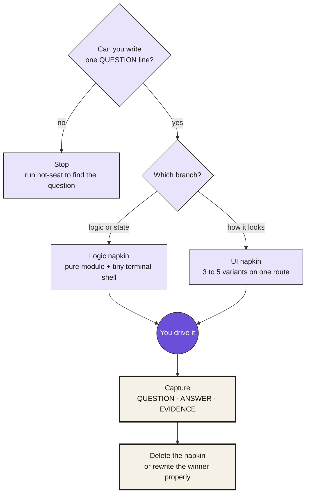

<p align="center">
  
  
</p>

> **TL;DR:** When you can't decide until you see it or drive it, Claude builds a disposable sketch that answers one written question. The answer gets saved somewhere permanent; the code gets thrown away.

## Say this

`prototype` · `mock up` · `sketch` · `try a few versions` · `see what it'd look like` · `feel out this state machine`

Or say you're stuck choosing between designs you can only judge by seeing or driving them.

## How it runs



Ambiguous and you're not around? It picks by neighborhood (near a backend module means logic, near a page or component means UI) and writes that assumption next to the QUESTION line.

## The two branches

| | Logic napkin | UI napkin |
|---|---|---|
| **Answers** | Does this logic, state model or data shape hold up? | What should this look like on screen? |
| **Builds** | A pure module (reducer, state machine, or functions) behind a throwaway terminal shell | 3 variants by default, 5 at most, each structurally different |
| **You see** | The full state redrawn after every keystroke, with shortcuts at the bottom | Variants on the real page, flipped with `?variant=` and a floating switcher bar |
| **What survives** | The pure module, rewritten properly; the shell gets deleted | The winner (or a mix, like "header from B, sidebar from C"), rewritten properly |

## What you get

The code dies. This block lives on, in a commit message, an ADR, the whiteboard ticket that asked for it, or `NOTES.md`:

```md
QUESTION: Does a three-state model (draft → active → archived) survive the "un-archive with pending edits" case?
ANSWER: No. It needs a fourth state.
EVIDENCE: un-archive with pending edits forced a fourth state
```

<sub>Illustrative example. The QUESTION and EVIDENCE lines are the SKILL.md's own example; the ANSWER is filled in to match. If you're not around for the verdict, ANSWER is left blank for whoever comes back.</sub>

## House rules

| Rule | What it means |
|---|---|
| **Visibly throwaway** | `napkin` or `prototype` in the path, so nobody mistakes it for production |
| **One command to run** | Wired into the project's existing task runner |
| **No persistence** | State lives in memory. A question about a DB gets a scratch store named "NAPKIN — wipe me" |
| **Zero polish** | No tests, no error handling past runnability, no abstractions |
| **Show the state** | Full state after every action or variant switch, so you can say "wait, that shouldn't be possible" |
| **Timebox** | A napkin that costs more than the real thing failed. Ballooning means the question is too big: split it |

## Stat sheet

| | |
|---|---|
| **Input** | One design question, plus the project it sits in |
| **Output** | Throwaway code, one run command, and a QUESTION / ANSWER / EVIDENCE block that outlives the code |
| **The gate** | The QUESTION line gets written before any code |
| **Language** | Whatever the project already uses. No new package managers or runtimes for a throwaway |
| **Switcher bar** | Keyboard arrows cycle variants, hidden in production builds, one shared component for every future napkin |
| **Ships with** | `references/logic.md`, `references/ui.md` |

## Plays well with

- **[hot-seat](../hot-seat/)**: when you can't phrase the one question yet, it finds it
- **[whiteboard](../whiteboard/)**: napkin tickets get built while you're away; the verdict waits for you
- **[connotation-cop](../connotation-cop/)**: an answer worth keeping forever can become an ADR
- **[whiteboard-help](../whiteboard-help/)**: the cheat sheet, including the solo "napkin this" phrase

## Not for

A v1 or a head start. Napkin code is written under napkin rules and never gets promoted as-is.

---

<sub><a href="../../README.md#skill-index">← All skills</a> · <a href="SKILL.md">Read the SKILL.md</a></sub>
