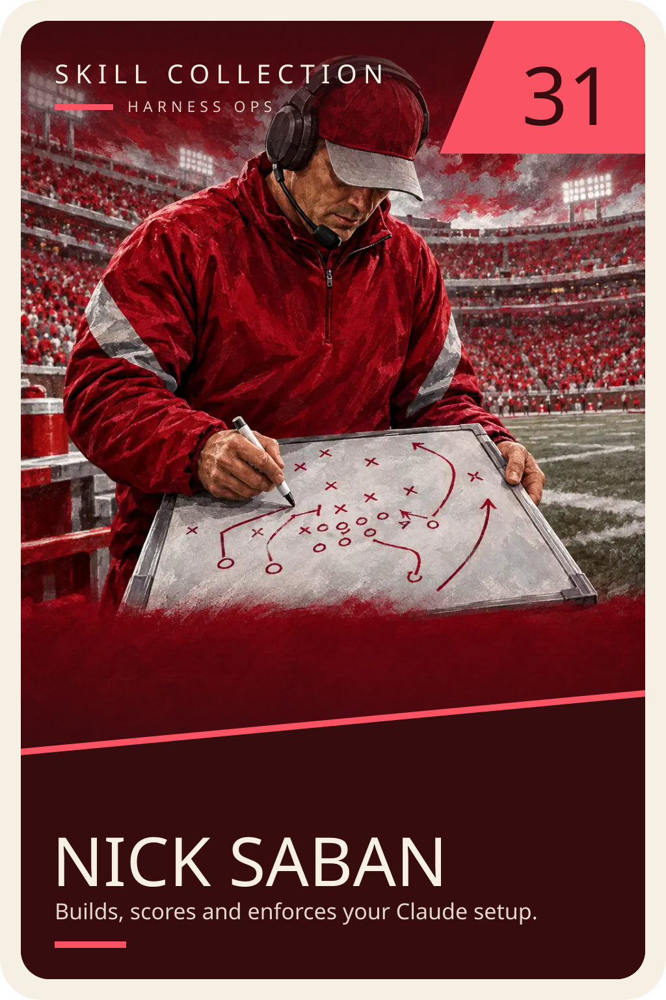
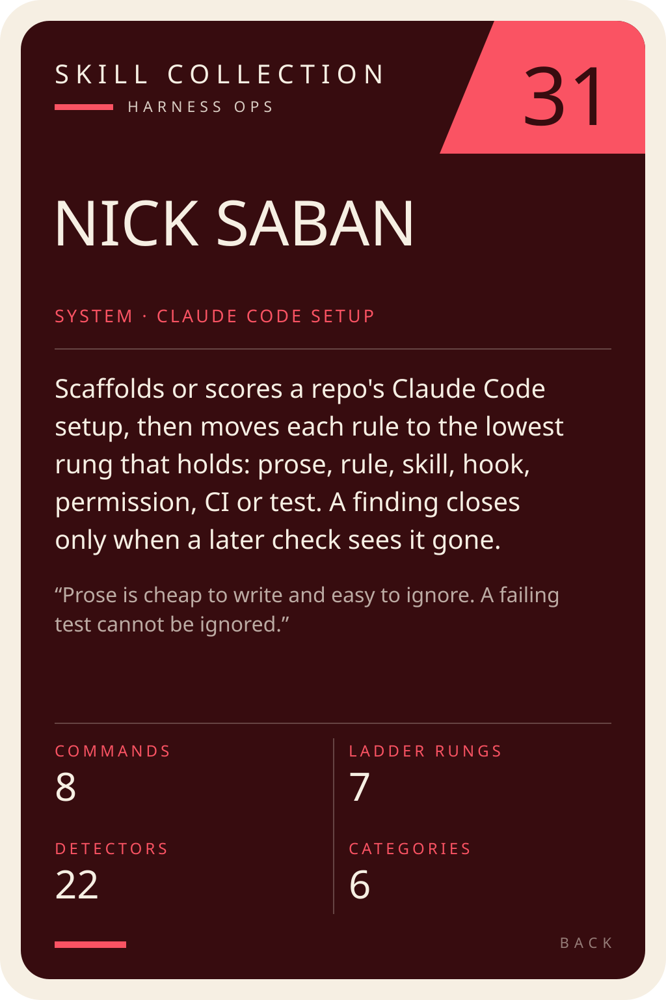
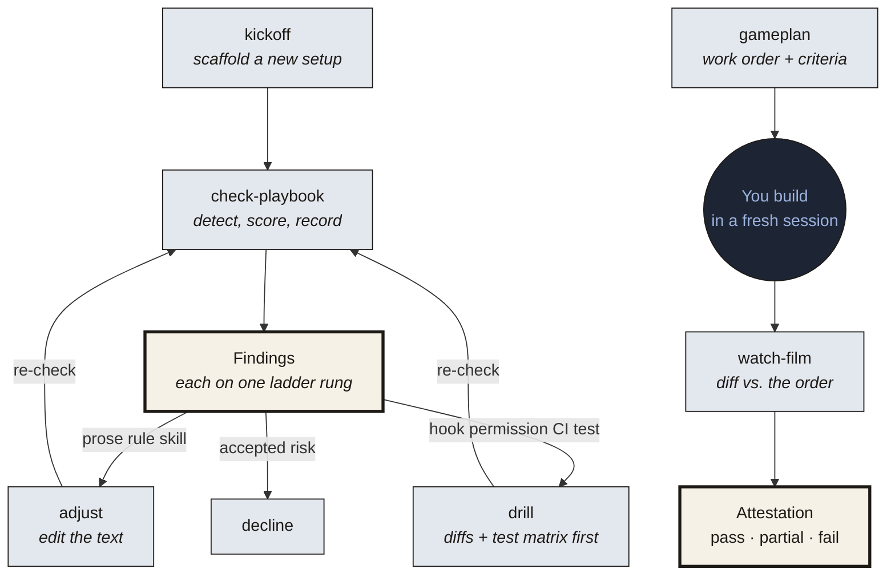

<p align="center">
  
  
</p>

> **TL;DR:** It sets up or grades the files that tell Claude Code how to behave in your repo, then turns rules Claude keeps ignoring into hooks, permissions or tests it can't skip. Nothing counts as fixed until a later check sees the problem gone.

## Say this

`set up Claude Code` · `Claude ignores my CLAUDE.md` · `it's huge and still misses things` · `it said done but ran nothing` · `it changed files I didn't ask about` · `it weakened a test to pass` · `rule, skill, or hook?` · `is my setup any good`

A bare `/nick-saban` (or `what next`) only recommends. It never runs a command on its own.

## The eight commands

| Command | Reach for it when | Writes |
|---|---|---|
| **`kickoff`** | The repo has no playbook yet. Refuses if one exists | `CLAUDE.md`, `.claude/**`, a baseline audit |
| **`check-playbook`** | You want the setup scored against 22 detectors in 6 categories | A new `audits/NNN.json` |
| **`scouting-report`** | You want the last scorecard, the delta and the open backlog | Nothing |
| **`adjust`** | A finding is about wording or placement: bloat, duplicates, rules in the wrong file | `CLAUDE.md`, `.claude/rules/`, `.claude/agents/` |
| **`drill`** | A rule needs to actually execute: hook, permission, CI gate or test. `drill permissions` does the whole permission surface | Hooks, `settings.json`, CI |
| **`decline`** | A finding is a trade-off you already chose. High severity needs a written reason | `waived.json` |
| **`gameplan`** | Before building a change: write down what "done" means | `orders/<slug>.md` |
| **`watch-film`** | After building: check the diff against that order | An attestation per run |

## How it runs



`adjust` and `drill` change the repo but never touch a finding's status. Only the next `check-playbook` closes a finding, by seeing that the problem no longer fires.

## The enforcement ladder

```
prose  →  scoped-rule  →  skill  →  hook  →  permission  →  ci  →  test
(weakest, cheapest to write)                    (strongest, hardest to ignore)
```

Every requirement belongs on the **lowest rung that actually holds**. `adjust` owns the first three rungs; `drill` owns the last four. Too high a rung is a finding too: a hook for something a one-line rule would have caught.

## What you get

```markdown
## Check-Playbook — pass 3

**Open high-severity: 1** · Score: 58 (+12)

Resolved since last pass: HN-002 (root-file-length), HN-004 (inferable-content)
New this pass: HN-009 (enforcement-bypass-surface)

### Open findings, by severity
| ID | Category | Rung | Claim |
|---|---|---|---|
| HN-009 | permissions | permission | The deny hook is registered on Bash; an MCP shell tool runs the same commands unguarded |
| HN-007 | enforcement | hook | "Always run Prettier after editing" is advisory prose with no executing mechanism |
| HN-011 | bounds | prose | Nothing asks for the smallest viable diff or names out-of-scope areas |

**Highest priority:** HN-009. Every protection in the deny hook is one tool choice away from irrelevant.

### Next

**Do this:** `drill HN-009`
It's the only open high, and the guard it covers can be walked around today.

**Instead, if the MCP shell is a reviewed, deliberate choice:** `decline HN-009`
```

<sub>Illustrative example. The repo and its findings are fictional; the layout follows <a href="references/check-playbook.md"><code>references/check-playbook.md</code></a> and the HN-007 claim is the sample finding in <a href="references/state.md"><code>references/state.md</code></a>.</sub>

Every command ends with a `### Next` block: one exact command to type, the reason from this run, and at most one alternative.

## Stat sheet

| | |
|---|---|
| **Input** | A repo, with or without an existing `CLAUDE.md` and `.claude/` folder |
| **State** | `.claude/nick-saban/` in your repo: `registry.json`, `waived.json`, `notes.md`, append-only `audits/NNN.json`, `orders/<slug>.md` and their attestations |
| **Rule it lives by** | Detected, never asserted. Nothing marks itself done |
| **Every finding** | Needs a written consequence. "Bad practice" alone isn't a finding |
| **Before scoring** | `verify_resolution.py` re-checks any open finding the new pass left out, and reinstates it if the problem is still there |
| **drill's guardrails** | Exact diffs, a test matrix, a backup, and one approval per connected system. Never weakens an existing guard or edits application code |
| **Score** | Averages six categories, so it always leads with the open-high count. A fresh scaffold reads UNASSESSED, never 100 |
| **Ships with** | `references/` (routing, ladder, findings, state, permission baseline, one file per command), `scripts/merge_pass.py`, `build_registry.py`, `verify_resolution.py`, `test_guard_matrix.py`, `evals/evals.json` (20 scenarios) |

## Plays well with

- **[whiteboard](../whiteboard/)**: when a change isn't shaped enough for `gameplan` yet, it belongs on a whiteboard first
- **[skill-system-architect](../skill-system-architect/)**: designs a skill system; this keeps the repo it runs in honest

## Not for

Code quality ([code-audit](../code-audit/)), test coverage ([test-assessment](../test-assessment/)), one-off prompt wording ([genie-proof-prompts](../genie-proof-prompts/)), writing new skills (`skill-creator`), or compacting a conversation ([handoff](../handoff/)).

---

<sub><a href="../../README.md#skill-index">← All skills</a> · <a href="SKILL.md">Read the SKILL.md</a></sub>
