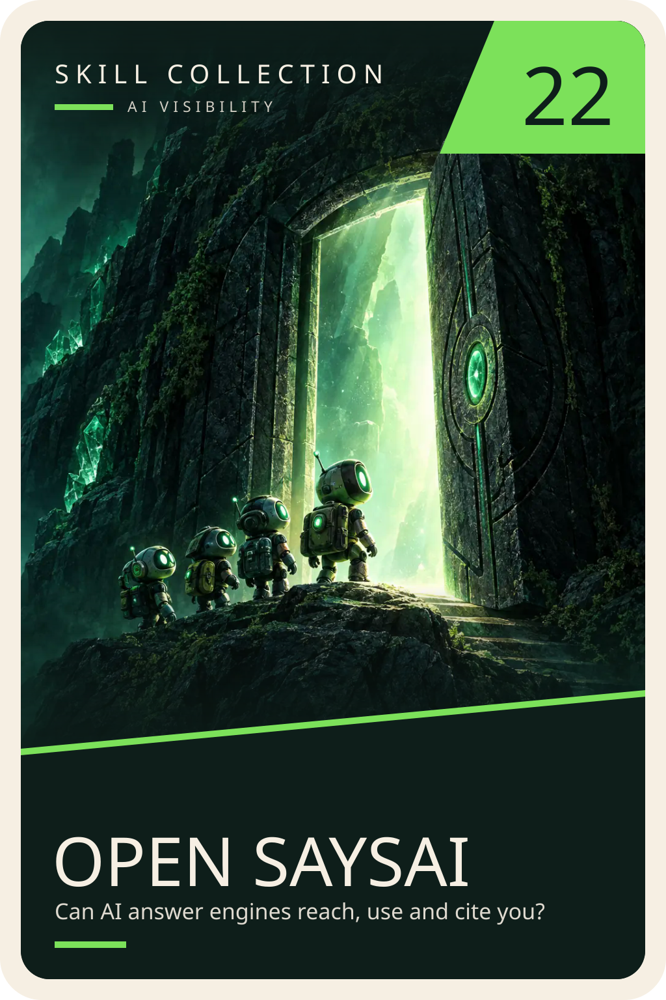
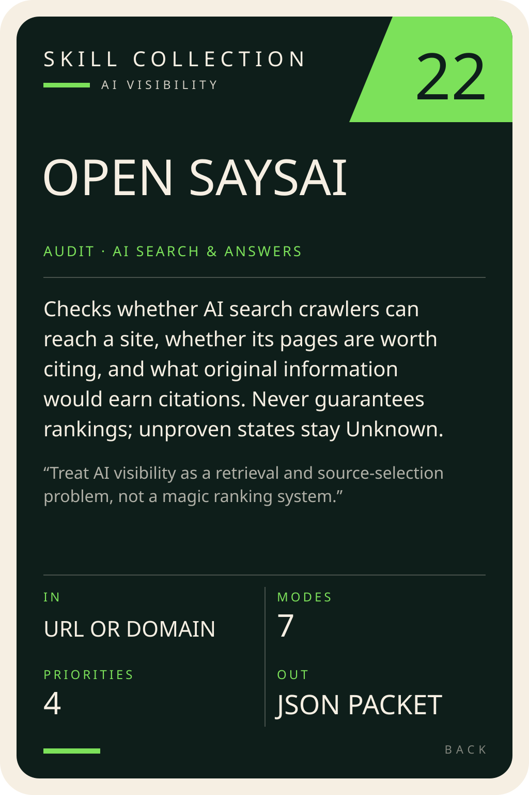
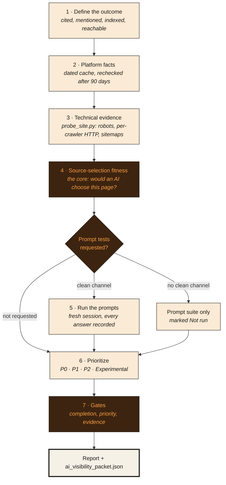

  
  

> **TL;DR:** Point it at a website and it checks whether ChatGPT, Claude, Google AI, Copilot and Perplexity can actually reach it, and whether its pages are good enough sources to get quoted. You get ranked fixes with proof behind each one, and it never promises rankings.

## Say this

`AI visibility audit` · `crawler or WAF diagnosis` · `robots.txt/sitemap implementation` · `citation-readiness audit` · `live prompt visibility testing` · `ai_visibility_packet generation`

Name a platform if you have one in mind: ChatGPT, Claude, Gemini, Copilot, Perplexity or Grok. A URL or domain is enough to start.

## How it runs

Technical checks decide whether AI systems *can* use the site. They are the gate, not the goal: most of the effort goes into step 4, whether they *would* pick it as a source.

## What you get

The full audit's centrepiece is the platform access matrix:

| Platform | Retrieval path | Robots | Synthetic-UA HTTP | Access evidence tier | Search index evidence | AI citation evidence | Action |
|---|---|---|---|---|---|---|---|
| ChatGPT | OAI-SearchBot | Accessible | 200 | Synthetic UA | Unknown | Unknown / not tested | None yet |
| Perplexity | PerplexityBot | Accessible | 403 | Synthetic UA | Unknown | Unknown / not tested | Unverified: check CDN logs before calling it a block |

Illustrative rows for a fictional site. Columns and allowed values come from <a href="references/output-templates.md"><code>references/output-templates.md</code></a>; the 403 row shows the rule that a block which may only be fake-bot protection is reported as Unverified, not P0.

The rest of the report follows in this order:

1. **Executive finding**: why AI systems would pass over this site as a source, and what would change that
2. **Priority findings**: each with problem, evidence, consequence and exact fix
3. **Recommended first action**: the top finding by priority order, with quick wins listed beside it
4. **Retrieval/source readiness**: a page-by-page review of at least 5 real pages
5. **Content/source opportunities**, **prompt visibility**, **measurement**, a **coverage check**, and **incidental site issues**
6. **Portable packet**: `ai_visibility_packet.json`, schema version 2.0

## The visibility chain

**reachable → indexed → retrieved → cited → recommended**

Each link needs its own evidence, and proving one never proves the next. A probe that got HTTP 200 while presenting a crawler's name is reported as exactly that, not as "the crawler can get in".

| Priority | Means |
|---|---|
| **P0 · Blocker** | A verified crawl, index or retrieval obstacle |
| **P1 · High leverage** | Source-worthiness, retrieval structure, authority or index-coverage gaps on important pages |
| **P2 · Enhancement** | Worthwhile but secondary. Measurement and freshness default here |
| **Experimental** | Unproven tactics such as `llms.txt` |

## Stat sheet

| | |
|---|---|
| **Input** | A URL or domain is enough. Optional: topics, markets, prompts, analytics, logs, webmaster exports, code |
| **Modes** | Full audit · platform audit · page audit · implementation · content/source opportunity · prompt visibility test · general playbook |
| **Output** | A human-readable report, plus `ai_visibility_packet.json` for every full or platform audit |
| **Crawler roles** | Search/indexing, live retrieval, user-directed fetchers and training crawlers are always kept separate |
| **Probe** | `probe_site.py` requests the page as 10 crawler user agents next to a normal browser, with longest-rule robots matching and `*` / `$` support |
| **Prompt tests** | Only through a clean channel. It never answers its own test prompts inside the audit |
| **Read-only** | Audit mode changes nothing: no git pull, no installs, no CDN or production changes |
| **Never** | Guarantees ranking or citations, invents "AI schema", or recommends cloaking, fake reviews or hidden crawler instructions |
| **Ships with** | `scripts/probe_site.py`, `scripts/test_probe_site.py`, `references/platforms.md`, `audit-framework.md`, `output-templates.md`, `ai-visibility-packet.md`, `agents/openai.yaml` |

## Plays well with

- **[website-audit](../website-audit/)**: the general, non-AI site crawl and scored report

## Not for

Quick generic "how do I show up in ChatGPT?" tips when a lighter SEO/GEO skill is installed, or general non-AI website QA (use [website-audit](../website-audit/)).

---

<a href="../../README.md#skill-index">← All skills</a> · <a href="SKILL.md">Read the SKILL.md</a>
