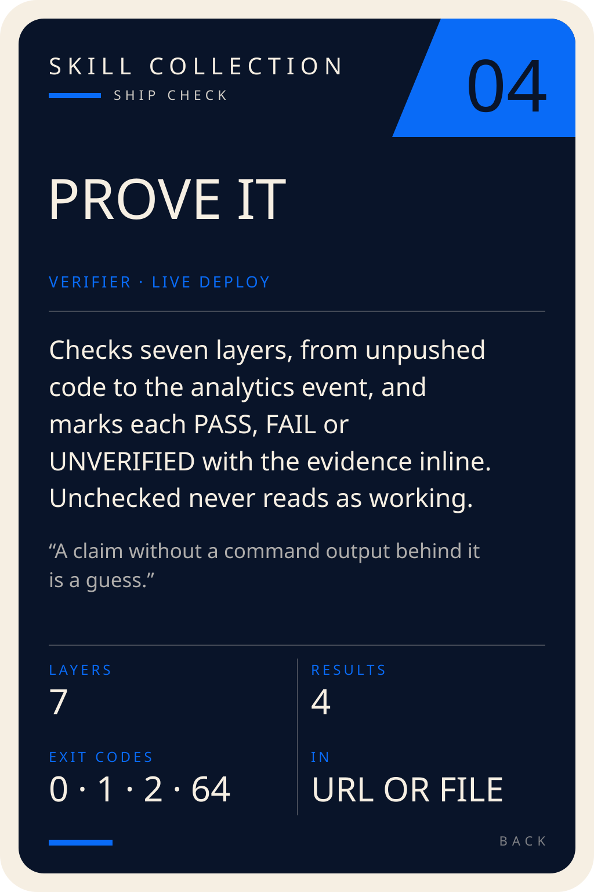
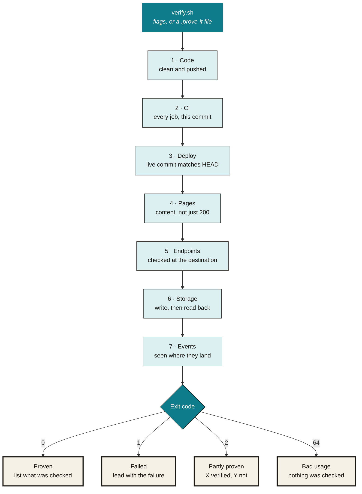

<p align="center">
  
  
</p>

> **TL;DR:** Before Claude says something is live, fixed or done, this runs the checks that prove it: pushed, CI green for that exact commit, the live site running that commit, the right words on the page. Anything it couldn't check is reported as unverified, never as working.

## Say this

`is it live?` · `did that deploy?` · `is it actually working?` · `are you sure?`

It also runs on its own: before any claim that something is "done", "shipped", "deployed", "live", "fixed" or "working", right after a `git push`, and whenever an earlier "it works" turned out to be false. Even when Claude is confident, because that's exactly when the check gets skipped.

## How it runs

Seven layers, in order. A failure at any layer invalidates every claim above it.



Layers 6 and 7 live in systems no generic script can see. They stay UNVERIFIED until they're checked by hand or the project adds its own `check storage` / `check analytics` command.

## What you get

A per-layer report with the evidence inline, failures first. The layout comes from the SKILL.md:

```text
Code      clean, HEAD 3f9c2ab == origin/main
CI        green for 3f9c2ab (verify ✓, audit ✓) — run 8812345
Deploy    live commit 3f9c2ab matches HEAD
Pages     / → Book a call present, Lorem ipsum absent
          /pricing/ → $49/mo present
Endpoint  POST /api/lead → 400 {"error":"missing email"}
Storage   check storage passed: test record written and read back
Events    N/A (declared): brochure site, no events
```

<sub>Illustrative example. The commit, run and routes are made up; the format follows the Reporting section of <a href="SKILL.md">the SKILL.md</a>. It matches the <code>.prove-it</code> file below, so this run exits <code>0</code>. Without the <code>check storage</code> and <code>na analytics</code> lines, those two layers would read UNVERIFIED and it would exit <code>2</code>.</sub>

<details>
<summary><b>The <code>.prove-it</code> file: one per project, so nobody has to remember the strings</b></summary>

```
version https://example.com/version.json
wait    600

page https://example.com/
  expect Book a call
  reject Lorem ipsum
page https://example.com/pricing/
  expect $49/mo

# an empty payload should be rejected: proves the route and its validation are live
# without creating a junk record
endpoint https://example.com/api/lead
  status 400
  expect "error"

na    analytics  brochure site, no events
check storage    node scripts/read-back-test-record.js
```

Committed at the repo root, it makes the whole run take no arguments. A layer is N/A only when a person declares it, like the `na analytics` line here.

</details>

## Exit codes

| Exit | Meaning | What Claude may say |
|---|---|---|
| **0** | Every declared layer passed | "It works", listing what was checked |
| **1** | Something FAILED | Leads with the failure |
| **2** | Nothing failed, something is UNVERIFIED | "X is verified, Y is not". Never "it works" |
| **64** | Unknown flag or bad config line | Nothing was checked; fix the command |

## Stat sheet

| | |
|---|---|
| **Input** | A URL with `--expect` / `--reject` strings, or a committed `.prove-it` file and no arguments |
| **Output** | A per-layer report with evidence inline, and an exit code that can gate a release |
| **The one rule** | A claim without a command output behind it is a guess. Run this turn, not last turn |
| **Layer results** | PASS · FAIL · UNVERIFIED · N/A, and N/A only when a person declares it |
| **Deploy check** | `stamp-version.sh` writes the built commit into `version.json`; `--wait 600` polls until the live commit is HEAD and CI has finished |
| **Page check** | Literal match against the saved response body, cache-busted. A 200 alone proves nothing |
| **Also covers** | Claims that something is absent (search the whole repo first) and "I can't" (try the underlying API first) |
| **Ships with** | `scripts/verify.sh`, `scripts/stamp-version.sh` |

## Plays well with

- **[agent-smiths](../agent-smiths/)**: its land step says a lane "landed", not that the code works. This checks that it does

---

<sub><a href="../../README.md#skill-index">← All skills</a> · <a href="SKILL.md">Read the SKILL.md</a></sub>
