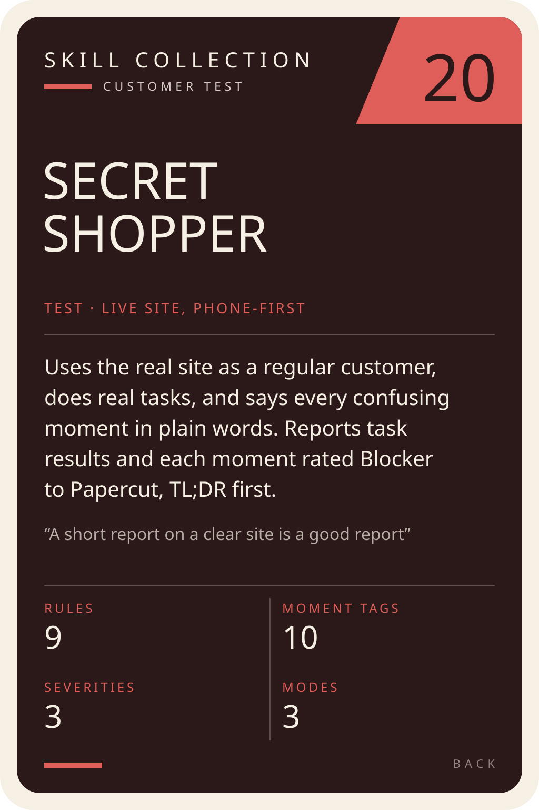
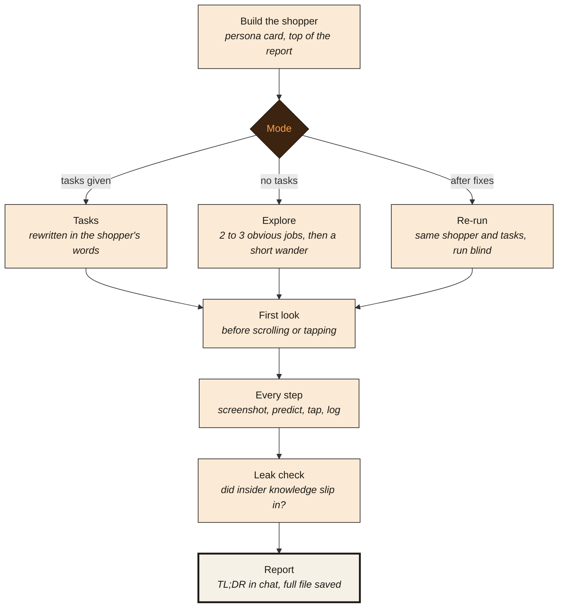

<p align="center">
  
  
</p>

> **TL;DR:** It goes undercover as a normal customer, uses your real site in a real browser, and tries to get real things done. Every time something makes it stop, it says so in plain words, and you get a report that leads with what to fix first.

## Say this

`test it like a regular customer` · `layman test` · `secret shop this` · `run it again after the fixes` · `click around and tell me what's confusing` · `try to book X and tell me how it goes` · `would a normal person get this?`

Works on live websites, web apps, and chat or command-line products, including Claude Code skills.

## How it runs



Tasks are always rewritten as the shopper's goal. If the button says "Request Service", the task is "I need someone to look at my AC this week", so the site's own labels never hand over the answer.

## What you get

```markdown
# Secret Shopper: [site or app] — [date]
**Shopper:** [one line] · **Device:** [phone 390 / desktop 1440] · **Browser:** [Chrome / Firefox] · **Mode:** [tasks / explore / re-run] · **Clicks:** [coordinates / snapshot]

## TL;DR
- **Verdict:** [one sentence, in the shopper's voice]
- **Fix first:** [the single biggest problem]
- **Tasks:** [X of Y done · Z gave up · B blocked · W stopped at a hard stop]
- **Moments:** [N blockers · N slowdowns · N papercuts]

## First look (before scrolling)
I thought it was… / for… / I'd tap… → Reality: [right or wrong, one line]

## Tasks
| # | What I was trying to do | Result | Steps | Where it went wrong |
|---|---|---|---|---|

## Moments (in the order they happened)
1. **WHAT'S THIS? · Slowdown** — Home, top menu: "What's 'Portal'? For me or for staff?" → skipped it, scrolled instead.
2. **TWICE? · Papercut** — Home, first screen: "Phone number in the red bar and again right under it. Same number?" → tapped the bigger one.
3. **WHERE'S…? · Blocker** — Looking for prices: "Checked Services, then About, then the bottom of the page. Nothing." → GAVE UP, would call the next plumber.

## Questions I'd ask someone who works here
## What was easy (don't break these)
## Builder notes (out of character)
[Top 3–5 fixes, one line each, pointing to moment numbers]
```

<sub>Format from <a href="SKILL.md">the SKILL.md</a> (last three sections shortened here), including its sample moments for a fictional plumber's site. Saved as <code>secret-shopper-&lt;site&gt;-&lt;YYYY-MM-DD&gt;.md</code>. Task results use ✅ easy · ⚠️ struggled · ❌ gave up · 🚫 blocked · ⏸ hard stop.</sub>

<details>
<summary><b>What a re-run adds</b></summary>

```markdown
## Since last run ([old date])
**Fixed:** N · **Still there:** N · **Changed:** N · **New:** N · **Couldn't check:** N

| Last time | Moment | Now | What I saw this time |
|---|---|---|---|
| #3 | WHERE'S…? · Blocker — no prices anywhere | ✅ Fixed | "Prices" in the menu, one tap |
| #5 | TWICE? · Papercut — two phone numbers | ➖ Still there | same red bar, same second number |
| — | WAIT, WHAT? · Slowdown — new popup on load | 🆕 New | appeared before the first scroll |
```

From <a href="references/rerun.md"><code>references/rerun.md</code></a>. The old report's moments stay unread until after the run, and it's never overwritten: the pair is the record.

</details>

## The moment tags

| Tag | The shopper says |
|---|---|
| **WHAT'S THIS?** | "What does this do?" |
| **HUH?** | "This doesn't make sense (here)." |
| **TWICE?** | "Why is this here twice?" |
| **WHERE'S…?** | "Where do I…?" |
| **DID IT WORK?** | "Did that do anything?" |
| **WAIT, WHAT?** | "I expected X, but got Y." |
| **UGH** | "Ugh." |
| **TRUST?** | "Is this legit?" |
| **GAVE UP** | "I'd leave / call / look elsewhere here." |
| **EASY** | "Oh, nice — that was easy." |

Each one is rated from the shopper's side: **Blocker** (couldn't do it, or I'd leave), **Slowdown** (had to guess, hunt or backtrack), **Papercut** (bugged me, didn't stop me).

## Stat sheet

| | |
|---|---|
| **Input** | An entry point (URL, invite link, staging or localhost) and optional tasks |
| **The shopper** | Knows the field basics and everyday web habits. Knows nothing about this product, its jargon, or where things live |
| **In character** | Nine rules: eyes only, scan like a person, no typed URLs, predict-then-tap, no help mid-run, plain voice, real patience, no invented problems, hard stops |
| **Patience** | Low gives up after about 3 dead ends, medium about 5. Then GAVE UP is logged and a determined mode tests the rest |
| **Device** | Phone-size (about 390 wide) for public and local-business sites; desktop for web apps and dashboards |
| **Hard stops** | Passwords, card numbers, account creation, payments and deletes stay with you. A final submit happens only if you asked, once, with fake data |
| **Scope** | First look, 2 to 4 tasks and a short wander. Not a site crawl |
| **Ships with** | `references/browser-playbook.md`, `references/rerun.md`, `agents/openai.yaml` |

## Plays well with

- **[ux-audit](../ux-audit/)**: the expert read, with heuristics and severity scoring
- **[ui-oddity-scan](../ui-oddity-scan/)**: a pinned, element-by-element page review
- **[conversion-audit](../conversion-audit/)**: persuasion and CTA strategy
- **[fresh-eyes](../fresh-eyes/)**: a true zero-context cold read of docs or code

## Not for

Expert audits ([ux-audit](../ux-audit/)), zero-context reads of docs or code ([fresh-eyes](../fresh-eyes/)), or element-level page scans ([ui-oddity-scan](../ui-oddity-scan/)). Given only a repo, it won't play the site from its source code: run it and open it in a browser, or use ux-audit's code mode.

---

<sub><a href="../../README.md#skill-index">← All skills</a> · <a href="SKILL.md">Read the SKILL.md</a></sub>
