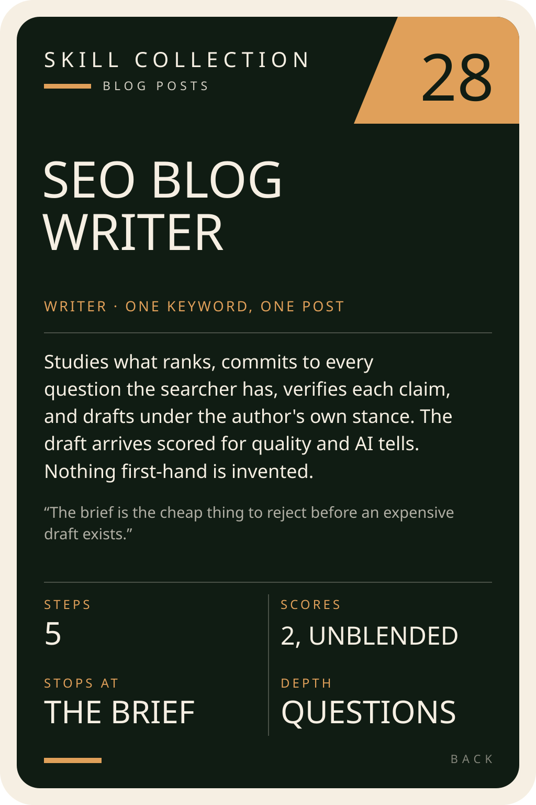
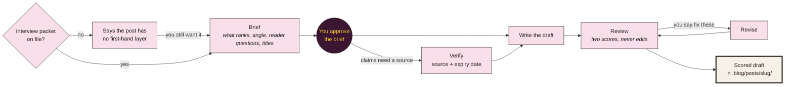

<p align="center">
  
  
</p>

<!-- skill-family:start -->
> **Part of [Who Let The Blogs Out](../who-let-the-blogs-out/).** It works alongside Who Let The Blogs Out and can also be installed on its own.
<!-- skill-family:end -->

> **TL;DR:** Give it a keyword. It studies what already ranks, writes a brief you can reject cheaply, then drafts a post that answers every question the searcher has and scores it before you read it. It never invents experience, results or opinions the author didn't give.

## Say this

`write an SEO blog post about X` · `a post targeting this keyword` · `give me title options` · `write a meta description` · `outline this post` · `does this read AI-written`

Titles, meta descriptions, outlines and the AI-written check are answered on their own, without running the whole flow or saving anything.

## How it runs



It **stops after the brief** unless you asked for the finished post in one go. Even then it stops for a real decision: the search results want a different format, a page you already have covers this, there's nothing original to add, or a required search tool is down.

## What you get

After the brief, a short reply instead of a dump of the research:

```text
The angle: Most owners replace a pool pump on a schedule; the better trigger is
           the motor's sound and the bill, and the post shows how to read both.
What it adds: The owner's own rule for when a repair stops being worth it.
Covering:
- How long does a pool pump usually last?
- Is it the pump or the motor?
- What does a variable-speed pump save?
- Repair or replace?

Brief: .blog/posts/when-to-replace-a-pool-pump/brief.md
Next: say 'write it'
```

After the draft, the review leads with what blocks, then what's worth fixing:

```markdown
## when-to-replace-a-pool-pump — draft-v1

**Blocking — has to change before this ships**
- The post says you've replaced "hundreds" of pumps. You never told me that. Cut it, or give me the real number.

**Worth fixing (2)**
- One reader question the brief committed to never gets answered: what a variable-speed pump saves.
- The energy-savings figure has no primary source I could find.

**Reads fine otherwise.** Voice is close, structure holds.

Findings: .blog/posts/when-to-replace-a-pool-pump/review-v1.json
Next: say 'fix these'
```

<sub>Illustrative example. The pool-service business and its post are fictional. The shapes follow the chat formats in <a href="references/brief.md"><code>references/brief.md</code></a> and <a href="references/review.md"><code>references/review.md</code></a>, with the plain-words "Next" line the SKILL.md uses.</sub>

<details>
<summary><b>What's inside brief.md</b></summary>

Frontmatter carries the thesis (copied from the interview, never rewritten), the angle, the information gain, the business purpose, the one thing the page is about, format fit, cannibalization, the coverage-target count, and the full title set. Then six sections and no others:

```text
## Reader questions this must answer      numbered, the count in coverageTargets
## Outline                                H2/H3 nodes with closes / uses / work
## Claims to make                         ID + one line each — index only, see claims.json
## Internal links (from registry + crawl, real URLs only)   destinations, then sources
## Image concepts                         ID + one line each — index only, see media.json
## What this post deliberately does not cover        each with its reason
```

The brief never contains a prose paragraph, not even one "to show the tone".

</details>

## How the draft is scored

Two scores, side by side, never blended into one number. Neither is a verdict on who wrote it.

**Rubric: 0–100, higher is better**

| Category | Weight |
|---|---:|
| Intent satisfaction | 20% |
| Accuracy and sourcing | 20% |
| Original value | 15% |
| Completeness and usefulness | 15% |
| Structure and readability | 10% |
| Brand and audience fit | 10% |
| Conversion alignment | 5% |
| Technical on-page SEO | 5% |

**Tells: 0–100, higher is worse**

| Category | Weight |
|---|---:|
| Substance & stance | 35% |
| Texture & specificity | 25% |
| Rhythm & structure | 20% |
| Constructions & tics | 12% |
| Lexicon | 8% |

Tells bands: **0–20** clean · **21–40** light tells · **41–60** noticeable · **61–80** reads generated · **81–100** template-grade.

## Stat sheet

| | |
|---|---|
| **Input** | A topic or primary keyword, ideally with the interview packet at `.blog/posts/<slug>/packet.md` |
| **Output** | In `.blog/posts/<slug>/`: `research-v1.md`, `brief.md`, `claims.json`, `media.json`, a versioned `draft-vN.md` with a publish checklist, and `review-vN.json` |
| **Depth** | Measured by reader questions answered, not word count. Each unanswered one is a finding |
| **Thesis** | The author's argument is sticky. Research can sharpen it, never replace it |
| **Never** | Invents credentials, anecdotes, results or opinions, or manufactures a disagreement to look original |
| **Review** | Scores and lists findings. It never edits the draft; revise does that, then review runs again |
| **First run** | Creates the `.blog/` starting tree and the client folder if they don't exist, without guessing brand details |
| **Ships with** | `references/brief.md`, `verify.md`, `write.md`, `review.md`, `revise.md`, `governing-rules.md`, `evidence-rules.md`, `research-protocol.md`, `headline-contract.md`, `quality-rubric.md`, `voice-and-tells.md`, `state.md`, `reporting.md`, `scripts/tells_metrics.py`, `assets/opinion-bank-template.md` |

## Plays well with

- **[blog-topic-interview](../blog-topic-interview/)**: captures the author's real stances and stories as the packet this skill drafts from
- **[ai-writing-detector](../ai-writing-detector/)**: scores any text for AI tells, no `.blog/` needed
- **[who-let-the-blogs-out](../who-let-the-blogs-out/)**: the full system these steps come from, with planning, images, publish and refresh

## Not for

Refreshing a post that's already published (that's [who-let-the-blogs-out](../who-let-the-blogs-out/)'s `refresh`), inventing experience the author didn't give, or faking humanity to beat detectors.

---

<sub><a href="../../README.md#skill-index">← All skills</a> · <a href="SKILL.md">Read the SKILL.md</a></sub>
