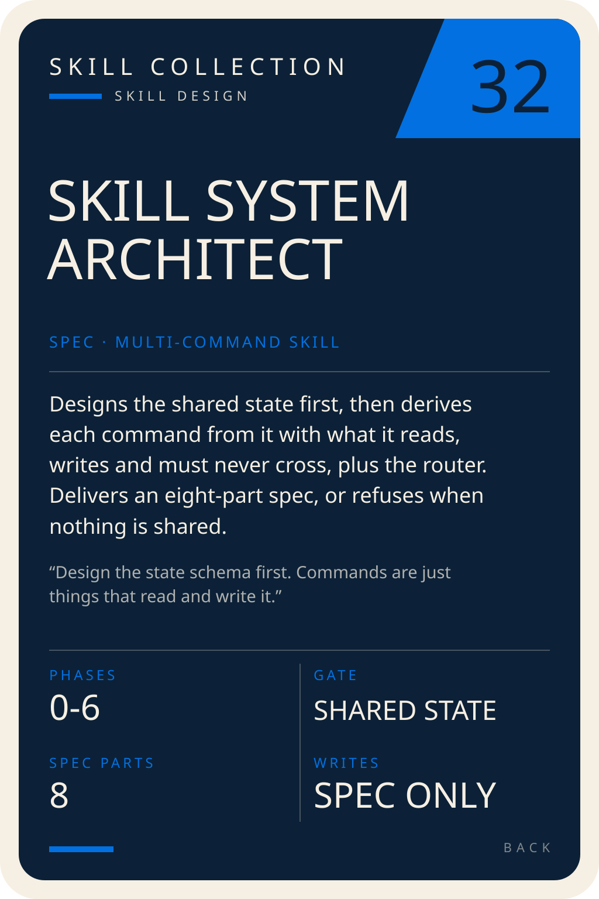
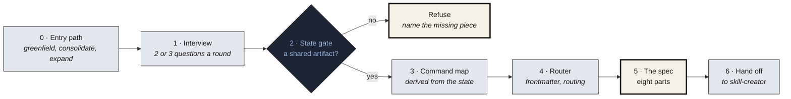

<p align="center">
  
  
</p>

> **TL;DR:** Before you build a skill with several commands, this designs it on paper: what the commands share, what each one reads and writes, and where each must stop. If the commands share nothing, it tells you it isn't really a system and stops there.

## Say this

`how should I structure this skill set` · `skill system` · `skill architecture` · `multi-command skill` · `system of skills` · `make these skills work together` · `skill with slash commands`

Or say your skills overlap, collide, duplicate each other, or never fire.

## How it runs

Phase 2 is a gate: no command gets named until the shared state exists.



A refusal with a reason counts as a successful run.

## The gate

> "Command A writes ______, and command B is more useful because it can read it."

All three checks must pass.

| Check | Passes when | If it fails |
|---|---|---|
| **Persistence** | Something survives the end of a session | These are stateless transformations. Modes, maybe; not a system |
| **Asymmetry** | At least two commands relate to the artifact differently | It's config or reference material, not memory |
| **Consequence** | Reading it changes what a command does | It's a log. Fine, but it doesn't make commands compose |

The **prefix test** backs it up: if you renamed every command to an unrelated standalone skill and nothing broke, they were never a system.

## What you get

One markdown spec, always in this order:

| # | Part | What's in it |
|---|---|---|
| 1 | **System summary** | The domain, the shared artifact, and one concrete example of commands composing |
| 2 | **Directory layout** | The full tree, including where state lives |
| 3 | **State schema** | Files, formats, field definitions, closed enums, ID rules, write rules |
| 4 | **Command map** | One row per command, five fields each |
| 5 | **Router** | Complete `SKILL.md` frontmatter and section skeleton, ready to paste |
| 6 | **Command file stubs** | The five-part header for each command. Headers only |
| 7 | **Build order** | Usually whichever command writes the state first |
| 8 | **Open decisions** | What was left undecided on purpose, and what changing it later would cost |

The command map is the heart of it. Every command needs a verb, a category, what it reads, what it writes and where it stops. A system of 2 to 4 commands can skip the category, as this one does:

```markdown
| Verb   | Reads                           | Writes              | Stops at                                    |
|--------|---------------------------------|---------------------|---------------------------------------------|
| survey | nothing                         | .garden/beds.json   | Never changes a planting plan.              |
| plan   | .garden/beds.json               | .garden/plan.md     | Never re-scores a bed. Never orders seeds.  |
| report | .garden/beds.json, plan.md      | nothing             | Writes nothing.                             |
```

<sub>Illustrative example. The garden system is fictional; the five fields and the rule that "Stops at" is written as a prohibition come from <a href="references/command-design.md"><code>references/command-design.md</code></a>.</sub>

A command that reads nothing and writes nothing is a standalone skill wearing the system's badge.

## Stat sheet

| | |
|---|---|
| **Input** | A new domain, several skills to consolidate, or one skill to expand, plus your installed skills for collision checks |
| **Output** | One architecture spec in eight parts, confirmed or corrected once, then stopped |
| **Never writes** | `SKILL.md`, reference files, scripts, or any file inside a skill directory. Approval to build is approval to hand off |
| **Hands off to** | `skill-creator`, which writes the files from the spec. The spec names the first file to build |
| **State rules** | Lives in your project, not the skill. Stable IDs, closed enums, an "accepted" status, append-only versions, and drift gets reported, not silently repaired |
| **Consolidating** | Every existing skill gets one fate: fold, merge, keep or retire, each with a reason. Nothing is deleted |
| **Ships with** | `references/inventory.md`, `state-schema.md`, `command-design.md`, `router-anatomy.md` |

## Plays well with

- **[nick-saban](../nick-saban/)**: once the system is built, keeps the repo it runs in honest

## Not for

Writing the skill. This produces an architecture spec only; `skill-creator` builds from it.

---

<sub><a href="../../README.md#skill-index">← All skills</a> · <a href="SKILL.md">Read the SKILL.md</a></sub>
