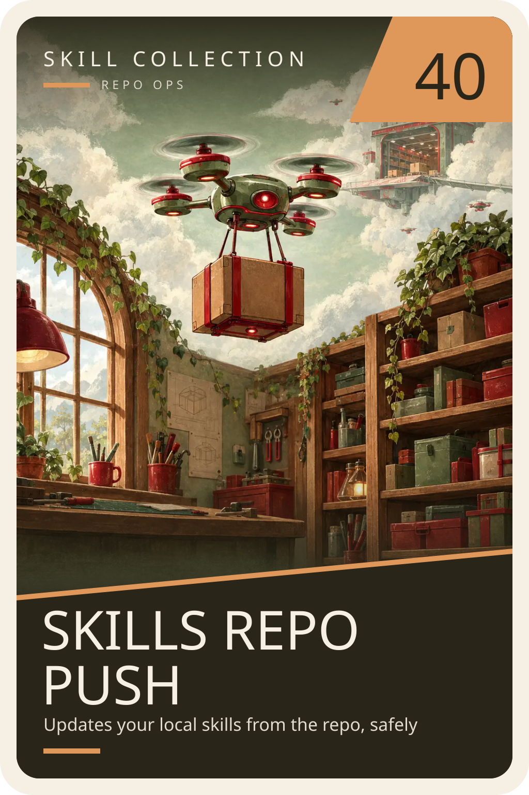
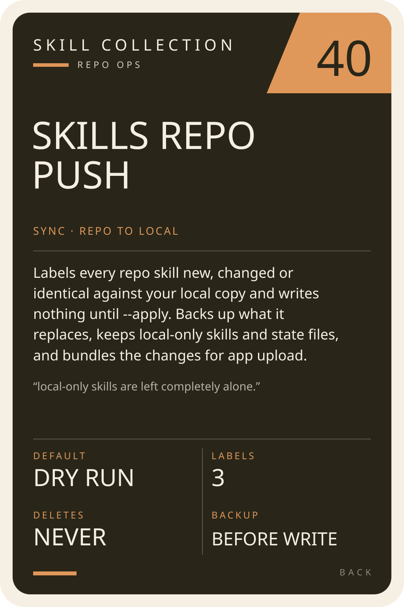
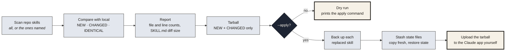

<p align="center">
  
  
</p>

> **TL;DR:** Pull the skills repo, then run this to bring your local skills folder up to date. It shows what would change first, and when you say apply it backs up the old copies, leaves your own local-only skills and saved notes alone, and packs the changes for uploading to the Claude app.

## Say this

`push skills out` · `sync repo to local` · `update my local skills from the repo` · `distribute skills` · `my local skills are stale` · `refresh skills from github`

Also right after a `git pull` in the skills repo.

## Commands

| Run | What happens |
|---|---|
| `scripts/push.sh` | Dry run. Shows what would change and writes the tarball; local skills untouched |
| `scripts/push.sh --apply` | Applies every NEW and CHANGED skill |
| `scripts/push.sh --apply skill1 skill2` | Applies only the named skills |
| `REPO_DIR=... LOCAL_DIR=... scripts/push.sh` | Points at a different repo clone or skills folder |

## How it runs



## What you get

A dry run prints something like this (colours stripped):

```text
Scanning skills repo: <REPO_DIR>/skills

Summary:
  NEW: 1 skills
  CHANGED: 1 skills
  IDENTICAL: 38 skills (skipped)

NEW skills to add:
  + standup-notes (2 files, 140 lines)

CHANGED skills to update:
  ≠ release-notes
    repo:  3 files, 260 lines
    local: 3 files, 241 lines
    SKILL.md differs (31 diff lines)
    keeping local references/opinion-bank.md (local state, not overwritten)

Creating tarball for Claude app upload...
  Tarball: /tmp/skills-push-20261127-101500.tar.gz
  Size: 8.0K

DRY RUN — no skills were modified
(the tarball above was written; nothing under <LOCAL_DIR> was touched)

To apply these changes, run:
  scripts/push.sh --apply

The tarball contains NEW+CHANGED skills for manual Claude app upload.
```

<sub>Illustrative example. The skill names and counts are made up; every line follows the output strings in <a href="scripts/push.sh"><code>scripts/push.sh</code></a>. The real run prints your actual paths.</sub>

With `--apply`, it also prints each skill it adds or updates, every state file it restored, the backup folder, and the steps for the app upload.

## Stat sheet

| | |
|---|---|
| **Input** | A clone of the repo (`REPO_DIR`) and your skills folder (`LOCAL_DIR`, default `~/.claude/skills`); optional skill names |
| **Output** | A NEW / CHANGED / IDENTICAL report, a tarball at `/tmp/skills-push-<timestamp>.tar.gz`, and on `--apply` updated skill folders |
| **Never deletes** | Skills that exist only locally are left completely alone |
| **State files kept** | `PRESERVE_GLOBS` (default `references/opinion-bank.md`, `references/*-bank.md`, `state.json`) are stashed and restored over the fresh copy |
| **Backup** | Every replaced skill folder is copied to `/tmp/skills-push-backup-<timestamp>/` first |
| **Compares** | `SKILL.md` and subfolders; hidden files and the repo-only `README.md` are ignored |
| **App upload** | Stays manual: extract the tarball and upload through the Claude app |
| **Ships with** | `scripts/push.sh` (the whole implementation), `platforms/chatgpt.md` (a ChatGPT version that builds `skill.zip` packages instead) |

## Plays well with

- **[skills-repo-sync](../skills-repo-sync/)**: the other direction, your local skills up to the repo
- **[blog-topic-interview](../blog-topic-interview/)**: its opinion bank holds your real positions locally, and this is what keeps a push from overwriting it with the blank template

## Not for

Sending local skills up to the repo. This runs repo → local, the opposite of [skills-repo-sync](../skills-repo-sync/).

---

<sub><a href="../../README.md#skill-index">← All skills</a> · <a href="SKILL.md">Read the SKILL.md</a></sub>
