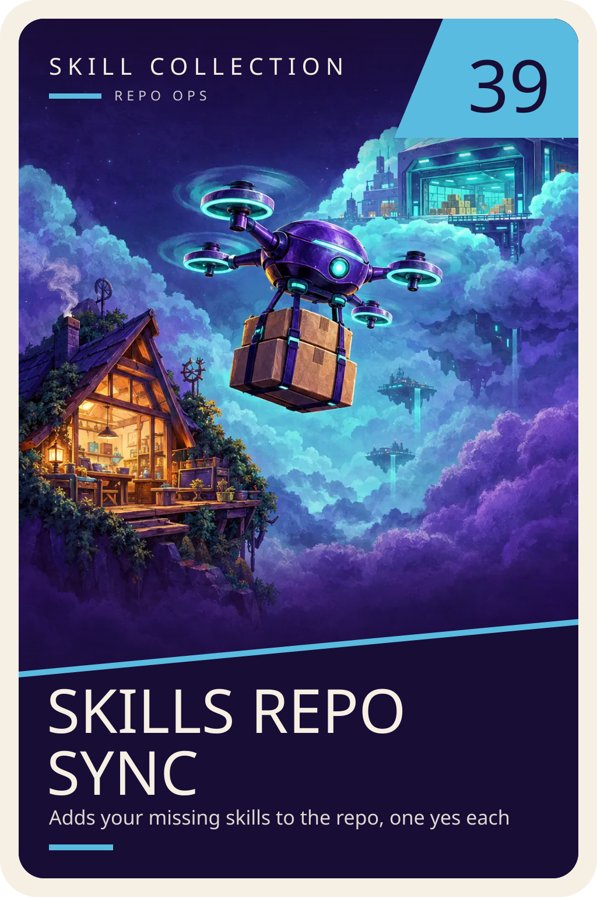
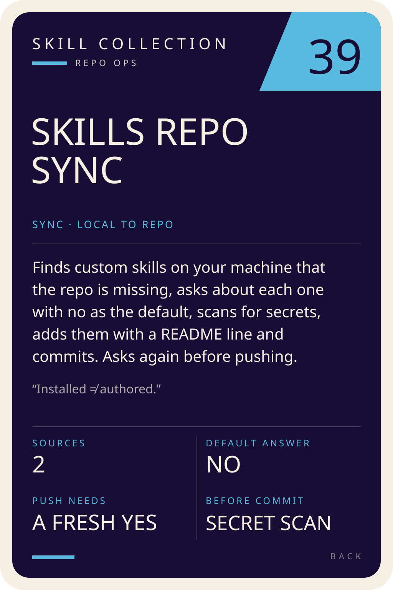
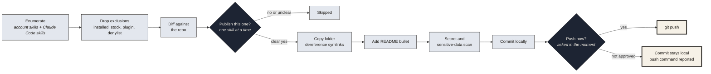

  
  

> **TL;DR:** It looks for skills you wrote that aren't in your public skills repo yet and asks you about each one, one at a time. The ones you say yes to get copied in, checked for secrets, listed in the README and committed, and nothing gets pushed until you say yes again.

## Say this

`sync my skills repo` · `check for new skills` · `update the skills repo` · `push my skills to github` · `backup my skills` · `are any skills missing from my repo?`

Also right after a new custom skill has been created.

## How it runs

A skill that trips the scan is left out of the sync and reported. Never push first and ask later.

## What you get

| Artifact | Format |
|---|---|
| **Skill folder** | `skills/<skill-name>/` with `SKILL.md` and any `references/`, `assets/`, `scripts/`, copied verbatim |
| **README index line** | `- **skill-name** — lowercase one-line summary`, under an existing `###` category |
| **Commit** | `Sync skills: add <names>` |
| **Push gate** | It stops, shows the skill names, file count and anything notable, and asks for an explicit yes |
| **Changed skills** | Listed in the report, not overwritten, unless you approve |

Formats quoted from <a href="SKILL.md">the SKILL.md</a>.

## What never gets synced

The only test for inclusion is whether you wrote it. Installed isn't authored.

| Excluded | How it's spotted |
|---|---|
| **Installed third-party skills** | Located in or symlinked into `~/.agents/skills/`, or frontmatter crediting another author, homepage, licence or package |
| **Anthropic stock skills** | A fixed list in the SKILL.md (`docx`, `pdf`, `pptx`, `xlsx`, `skill-creator` and others) |
| **Plugin skills** | Names with a colon, like `small-business:*` |
| **Private skills** | Anything matching a glob in the repo's `.publish-denylist`. Never offered at all; CI fails the build if one lands in `skills/` |
| **Unclear provenance** | It asks. It never defaults to syncing |

## Stat sheet

| | |
|---|---|
| **Input** | Your local skill folders (account skills cache and Claude Code skills), a clone of the repo, and you, to answer each prompt |
| **Output** | New skill folders, one README bullet each, a local commit, and a push only after a fresh yes |
| **Default answer** | No. A skill that doesn't get a clear yes stays out, however safe it looks |
| **Secret scan** | API keys, tokens, JWTs, private keys and assignment-style secrets, plus client names, Sheet or Doc IDs, internal URLs and real emails or phone numbers |
| **Push approval** | Must come in the moment. "Sync my repo" up front doesn't count |
| **Verifies** | Every new `SKILL.md` frontmatter parses, no symlinks left, README bullet count matches folder count |
| **Ships with** | `SKILL.md`, `platforms/chatgpt.md` (a ChatGPT version that syncs supplied skills through a feature branch and pull request) |

## Plays well with

- **[skills-repo-push](../skills-repo-push/)**: the other direction, repo to your local skills folder

---

<a href="../../README.md#skill-index">← All skills</a> · <a href="SKILL.md">Read the SKILL.md</a>
