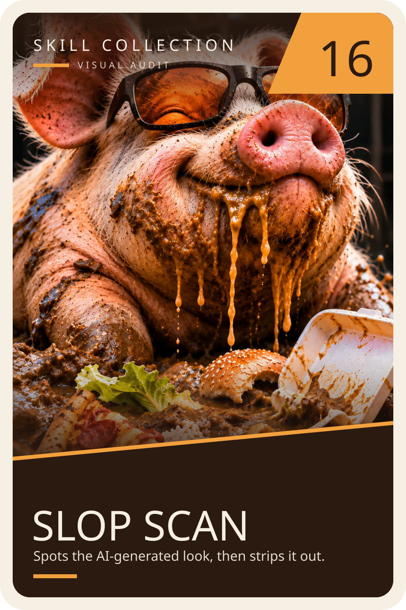
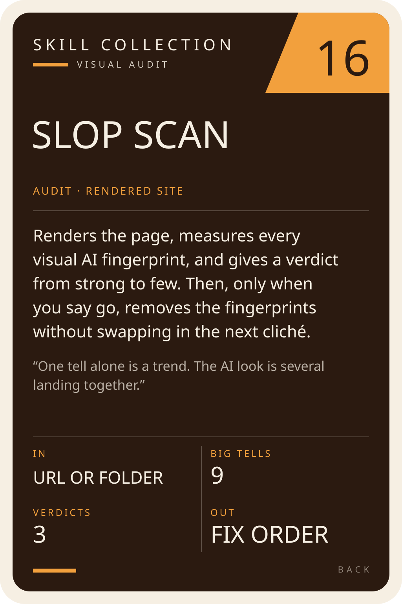
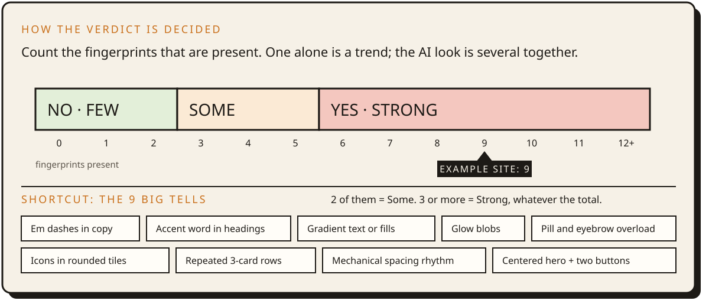
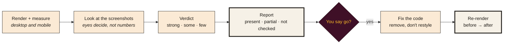

<p align="center">
  
  
</p>

> **TL;DR:** Point it at a site and ask "does this look AI-made?" It renders the page, counts the visual tells, and gives a straight yes, some, or no. Say go and it strips them out of the code without swapping in the next cliché.

## Say this

`does this look AI-generated` · `is this slop` · `de-AI this site` · `remove the AI look` · `why does this look AI` · `audit the AI tells`

## How the verdict works

<p align="center">
  
</p>
<sub>Thresholds and the big-tell list come straight from <a href="SKILL.md">the SKILL.md</a>. The "example site: 9" marker matches the sample report below.</sub>

## How it runs



Nothing gets marked Absent unless it was actually looked at. Anything it couldn't see (like hover states in a static screenshot) is listed as **Not checked**.

## What you get

The report is short and terminal-friendly. This is the format from the SKILL.md:

```text
Does this visually have the fingerprints of an AI-generated site? YES (strong)
9 present, 6 big tells. Cluster: v0/shadcn kit.

PRESENT
- Em dashes: 14 in visible text, incl. h1 and both CTAs
- Accent word: "spotless" in the h1 set in Caveat
- Pills: 7, three sitting above headings
- Icon tiles: 6 Lucide icons in 44px rounded squares
- 3-card rows: services and pricing, identical 357x230 cards
- Rhythm: 96px padding on 7/7 sections, same 1120px column
PARTIAL
- Fade-up: 4 sections hidden until scroll
NOT CHECKED
- Hover states (static screenshots)

FIX ORDER
1. ...
```

It also names the look when several tells cluster: **v0/shadcn kit**, **Lovable/Bolt purple SaaS**, **Claude-style cream editorial**, **dark glow SaaS**, or **bento product page**.

<details>
<summary><b>How the fixes work</b></summary>

| Fingerprint | Fix |
|---|---|
| Em dashes | Periods, commas or colons. Punctuation only; the copy isn't rewritten |
| Accent word in a heading | Same font, style and colour as the rest of the heading |
| Gradient text or backgrounds | Flat colour. Glow blobs and glass get deleted |
| Pills and eyebrow labels | Deleted; real controls like filters stay |
| Icon tiles | Tile removed; the icon stays plain or goes |
| 3-card rows and bento | Vary count and size; not every group needs cards |
| Mechanical rhythm | Spacing varies by importance; something breaks the column |
| Centered hero + two buttons | One action, ideally off-center |

Every replacement is checked against `references/banned-replacements.md`, so a gradient doesn't just become a glow.

</details>

## Stat sheet

| | |
|---|---|
| **Input** | A URL, localhost, a local folder or HTML file, a repo with a dev server, or screenshots |
| **Evidence** | `desktop-top.png`, `desktop-full.png`, `mobile-full.png` and `render-scan.json` |
| **Output** | A verdict, the present/partial/not-checked list, and a fix order |
| **Fixes** | Only when asked. Touches fingerprints only, then re-renders and reports before → after |
| **Never judges** | Whether photos, reviews or stats are real, whether the design fits the business, copy beyond em dashes, or UX and conversion |
| **Ships with** | `scripts/render.sh`, `render-scan.cjs`, `scan.py` (finds the source line for each tell), `references/tells.md`, `banned-replacements.md` |

## Plays well with

- **[ui-oddity-scan](../ui-oddity-scan/)**: per-page copy and layout oddities, the content side slop-scan won't touch
- **[conversion-audit](../conversion-audit/)**: whether the page serves its one action
- **[website-audit](../website-audit/)**: the whole-site crawl and scored report

---

<sub><a href="../../README.md#skill-index">← All skills</a> · <a href="SKILL.md">Read the SKILL.md</a></sub>
