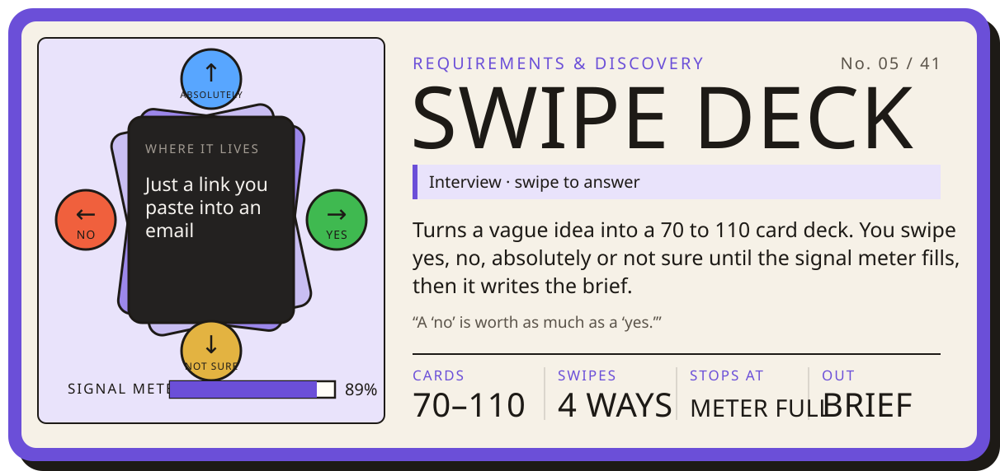
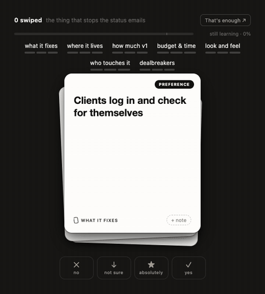
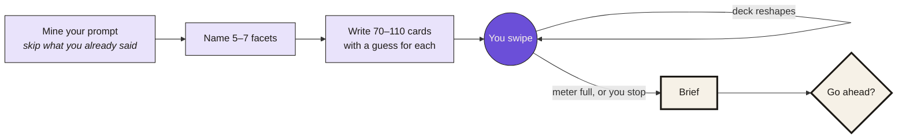

<p align="center">
  
</p>

> **TL;DR:** Instead of a list of questions, you get a deck of statements to swipe. It learns from every swipe, stops when it has stopped being surprised by you, and writes up what you actually want.

## Say this

`swipe deck` · `interview me` · `tinder style` · `20 questions me` · `figure out what I want` · `get it out of my head`

It also kicks in on its own when Claude is about to ask you more than three clarifying questions in a row.

## See it move

<p align="center">
  
</p>
<sub>The real widget from <a href="assets/deck.html"><code>assets/deck.html</code></a>, loaded with the cards from <a href="references/worked-example.md">the worked example</a>.</sub>

## Four swipes, four meanings

| Swipe | Means | The deck then… |
|---|---|---|
| **→ yes** | Right direction | Nudges toward that topic |
| **↑ absolutely** | You hit the vein | Pulls the deeper cards on that topic forward |
| **← no** | Wrong direction | Drops the cards that depended on it |
| **↓ not sure** | Too vague to react to | Reaches for a more concrete version of the card |

You can also tap a word to rewrite a card ("$5k" → "$15k") or add a note. Those count as the strongest signal in the whole session.

## How it runs



**When does it stop?** Claude writes a guess for how you'll swipe every card. The meter only fills once those guesses stop being wrong, every facet has enough answers, and enough of your swipes went below the surface. While you keep surprising it, there is still more to learn.

## What you get

From the worked example: *"I want to build something for my clients so they stop emailing me asking where their project is at."* After 47 swipes:

```text
SIGNAL METER: 89% (I think I've got it)
  facets at full depth: 7/7
  swipes you predicted correctly: 38/44
  share of swipes below the surface: 47%
```

<details open>
<summary><b>The brief it wrote</b> (trimmed)</summary>

> **Client status page: what you actually want**
>
> **The shape of it.** A single page on your existing site where each client sees their own projects (stage, what's next, when it was last touched), reachable by a secret link with no login. Your PM updates it from her phone. Live in six weeks, your number, from the card you rewrote.
>
> **Locked in**
> - Zero explanation required: if a client has to ask how it works, it failed
> - Rough and live in six weeks beats polished in three months
> - Secret per-client links, no accounts
> - One-way: status out, no comments or replies
>
> **Ruled out:** a downloadable app · comment threads in v1 · you personally doing the updates
>
> **Still fuzzy:** whether progress photos are core · invoices later (one yes on one card)
>
> **First thing I'd do:** mock the single client view and put it in front of your PM before anything gets built.

</details>

It then stops and asks before building anything.

## Stat sheet

| | |
|---|---|
| **Input** | Any vague or taste-driven request: a project, a trip, a name, a direction |
| **Output** | A brief: shape, locked in, ruled out, still fuzzy, the tension, first step |
| **Deck size** | 70–110 cards, written up front, re-ranked live after every swipe |
| **Honesty rule** | Guesses never get written up as your answers; they go under "Still fuzzy" |
| **No widget?** | Runs in chat as a numbered list; reply like `1r 3l 5u 7d` |
| **Ships with** | `assets/deck.html` (the widget), `references/question-craft.md`, `references/worked-example.md` |

## Plays well with

- **[whiteboard](../whiteboard/)**: the brief is a good starting map for a big plan
- **[hot-seat](../hot-seat/)**: when what's left is a few real decisions, not a taste

---

<sub><a href="../../README.md#skill-index">← All skills</a> · <a href="SKILL.md">Read the SKILL.md</a></sub>
