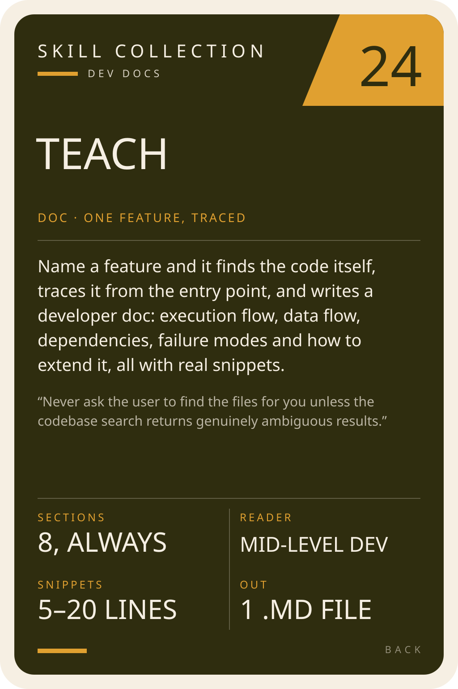
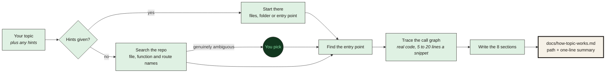

<p align="center">
  
  
</p>

> **TL;DR:** Name a feature, like "payments" or "the webhook system". Claude finds the code itself, follows it from where it starts, and writes a "how this works" doc for developers, built from real code snippets.

## Say this

`/teach payments` · `how does X work` · `explain the auth flow` · `document how payments work` · `walk me through the webhook system` · `onboarding docs for this module`

Hints are optional and read loosely, not as strict flags: `/teach webhook system -- context: lives in src/webhooks/` or `/teach "auth middleware" --files src/middleware/auth.ts`.

## How it runs



It only asks you to point at files when its own search turns up genuinely ambiguous matches. If several candidates exist, it names them in the doc intro and covers the most likely one.

## What you get

One markdown file, `docs/how-[topic-slug]-works.md`, always in this shape:

```markdown
# How Payments Work

## What Is This?
...

## Entry Point
`POST /api/payments/charge` — `src/app/api/payments/charge/route.ts`

// src/app/api/payments/charge/route.ts
export async function POST(req: Request) {
  // ...
}

## Execution Flow
1. **Validate request** — `src/lib/validators/payment.ts`
   ...

## Data Flow
## Key Dependencies
## Error Handling & Edge Cases
## Where To Look If Something Breaks
## How To Extend This
```

<sub>Trimmed from the example output structure in <a href="SKILL.md">the SKILL.md</a>. The payments feature and its paths are illustrative, not from a real project.</sub>

## The eight sections

| Section | What it answers |
|---|---|
| **What Is This?** | One plain paragraph on what it does and why it exists. No code yet |
| **Entry Point** | Where execution begins: a route, queue consumer, job, webhook or CLI command, with file path and line range |
| **Execution Flow** | A numbered trace: which function, which file, what it does, what it returns or changes |
| **Data Flow** | What comes in, how it changes at each stage, what goes out, plus the relevant schema or type |
| **Key Dependencies** | Internal modules and external packages, one line each on their role |
| **Error Handling & Edge Cases** | Validation, timeouts, try/catch, and TODOs in the code worth flagging |
| **Where To Look If Something Breaks** | Symptom, first file to open, and the env vars or flags involved |
| **How To Extend This** | Where a new case goes, which conventions to follow, which tests to update |

## Stat sheet

| | |
|---|---|
| **Input** | A topic, optionally with file paths, a folder description or an entry point |
| **Output** | `docs/how-[topic-slug]-works.md`, then the path and a one-line summary in chat |
| **Reader** | A mid-level developer new to this part of the codebase |
| **Snippet rules** | Real code over pseudocode, 5 to 20 lines, a `// path` comment above each, `// ...` for cuts, never whole files |
| **Existing docs** | Says before it creates `docs/` or appends to an existing index. Never edits silently |
| **Flags** | Anything surprising or that has caused bugs before, when comments or git blame show it |
| **Ships with** | `SKILL.md` only |

## Plays well with

- **[eli5-features](../eli5-features/)**: the same feature explained for the people who use the product, not the people who build it

## Not for

End-user or customer-facing help articles. Those go to [eli5-features](../eli5-features/).

---

<sub><a href="../../README.md#skill-index">← All skills</a> · <a href="SKILL.md">Read the SKILL.md</a></sub>
