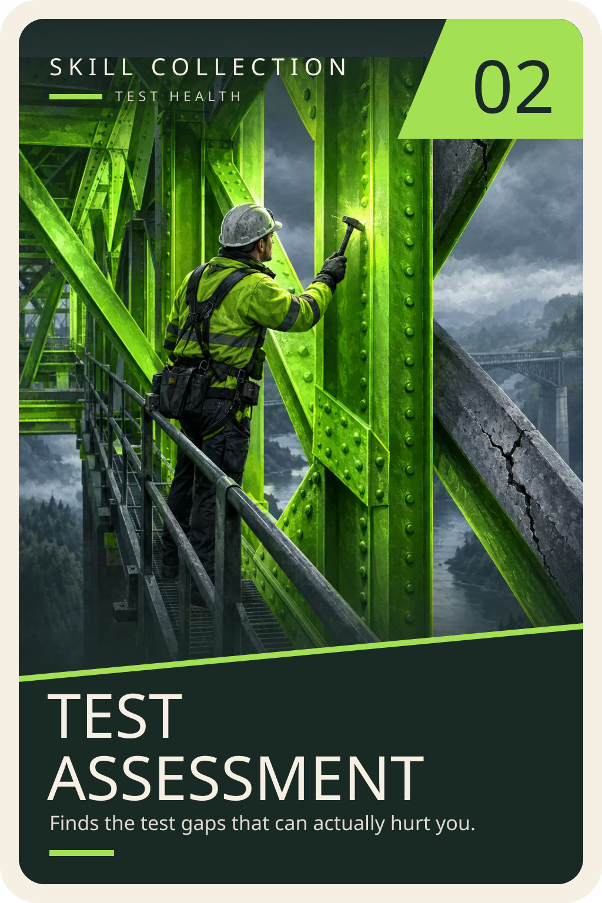
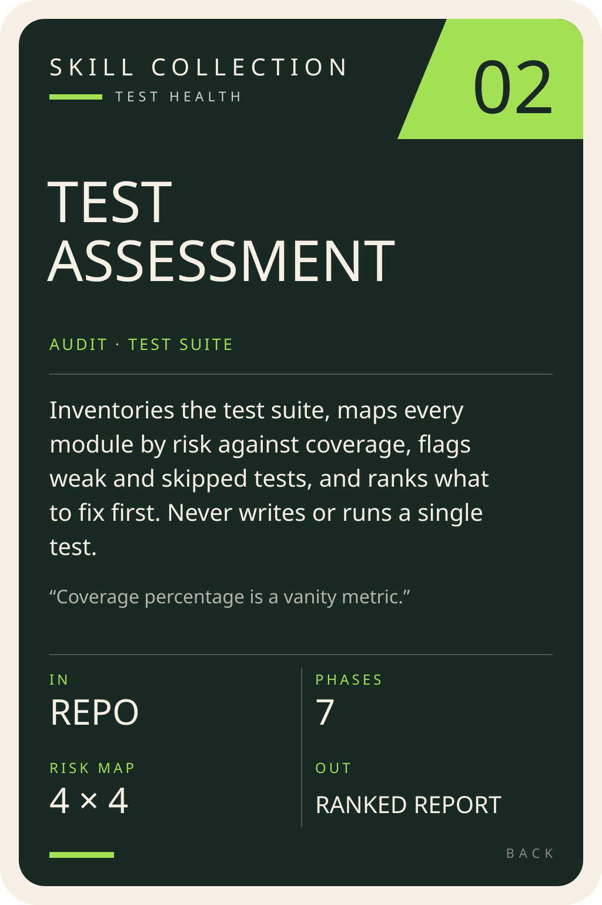
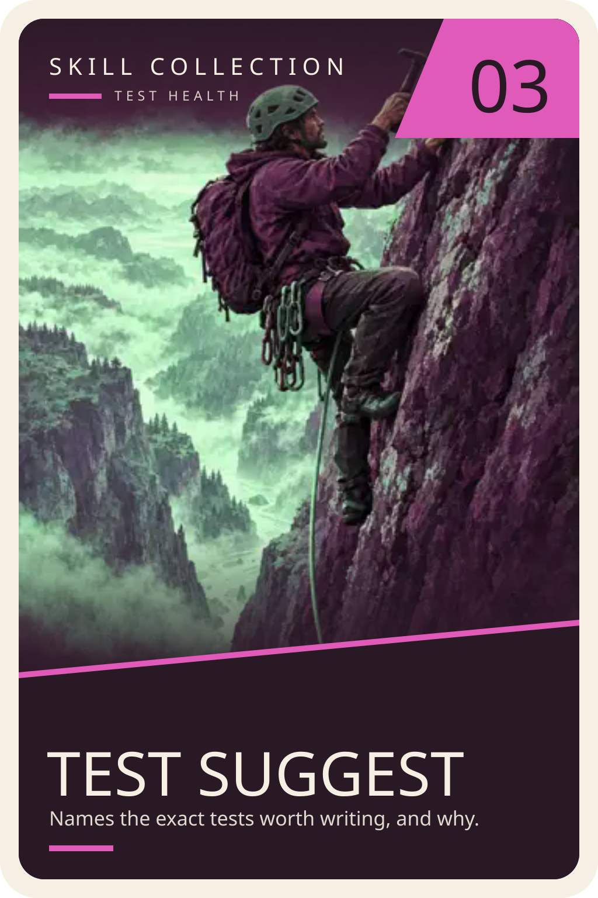
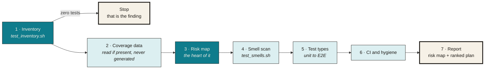

<p align="center">
  
  
</p>

<!-- skill-family:start -->
**The family:** these skills are parts of this one, each also installable on its own.

<p><a href="../../skills/test-suggest/"></a></p>
<!-- skill-family:end -->

> **TL;DR:** Point it at a repo and ask if it's well tested. You get a report that puts every module on a risk-versus-coverage grid, so the untested payments code shows up long before the untested logging code.

## Say this

`is this tested?` · `what's the test situation?` · `audit our tests` · `are there enough tests` · `where should we add tests` · `testing gaps` · `test debt` · `flaky tests`

Or ask anything about test coverage, test quality, or untested code paths.

## How it runs

Seven phases, in order. Earlier phases set up the context later ones need. Zero tests ends it at phase 1: that's the whole finding.



## What you get

A report with seven sections: executive summary, the numbers, the risk map, top gaps, quality findings, what's working well, and recommended next steps (this week, this month, this quarter). The risk map is the centerpiece:

```markdown
## Risk Map

|             | None                     | Sparse              | Partial | Solid |
|-------------|--------------------------|---------------------|---------|-------|
| **Critical**| billing/refund.ts        | auth/session.ts     | 0       | 1     |
| **High**    | api/bookings.ts          | jobs/reminders.ts   | 2       | 3     |
| **Medium**  | 4                        | 6                   | 5       | 2     |
| **Low**     | 9                        | 3                   | 2       | 7     |

## Top Gaps

### Finding 1: Refund handling — Severity: Critical

- **What:** billing/refund.ts issues partial and full refunds through the payment provider
- **Why it matters:** a wrong amount or a double refund costs real money and won't show up until reconciliation
- **Current state:** No tests
- **What to test:**
  - Refund larger than the original charge is rejected, nothing sent to the provider
  - Retrying a refund that already succeeded does not refund twice
  - Provider timeout leaves the booking marked "refund pending", not "refunded"
- **Test type recommended:** Integration
```

<sub>Illustrative example. The project is fictional; the layout follows <a href="assets/report-template.md"><code>assets/report-template.md</code></a>.</sub>

## Severity guide

Inflation makes real Criticals invisible, so the scale is fixed:

| Severity | Means |
|---|---|
| **Critical** | Untested code that handles money, auth, data deletion, or PII |
| **High** | Untested core business logic, or a structural problem: no integration tests at all, CI doesn't run tests |
| **Medium** | Sparsely tested complex modules; smells that make the suite unreliable (skipped tests, no assertions) |
| **Low** | Style issues, minor smells, low-risk modules that probably should have tests |
| **Info** | Worth flagging, not actionable on its own |

## Stat sheet

| | |
|---|---|
| **Input** | A repo path. Existing coverage files (`coverage/`, `lcov.info`, `coverage.xml` and the like) are read if they're there |
| **Output** | The seven-section report above, ending in a prioritized plan, not a backlog |
| **Core rule** | Coverage percentage is a vanity metric. Every finding answers "why does this gap matter?" |
| **Risk signals** | Money, auth, data deletion, external API writes, DB writes, crypto, concurrency, parsers, public request paths |
| **Won't** | Write tests, run the suite, generate coverage, or modify code |
| **Big repos** | Over ~100k lines it scans everything cheaply, then risk-maps the 20 most-changed files plus risk-named folders, and says so |
| **Without a shell** | Inventory and smell scan done by reading files; CI hygiene skipped (and noted) if the config can't be read |
| **Ships with** | `scripts/test_inventory.sh`, `risk_map.sh`, `test_smells.sh`; `references/risk-mapping.md`, `test-smells.md`, `test-types.md`, `language-notes.md`; `assets/report-template.md` |

## Plays well with

- **[test-suggest](../test-suggest/)**: the next step. Turns the top findings into specific test cases
- **[code-audit](../code-audit/)**: the whole-repo health check; run this when it says the tests are thin

## Not for

Writing tests. Ask it to "find gaps and write tests" and it finishes the assessment, stops, and offers to run test-suggest on the top findings.

---

<sub><a href="../../README.md#skill-index">← All skills</a> · <a href="SKILL.md">Read the SKILL.md</a></sub>
