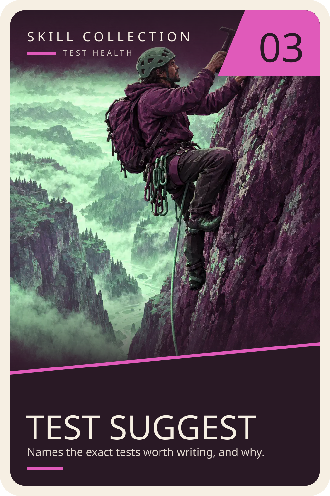
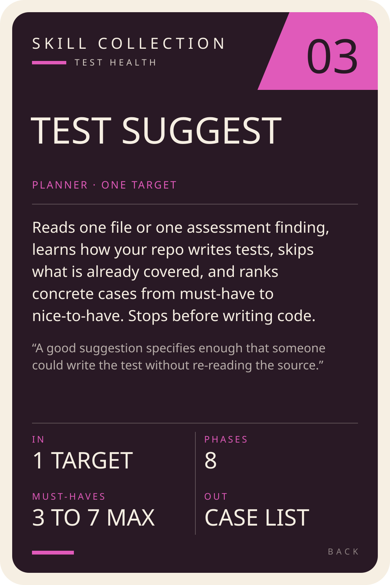
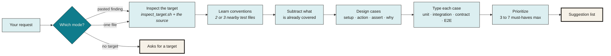

<p align="center">
  
  
</p>

<!-- skill-family:start -->
> **Part of [Test Assessment](../test-assessment/).** It works alongside Test Assessment and can also be installed on its own.
<!-- skill-family:end -->

> **TL;DR:** Name a file, or paste a gap from a test assessment. You get a ranked list of specific tests to write, each with its setup, what to call, what to check and why it matters, detailed enough to write without rereading the code.

## Say this

`what should I test in auth.ts` · `give me test ideas for this module` · `suggest tests for this file` · `what test cases would catch real bugs in X` · `I have a finding from test-assessment, what tests would close that gap`

A bare "what should I test?" gets one question back: which file. It never guesses a target.

## How it runs



Suggestions follow the repo's own framework, assertion style, naming and file layout. A Jest-style case in a node:test repo won't even run.

## What you get

```markdown
# Test Suggestions — lib/invite-code.ts

**Target file(s):** `lib/invite-code.ts` (142 lines, TypeScript)
**Test framework:** Vitest
**Test file location:** alongside source, `lib/*.test.ts`
**Existing coverage:** 2 existing cases, see below

## Already Covered

- `lib/invite-code.test.ts:12` — valid code redeems and returns the team id
- `lib/invite-code.test.ts:31` — unknown code returns null

## Must-have

### 1. Rejects a code that has already been redeemed

- **Type:** Unit
- **Test file:** `lib/invite-code.test.ts`
- **Setup:** stub `db.invites.find` to return `{ code: 'K7Q2', redeemedAt: '2026-01-04' }`
- **Action:** call `redeem('K7Q2', 'user-9')`
- **Assert:** throws `InviteAlreadyUsedError` AND `db.members.insert` is never called
- **Why:** without this check one invite link adds unlimited people to a paid team
- **Watch out for:** reset the stub between tests so the redeemed state doesn't leak

## Should-have
...
## Nice-to-have
...
## Untestable As-Written
...
## Next Step

I can generate the actual test code for any of these. Say:
- "Write case N" — produce code for one case
- "Write all must-haves" — produce code for the must-have group
- "Write all" — produce code for everything
```

<sub>Illustrative example. The project and file are fictional; the layout follows <a href="assets/suggestion-template.md"><code>assets/suggestion-template.md</code></a>.</sub>

## How cases get ranked

| Tier | What goes here |
|---|---|
| **Must-have** | Security boundaries, money handling, data deletion, the path that breaks most often if the contract changes. 3 to 7 per target, max |
| **Should-have** | The main happy path, the most common error case |
| **Nice-to-have** | Unusual edge cases, defensive checks for "shouldn't happen" states |

A case that can't name what would break in production isn't worth writing, so it doesn't make the list.

## Stat sheet

| | |
|---|---|
| **Input** | One named file, or a pasted test-assessment finding (several files, grouped per file in the output) |
| **Output** | Header, already covered, numbered cases in three tiers, untestable-as-written, next step |
| **Every case has** | Name, Type, Setup, Action, Assert, Why, and an optional Watch out for |
| **Core rule** | Specific enough to write the test without rereading the source. No "test the happy path", no tautologies |
| **Untestable code** | Called out honestly with a refactor or a higher-level test strategy. No mock-everything workarounds |
| **Big targets** | Over ~500 lines or 20+ exports: the 5 to 8 most important behaviors, and it says so |
| **Without a shell** | Reads the file by hand; if it can't read existing tests, it says the conventions were assumed |
| **Ships with** | `scripts/inspect_target.sh`; `references/case-design.md`, `test-types.md`, `untestable-code.md`, `language-notes.md`; `assets/suggestion-template.md` |

## Plays well with

- **[test-assessment](../test-assessment/)**: finds the gaps; paste one of its findings straight in
- **[code-audit](../code-audit/)**: when the audit says a module is under-tested, this designs the cases

## Not for

Writing or running the test code (that's a normal follow-up once you've reviewed the list), refactoring untestable code, or a repo-wide coverage check (use test-assessment).

---

<sub><a href="../../README.md#skill-index">← All skills</a> · <a href="SKILL.md">Read the SKILL.md</a></sub>
