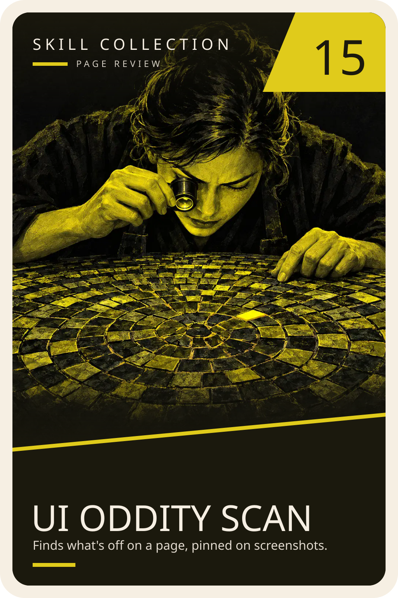
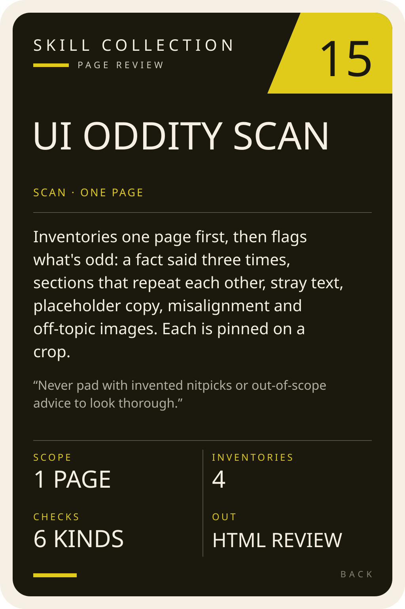
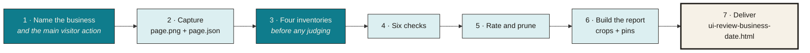

<p align="center">
  
  
</p>

> **TL;DR:** Ask "does this page look right?" and it reads the page like a picky designer. It catches the stuff everyone skims past, like the phone number shown three times or a list that repeats the paragraph above it, and pins each one on a screenshot.

## Say this

`does this page look right?` · `find anything weird on this page` · `anything off about my landing page?` · `sanity-check this UI` · `look over this page`

## How it runs



**Why inventory first:** these oddities survive because everyone skims. So it lists every heading, every key fact and everywhere it appears, every button, and every repeat before deciding anything.

**Why name the business first:** "does this image fit?" has no answer without it. The inferred subject goes at the top of the report so you can correct it.

## The six checks

| Check | Flag | Don't flag |
|---|---|---|
| **Repetition** | A phone number in the top bar, right below it, and in the hero button | The phone number in the header and the footer |
| **Copy oddities** | "and start saving today" alone under a button; `undefined`, `{{var}}`, lorem ipsum | "No credit card required" under a signup button |
| **CTA oddities** | "Start free trial" twice in one hero | The main button once per scroll section |
| **Layout** | Star icons floating off their "4.9 · 212 reviews" text; overlaps; cut-off text | Spacing that looks deliberately designed |
| **Imagery fit** | A garage-door hero photo with no garage door in it | Abstract gradients and patterns |
| **Consistency** | "QuickBooks" / "Quickbooks" / "Quick Books" on one page | Tone shifts the page plays for effect |

<sub>Examples from <a href="references/checks.md"><code>references/checks.md</code></a>.</sub>

**Severity:** high (visitors notice fast, trust or conversion suffers) · medium (noticeable on a careful read) · low (polish). When unsure, it picks the lower one.

## What you get

A self-contained HTML review, one card per page section in page order, each with a screenshot crop, numbered pins, and a one-line structural fix per note. It's built from a `findings.json` like this:

```json
{
  "meta": {
    "business": "Maple Street Garage Doors", "source": "URL or file", "date": "YYYY-MM-DD",
    "subject": "Local garage-door repair company; primary action: call now",
    "pattern_intro": "1-2 sentences naming the pattern behind most findings",
    "repeats": [{"count": "7x", "message": "Phone number", "where": "top bar, header, hero button, footer"}],
    "recommendation": "the one structural change that fixes most of it"
  },
  "sections": [{
    "title": "Header + Hero",
    "region": [y0, y1],
    "working_well": false,
    "findings": [
      {"severity": "high|medium|low", "text": "the oddity, quoting exact copy", "fix": "structural fix", "pin": [x, y]},
      {"severity": "good", "text": "something in this section that genuinely works — keep it"}
    ]
  }]
}
```

<sub>Shape from <a href="SKILL.md">the SKILL.md</a> and the docstring in <a href="scripts/build_report.py"><code>scripts/build_report.py</code></a>. The business name is fictional.</sub>

The **repeats table** is the headline: every message said more than once, how many times, and where. Green "good" notes mark what to keep, so a clean page gets a short, mostly green report instead of invented nitpicks.

## Stat sheet

| | |
|---|---|
| **Input** | A live URL, a localhost URL, a screenshot, or HTML/JSX source, plus the business and the page's main visitor action (it asks if unclear) |
| **Output** | `ui-review-<business>-<date>.html` with section cards and numbered pins, plus `crops/<section>.png` |
| **Evidence** | `page.png` (full-page screenshot) and `page.json` (text boxes, buttons, exact duplicates, repeated phone numbers, broken images, overflow) |
| **Rule it lives by** | One fact, one home per screenful. Fixes are structural, never rewording |
| **Never reports** | Link QA, SEO, WCAG audits, mobile guesses from desktop captures, copy rewrites, conversion strategy |
| **Ships with** | `scripts/capture_page.py`, `build_report.py`, `annotate.py` (full-page overview, only on request), `references/checks.md` |

## Plays well with

- **[website-audit](../website-audit/)**: the whole-site crawl; QA mode runs this scan on the top 3 pages
- **[slop-scan](../slop-scan/)**: the visual AI-made look this scan doesn't judge
- **[ux-audit](../ux-audit/)**: friction across a multi-step flow
- **[conversion-audit](../conversion-audit/)**: whether the page persuades people to act

## Not for

Link and href checks, SEO, accessibility audits (except contrast so low people visibly struggle), UX flow or conversion advice, mobile responsiveness guesses, or copy rewrites.

---

<sub><a href="../../README.md#skill-index">← All skills</a> · <a href="SKILL.md">Read the SKILL.md</a></sub>
