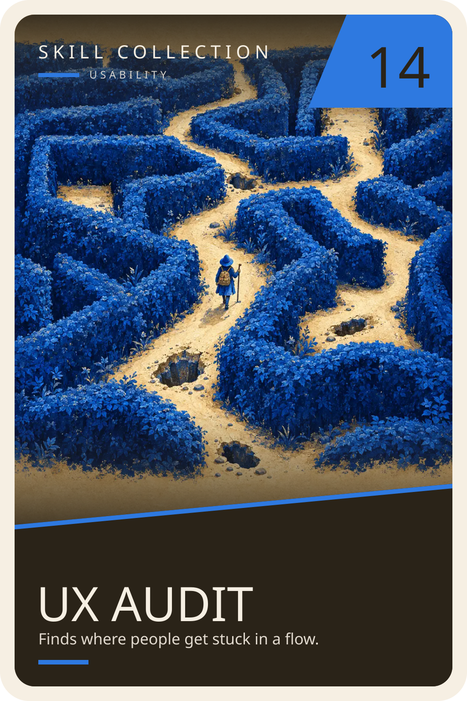
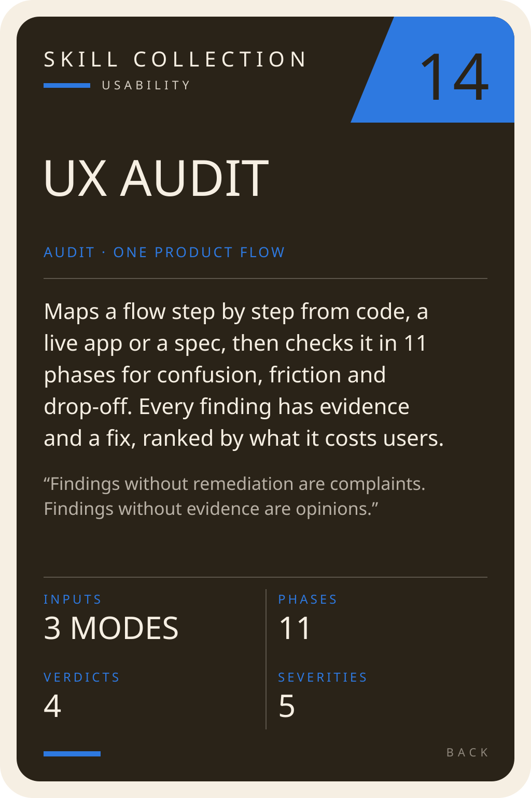
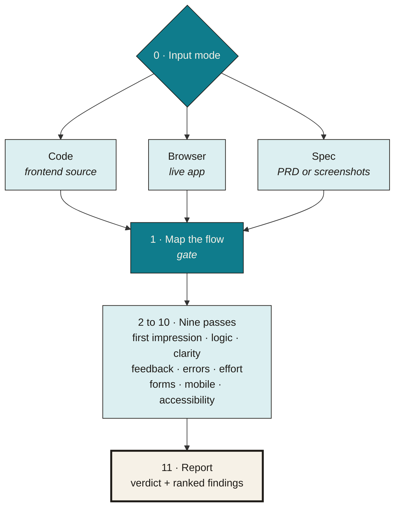

<p align="center">
  
  
</p>

> **TL;DR:** Hand it a signup, checkout or onboarding flow and it walks through it like a first-timer on a phone. You get a one-line verdict and a ranked list of where people get confused or quit, each with proof and a specific fix.

## Say this

`audit the UX of this flow` · `is this flow confusing` · `does this checkout make sense` · `why are people dropping off at step 3` · `audit this form` · `where's the friction` · `is my checkout any good?`

## How it runs

Step 0 picks how the flow gets rebuilt. Phase 1 is a gate: nothing gets judged until the map exists.



More than one input? It uses them together: walk the live app to feel it, read the code to see why. It asks for more evidence only when the answer would change a recommendation, and then asks for the smallest thing (one screenshot, not "some screenshots").

## The 11 phases

| # | Phase | The question |
|---|---|---|
| 1 | **Map the flow** | Entry points, steps, branches, inputs, exits. If it can't be mapped cleanly, that's finding #1 |
| 2 | **First impression** | Can a newcomer tell what this is and what to do within ~5 seconds? |
| 3 | **Flow logic** | Is anything asked too early, twice, or with no way back? |
| 4 | **Clarity and leakage** | Do labels describe outcomes? Is the code's vocabulary showing through? |
| 5 | **Feedback** | Does the user always know what's happening and what just happened? |
| 6 | **Errors** | Are mistakes prevented, and do errors say how to fix them? |
| 7 | **Effort** | How many fields, choices and things to remember? |
| 8 | **Forms** | Persistent labels, right keyboards, save and resume |
| 9 | **Mobile** | Tap targets, thumb reach, keyboard overlap, reflow |
| 10 | **Accessibility** | Keyboard, focus, labels, contrast, motion |
| 11 | **Report** | Verdict, map, findings, what's good, next steps |

## What you get

A one-line verdict (**clear** / **mostly clear** / **confusing** / **broken**) on top, then the findings in this shape:

```markdown
## Findings

| ID | Severity | Category | Title | Location | Summary |
|----|----------|----------|-------|----------|---------|
| U1 | Critical | Flow logic | [title] | [file:line / step / frame] | [one line] |
| U2 | High | Comprehension | [title] | [...] | [...] |

## Detailed findings

### U1 — [Title]  ·  Critical  ·  [Category]

**What it is.** [The issue, concretely.]
**User impact.** [Who hesitates or quits, and why. The drop-off story.]
**Evidence.** [`file:line` / "Step 4, `step-04.png`" / quoted spec line — the specific pointer.]
**Heuristic.** [Which usability heuristic it violates, if applicable.]
**Recommended fix.** [Specific, actionable. Not "improve UX."]
**Effort.** [S / M / L]
```

<sub>Excerpt from <a href="assets/report-template.md"><code>assets/report-template.md</code></a>. The full report also has an executive summary, the flow map, what's good, prioritized next steps, a suggested next pass, and coverage notes.</sub>

| Need | Format |
|---|---|
| **The full picture** | Detailed default (`assets/report-template.md`) |
| **A fast answer** | Concise: verdict, biggest problem, three issues, what to change first |
| **Work for a team** | Ticket-ready: one ticket per fix with affected files and acceptance criteria |
| **A number** | Optional 1 to 5 rubric across 10 categories, with the verdict derived from it |

## How fixes are ordered

Subtraction first. New UI is the last resort, not the first idea.

**1. Remove** a step, field or choice → **2. Consolidate** duplicates → **3. Rename** so labels say the outcome → **4. Reorder** so context comes first → **5. Add feedback** → **6. Add new UI**

## Stat sheet

| | |
|---|---|
| **Input** | Frontend source, a live app plus browser automation, or a written flow, spec or screenshots |
| **Output** | Verdict, executive summary, numbered flow map, findings table, expanded findings with evidence, fix and S/M/L effort, what's good, next steps |
| **Severity scale** | Critical · High · Medium · Low · Info, by cost to users and the business, never by taste |
| **Rule it lives by** | Every finding points at something concrete and ends with a specific fix. Messy code is a clue about the experience, not proof |
| **Without a shell or browser** | Still works by reading the materials and notes what it couldn't verify |
| **Ships with** | `scripts/ui_inventory.sh`, `references/heuristics.md`, `rubric.md`, `report-variants.md`, `code-mode.md`, `browser-mode.md`, `spec-mode.md`, `assets/report-template.md` |

## Plays well with

- **[ui-oddity-scan](../ui-oddity-scan/)**: oddities on a single page, like the same fact said three times
- **[conversion-audit](../conversion-audit/)**: whether a page persuades people to take its one action
- **[website-audit](../website-audit/)**: the whole-site crawl and score
- **[fresh-eyes](../fresh-eyes/)**: a first-time-user test that logs each confusion as it happens

## Not for

Visual polish or redesign. A single button restyle or one-line copy tweak gets a direct answer, not an audit. Per-page oddities are [ui-oddity-scan](../ui-oddity-scan/); persuasion is [conversion-audit](../conversion-audit/).

---

<sub><a href="../../README.md#skill-index">← All skills</a> · <a href="SKILL.md">Read the SKILL.md</a></sub>
