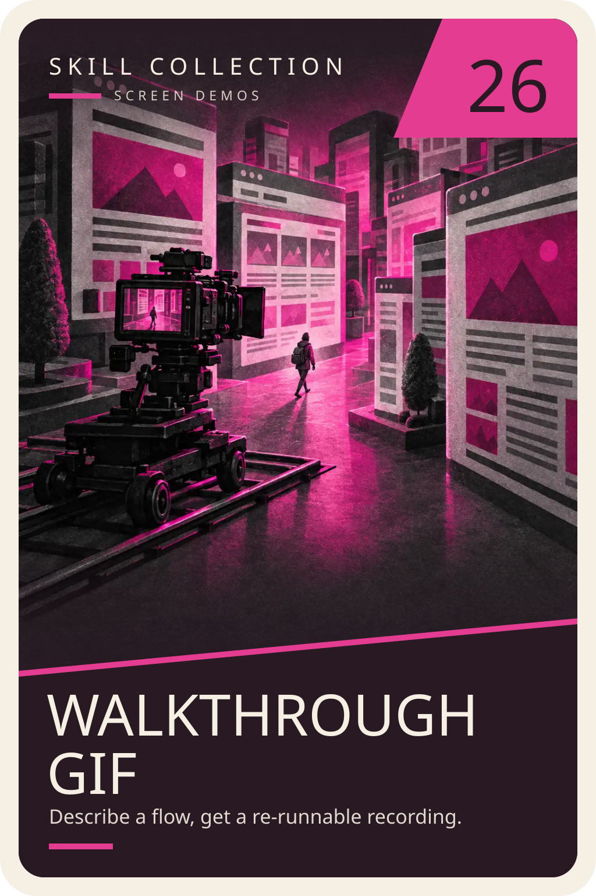
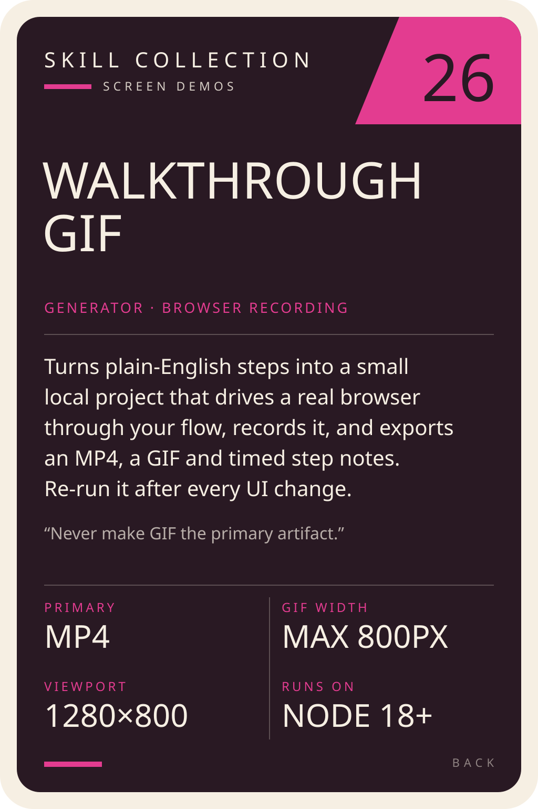

<p align="center">
  
  
</p>

> **TL;DR:** Describe a flow in your web app in plain English. You get a small project that drives a real browser through those steps, records it, and turns the recording into an MP4, a GIF and a list of timed steps. Re-run it after every UI change.

## Say this

`record a walkthrough of` · `create a GIF showing how to` · `make a demo of` · `capture the flow for` · `show how [feature] works in the browser` · `document this UI flow`

## How it runs

```mermaid
flowchart LR
    Q["Gather the basics<br/><i>URL, steps, login, pace, viewport</i>"] --> B["Bail check<br/>MFA, CAPTCHA, over 90 s"]
    B --> G["Generate the project<br/>walkthrough-name/"]
    G --> T["One act call per step<br/><i>plain English, no selectors</i>"]
    T --> R(("You run it<br/>or say go"))
    R --> V["Playwright records<br/>.webm"]
    V --> C["convert.sh<br/>MP4 first, then GIF"]
    C --> O["MP4 + GIF + timed steps"]

    classDef step fill:#DFF1E3,stroke:#1D1A16,color:#1D1A16
    classDef you fill:#12371F,stroke:#1D1A16,color:#8BE3A8
    classDef out fill:#F6F1E7,stroke:#1D1A16,color:#1D1A16,stroke-width:3px
    class Q,B,G,T,V,C step
    class R you
    class O out
```



Stagehand needs an LLM key (`ANTHROPIC_API_KEY`, or the key for whichever model is configured), so that's confirmed first. If you agree, Claude Code runs the whole pipeline itself and checks the MP4's duration and both file sizes before calling it done.

## What you get

A project, then three output files and a step log:

```text
walkthrough-[name]/
├── package.json
├── tsconfig.json
├── .env.example
├── src/
│   └── walkthrough.ts      ← main script
├── scripts/
│   └── convert.sh          ← ffmpeg + gifski conversion
└── output/
    ├── walkthrough.webm    ← raw Playwright recording
    ├── walkthrough.mp4     ← converted (H.264, web-safe)
    ├── walkthrough.gif     ← gifski output, max 800px wide
    └── walkthrough.md      ← step-by-step annotation
```

`walkthrough.md` lists each step with seconds from the start, ready to use as a caption:

```markdown
# Walkthrough Steps

1. [0s] Navigate to the dashboard
2. [3s] Click New Report button
3. [6s] Type the report name into the Name field
4. [9s] Click Save
```

<sub>Trees come from <a href="SKILL.md">the SKILL.md</a>. The step log follows the <code>logStep</code> format in <a href="references/stagehand-patterns.md"><code>references/stagehand-patterns.md</code></a>; the app and its steps are fictional.</sub>

<details>
<summary><b>The setup checklist it hands you</b></summary>

```text
## Setup
npm install
npx playwright install chromium
cp .env.example .env  # fill in ANTHROPIC_API_KEY + any credentials

## Run
npx tsx src/walkthrough.ts

## Convert to GIF + MP4
bash scripts/convert.sh
```

</details>

## When it warns you first

| Condition | What happens |
|---|---|
| **Login with MFA or SSO** | Can't be automated; you export cookies from a logged-in browser |
| **CAPTCHA on the page** | Playwright stalls; use a demo or sandbox environment |
| **Heavy animation or infinite scroll** | Recorded fine, but the GIF gets large; suggest clipping |
| **Flow over 90 seconds** | MP4 only; the GIF would be unusably large |
| **Randomized content** | Stagehand still finds things, but reruns may look different |

## Stat sheet

| | |
|---|---|
| **Input** | A start URL, the steps in plain English, the login situation, format, pace and viewport (default 1280×800) |
| **Output** | A runnable Node/TypeScript project, then `walkthrough.mp4`, `.gif` and `.md` |
| **MP4 first** | The GIF is always derived from the video, never the main artifact. Keep walkthroughs under 60 s |
| **Secrets** | Credentials live in `.env` and reach Stagehand through `variables`, never inside a step's text |
| **Click ripples** | An optional overlay injected before the run marks every click |
| **Needs** | Node 18+, Playwright, Stagehand, ffmpeg, gifski (optional). Claude Code only |
| **Ships with** | `references/stagehand-patterns.md`, `references/output-pipeline.md` |

## Plays well with

- **[eli5-features](../eli5-features/)**: help docs that mark where a video would help; this makes the video

## Not for

Quick one-off captures in your own logged-in browser. The `claude-in-chrome` `gif_creator` tool is far simpler for that. Use this skill when you need a re-runnable script, MP4, a high-quality GIF, a clean-profile recording or CI repeatability.

---

<sub><a href="../../README.md#skill-index">← All skills</a> · <a href="SKILL.md">Read the SKILL.md</a></sub>
