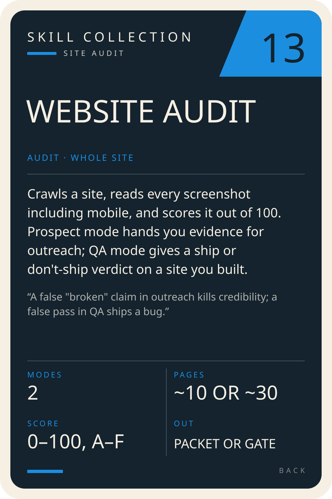
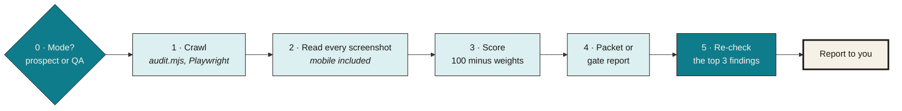

<p align="center">
  
  
</p>

> **TL;DR:** Give it a website and it crawls the pages, looks at every screenshot (phone size too), and scores the site out of 100. For someone else's site you get proof of what's broken; for a site you built you get a clear "ship it" or "don't ship it yet."

## Say this

`audit this site` · `run a website audit` · `what's broken on this site` · `check this prospect's website` · `QA this build` · `is this site ready to launch`

## Two modes

| | PROSPECT | QA |
|---|---|---|
| **Whose site** | A lead's | One you built or are delivering |
| **Goal** | Evidence for outreach | Nothing ships broken |
| **Depth** | Up to ~10 pages, top 5 problems | Up to ~30 pages or the full sitemap, every checklist item pass/fail |
| **Output** | `audit_packet.json` + a short summary | A markdown gate report with a verdict |
| **Extra passes** | Skipped unless asked | `ui-oddity-scan` on the top 3 pages |

Given a bare URL, it asks one question: is this a lead's site or one of yours?

## How it runs



The script measures what a script can (status codes, links, SEO tags, console errors, HTTPS, screenshots). Claude judges what it can't: design era, copy clarity, duplicated info, CTA strength, trust signals, mobile breakage. If the crawler is blocked, it falls back to fetching content and marks technical items "not verifiable".

## How the score works

| Severity | Weight | Meaning |
|---|---|---|
| **CRITICAL** | 15 | Actively losing customers or broken function: site down, broken forms, no mobile usability, SSL errors |
| **MAJOR** | 8 | Meaningfully hurting results: no HTTPS redirect, broken links on key pages, missing titles, dead CTA |
| **MINOR** | 3 | Polish: missing alt text, thin meta descriptions, no favicon |

**Score** = 100 minus the weights, floored at 0. **Grades:** A ≥ 90 · B ≥ 80 · C ≥ 65 · D ≥ 50 · F below 50.

**QA verdicts:** **SHIP** (no CRITICAL, 2 or fewer MAJOR) · **FIX THEN SHIP** · **DO NOT SHIP** (any CRITICAL).

## What you get

In PROSPECT mode, a portable packet that an outreach step can read directly:

```json
{
  "packet_type": "audit_packet",
  "domain": "example.com",
  "audited_at": "<ISO date>",
  "mode": "prospect",
  "score": 47,
  "grade": "F",
  "pages_crawled": 9,
  "top_findings": [
    {
      "severity": "CRITICAL",
      "category": "mobile",
      "finding": "Homepage nav unusable on mobile — links overlap the logo",
      "evidence": "screenshots/home-mobile.png",
      "sales_angle": "60%+ of local searches are mobile; their front door is broken for most visitors"
    }
  ],
  "all_findings": [ "...same shape, every finding..." ],
  "works_well": [ "things that are fine — keeps the audit honest and outreach credible" ],
  "screenshots_dir": "audit-example.com/screenshots"
}
```

<sub>Copied from the packet shape in <a href="SKILL.md">the SKILL.md</a>. The domain and numbers are placeholders.</sub>

Then a short summary: the grade, the top 3 to 5 findings each with its sales angle, and one sentence on what's genuinely fine. In QA mode you get a markdown report instead: a pass/fail table for every checklist item, findings grouped CRITICAL → MAJOR → MINOR with evidence paths, the verdict line, and the before-fix score so re-runs show progress.

## Stat sheet

| | |
|---|---|
| **Input** | A URL, plus which mode applies (often clear from context). Node with Playwright installable |
| **Output** | PROSPECT: `audit_packet.json` + summary. QA: gate report. Both leave `audit.json` and a `screenshots/` folder |
| **Checklist** | Availability and security, crawl health, SEO basics, mobile, performance, design and content, plus QA-only extras like form submits and staging links |
| **Rule it lives by** | Never hand-guess what the script can measure; re-check the top 3 findings before reporting |
| **Won't** | Write outreach copy. That's a later step |
| **Repeat runs** | Can be set up weekly against a list of sites, reporting only regressions |
| **Ships with** | `scripts/audit.mjs` (Playwright crawler), `references/checklist.md` (every item with its severity, split into script-checked and judged) |

## Plays well with

- **[ui-oddity-scan](../ui-oddity-scan/)**: per-page oddities; QA mode runs it on the top 3 pages
- **[ux-audit](../ux-audit/)**: friction across a whole flow
- **[fresh-eyes](../fresh-eyes/)**: where a first-time visitor gets confused
- **[conversion-audit](../conversion-audit/)**: whether a page serves its one action
- **[secret-shopper](../secret-shopper/)**: a regular customer tries the real tasks

## Not for

Writing the outreach copy, per-page duplication detail ([ui-oddity-scan](../ui-oddity-scan/)), or flow-level usability ([ux-audit](../ux-audit/)). It calls those instead.

---

<sub><a href="../../README.md#skill-index">← All skills</a> · <a href="SKILL.md">Read the SKILL.md</a></sub>
