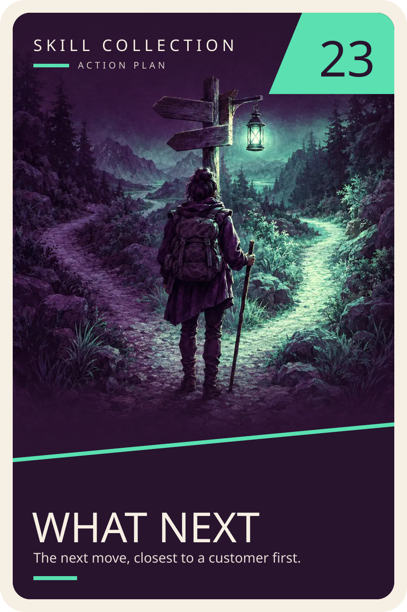
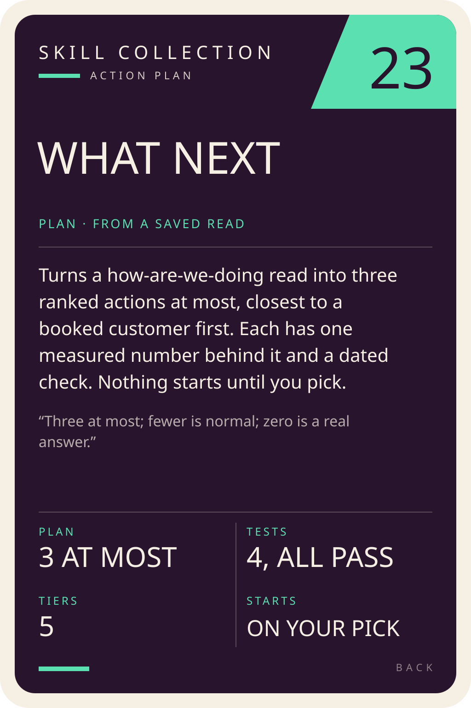
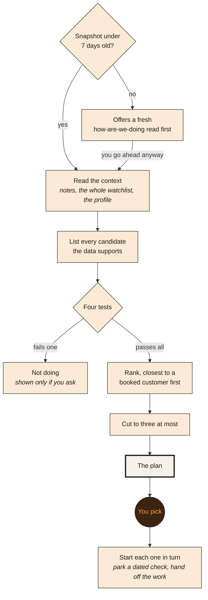

<p align="center">
  
  
</p>

> **TL;DR:** After a [how-are-we-doing](../how-are-we-doing/) read, ask "so what?" You get at most three things to do this week, ranked by how close each is to a real booked customer, each with the one number behind it and a date to check it worked. Nothing starts until you pick.

## Say this

`what should we do next` · `what should I work on` · `what now` · `what do we do with this` · `next steps` · `action plan` · `where should I focus` · `what's the priority` · `what would move the needle` · `ok so what?`

Also: "why is nothing worth changing?" and "let's revisit that parked item".

## How it runs



It works from the snapshot how-are-we-doing saved, so the advice rests on the same numbers you see on the dashboard. It never re-measures.

## What you get

```markdown
**Your move:** Call back the two people who booked last week but never confirmed.

**This week** (pick any; nothing starts until you say)

1. **Follow up the two unconfirmed bookings** · you · 10 min
   Why: 2 bookings with no status set (CRM, Oct 1–12).
   Check: Oct 20: both marked real or ruled out.

2. **Link to the cleaning page from the services page** · me · 20 min
   Why: "teeth cleaning near me" sits at position 9 with 6 clicks from 410 impressions (Search Console, Sep 13–Oct 10).
   Check: Nov 10: clicks on that query, against 6.

**Holding off:** whitening page title test (Oct 27), two pages waiting to be indexed (Oct 20). Ask to see the full skip list.

**Only you can answer:** Are Saturday slots still open to new patients?
```

<sub>Illustrative example. The dental practice and every number are fictional; the layout follows the plan template in <a href="SKILL.md">the SKILL.md</a>.</sub>

Plain words to the owner: no file paths, tool names or internal labels. One number per "Why", with its source and dates. Effort is a time, not a letter. "Nothing worth changing this week" is a real answer, and still comes with the **Holding off** line.

## The four tests

Every candidate must pass all four, or it goes to the skip list.

| Test | What it asks |
|---|---|
| **Buyer test** | Would the person behind this query, visit or lead buy something this business sells? If the link has to be argued, it isn't there |
| **Evidence** | Is there a measured row to quote, with its source and window? No row, no action |
| **No open experiment** | Is a dated read still pending on this page, or was this fix already tried? Either one blocks it |
| **One sized action** | Is there a single concrete move, with who does it and how long it takes? |

## How it ranks

| Tier | What it is |
|---|---|
| **1** | Leads and deals already in reach: unconfirmed bookings, follow-ups, pipeline status |
| **2** | Channels that already produced real bookings |
| **3** | Buyer traffic that arrives and leaves: leaky landing pages, friction on service or contact pages |
| **4** | Search demand near page one that passes the buyer test |
| **5** | Plumbing and long shots: indexing, new demand, technical |

Within a tier, smaller effort with stronger evidence goes first. Impressions never decide rank. A task you put off keeps its rank; it only leaves when you drop it.

## Stat sheet

| | |
|---|---|
| **Input** | A business profile and its latest snapshot from how-are-we-doing |
| **Output** | Your move, up to three steps for this week, what's on hold until when, and at most two questions |
| **Stale data** | Over 7 days old, or missing a source the plan leans on: says so and offers a fresh read first |
| **Starts** | Only what you pick. Sending, publishing or deploying asks for a second, explicit yes |
| **Proof** | Each started step parks a dated check with today's baseline, so the next read settles it |
| **Who does it** | Matched at run time to installed skills by what they say they do, or written out as manual steps |
| **Ships with** | `scripts/candidates.py`, `references/tests.md`, `references/handoffs.md` |

## Plays well with

- **[how-are-we-doing](../how-are-we-doing/)**: measures and saves the snapshot this skill plans from
- **[who-let-the-blogs-out](../who-let-the-blogs-out/)**: the kind of skill it hands a post refresh or title rewrite to
- **[conversion-audit](../conversion-audit/)**: the kind of skill it hands a page that leaks visitors to
- **[ui-oddity-scan](../ui-oddity-scan/)**: the kind of skill it hands a page with odd or broken UI to

## Not for

Measuring. It never re-pulls the numbers; that's [how-are-we-doing](../how-are-we-doing/). It also never proposes content just to fill a calendar.

---

<sub><a href="../../README.md#skill-index">← All skills</a> · <a href="SKILL.md">Read the SKILL.md</a></sub>
