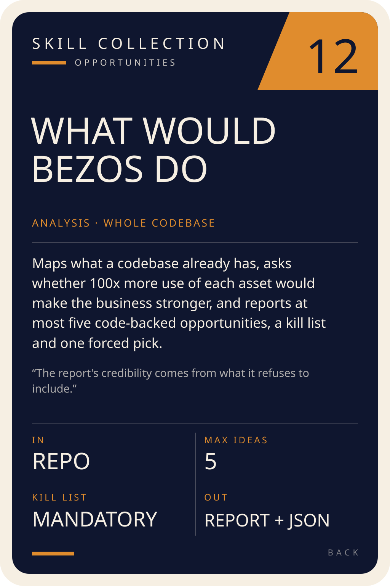
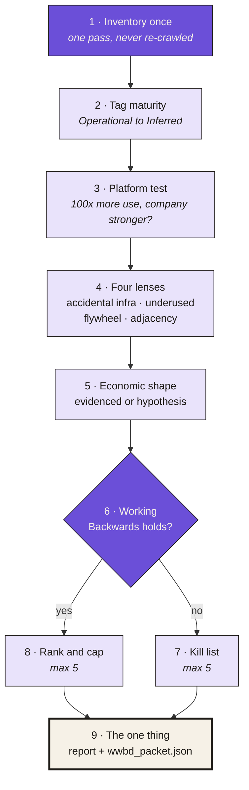

<p align="center">
  
  
</p>

> **TL;DR:** Point it at a repo and it finds things you already built that could be worth a lot more than the one job they do now. You get at most five ideas backed by code, a list of tempting ideas to skip, and one straight answer on where to start.

## Say this

`WWBD` · `what would Bezos do` · `what are we sitting on` · `what did we accidentally build` · `is there a product hiding in here` · `anything valuable buried in this codebase?`

## How it runs



Depth follows the opportunity surface, not the file count: **narrow** repos get the top 3, **normal** ones the full run, **complex** monorepos get split into domains and only the 1 or 2 strongest are analyzed.

## Every finding climbs six steps

A finding that skips a step gets cut. This is the skill's own worked example:

| Step | Example |
|---|---|
| **Evidence** | `lib/notify/` has retries, channel routing, templates, scheduling and event triggers; called from one place (`auth/reset-password.ts`) |
| **Asset** | A general event-routing and delivery engine |
| **Maturity** | Built: works, but one narrow consumer |
| **Leverage** | Fixed cost already paid; every future feature that needs messaging rebuilds it |
| **Opportunity** | Make it the shared event layer behind reminders, lifecycle messages, alerts and reports |
| **Business hypothesis** | Optional and labelled: later expose it to customers as programmable triggers |

Note what it does not say: "sell it as a notification SaaS." Making five existing features cheaper is a legitimate, often better, answer.

## What you get

A report in this exact shape, plus `wwbd_packet.json` for other skills to read:

```markdown
# WWBD: [target]
Surface: [narrow | normal | complex] · Domains analyzed: [list if partitioned]

## What we're sitting on
## Asset inventory
| Asset | Maturity | Currently serves | 100× test |

## Opportunities (max 5)
### N. [Name]
- Asset · Evidence · Why it's underused · Leverage mechanism
- Economic shape: [shape] — [evidenced | supported hypothesis | business context required]
- Working Backwards · Effort (S/M/L) · Smallest first step

## Kill list (max 5)
## Appendix: minor observations (one line each)
## Out of scope (handoffs)
## The one thing
```

<sub>Condensed from the report structure in <a href="SKILL.md">the SKILL.md</a>. Each opportunity's fields are listed one per line there.</sub>

The Working Backwards line has to complete this sentence honestly, or the idea moves to the kill list:

> For **[specific customer]**, we now provide **[capability]**, using **[existing asset]**, which solves **[specific problem]** better because **[structural advantage]**.

## Stat sheet

| | |
|---|---|
| **Input** | A repo you can read. Business context helps but isn't required |
| **Output** | The report above and `wwbd_packet.json` |
| **Caps** | 5 opportunities, 5 kill-list entries, everything else one line or cut |
| **Maturity tags** | Operational · Proven · Built · Prototype · Inferred. Prototype or Inferred can never be called evidenced |
| **Confidence** | Evidenced · Supported hypothesis · Business context required. Code proves feasibility, never demand |
| **Never** | States a price, market size or revenue figure; calls something a flywheel without naming the loop; writes Bezos commentary or Amazon stories |
| **Ships with** | `references/primitives.md` (primitive catalog, economic shapes, adjacency distance, common false positives) |

## Plays well with

- **[gap-scan](../gap-scan/)**: features that are missing, which WWBD never reports
- **[code-audit](../code-audit/)**: code that's broken, slow or insecure
- **[ux-audit](../ux-audit/)**: flows that confuse people
- **[conversion-audit](../conversion-audit/)**: pages that don't persuade

## Not for

Missing features, broken code, confusing flows or weak persuasion. WWBD only starts from something that already exists. "This codebase has no significant latent assets" is a valid result.

---

<sub><a href="../../README.md#skill-index">← All skills</a> · <a href="SKILL.md">Read the SKILL.md</a></sub>
