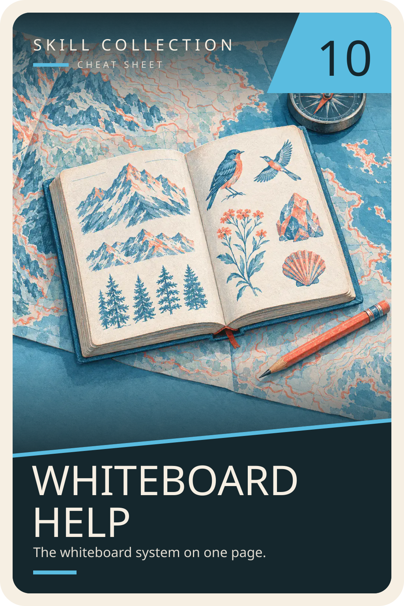
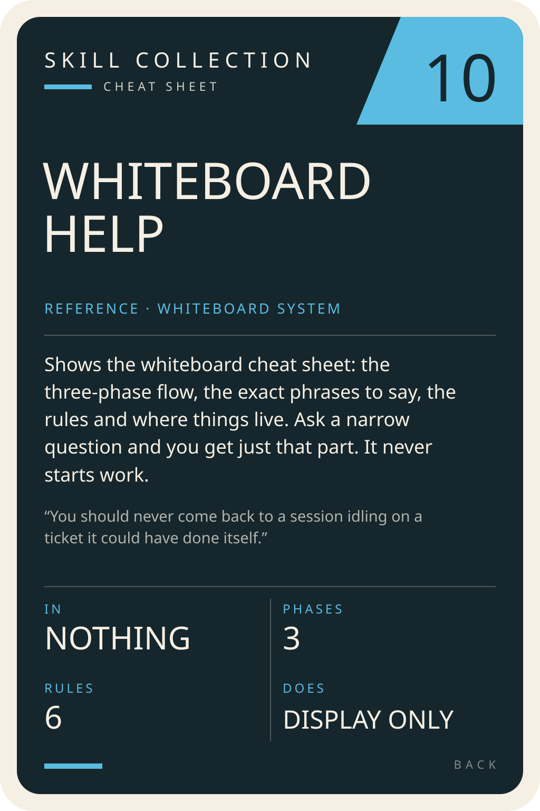
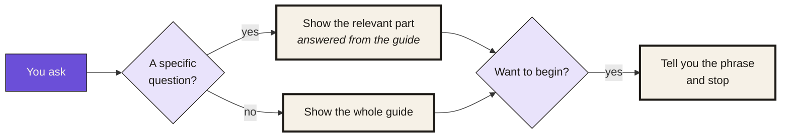

<p align="center">
  
  
</p>

> **TL;DR:** Forgot how the whiteboard works? Ask, and Claude shows the cheat sheet: the steps, the exact words to say, and the rules. It only shows the guide. It never starts a board or does any work.

## Say this

`whiteboard help` · `how do I use the whiteboard` · `what's the flow` · `remind me how whiteboard works` · `which skill do I use`

Or ask a narrow question like "how do I close a board?" and you get just that part.

## How it runs



No state, no tracker access, no work. If you want to start, it hands you the words and you say them.

## What you get

The guide itself, inline. This is its opening, copied from the SKILL.md:

```text
Big fuzzy idea → put it on the whiteboard → work the tickets, stopping only
when it needs you → snapshot the board into a spec when nothing's left to decide.

1. Draw      Say: "whiteboard this: [your idea]"   (once per effort)
2. Work      Say: "work the board" / "run the board" / "work one ticket"
3. Snapshot  Say: "snapshot the board"             (once, at the end)
```

<sub>Condensed from the guide in <a href="SKILL.md">the SKILL.md</a>. The full version also covers ticket types, solo phrases, the rules, where things live, and a "Stuck?" section.</sub>

## The phrases, at a glance

| You want to | Say |
|---|---|
| **Start a board** | "whiteboard this: [your idea]" (in a repo with GitHub Issues) |
| **Work it with you around** | "work the board" |
| **Let it run while you're away** | "run the board" |
| **Do exactly one ticket** | "work one ticket" |
| **Close it out into a spec** | "snapshot the board" |
| **Get the missing wrap-up** | "sign off" |
| **Stress-test one plan, no board** | "hot seat me on [decision]" |
| **Answer one design question in code** | "napkin this: [design question]" |
| **Settle what a word means** | "connotation-cop: [term fight]" |

## Stat sheet

| | |
|---|---|
| **Input** | Nothing. A specific question narrows the answer to the matching section |
| **Output** | The guide inline: the three-phase flow, ticket types, solo phrases, six rules, where things live, troubleshooting |
| **Covers** | whiteboard, hot-seat, napkin, connotation-cop |
| **Rule it lives by** | Display only. It never starts a board, resolves tickets, or does any work |
| **Ships with** | `SKILL.md` only |

## Plays well with

- **[whiteboard](../whiteboard/)**: the system this guide explains; say its phrases to actually start
- **[hot-seat](../hot-seat/)**: the one-question-at-a-time grilling behind hot-seat tickets
- **[napkin](../napkin/)**: throwaway code that answers one design question
- **[connotation-cop](../connotation-cop/)**: settles a term and books it in the glossary

## Not for

Starting a board or doing any planning. That's [whiteboard](../whiteboard/) itself.

---

<sub><a href="../../README.md#skill-index">← All skills</a> · <a href="SKILL.md">Read the SKILL.md</a></sub>
