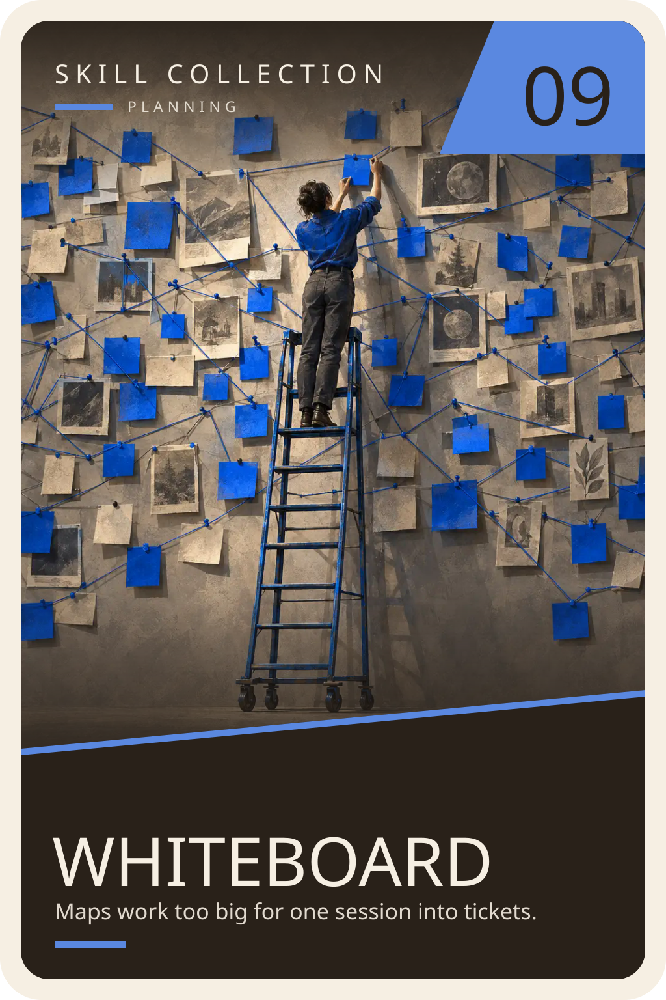
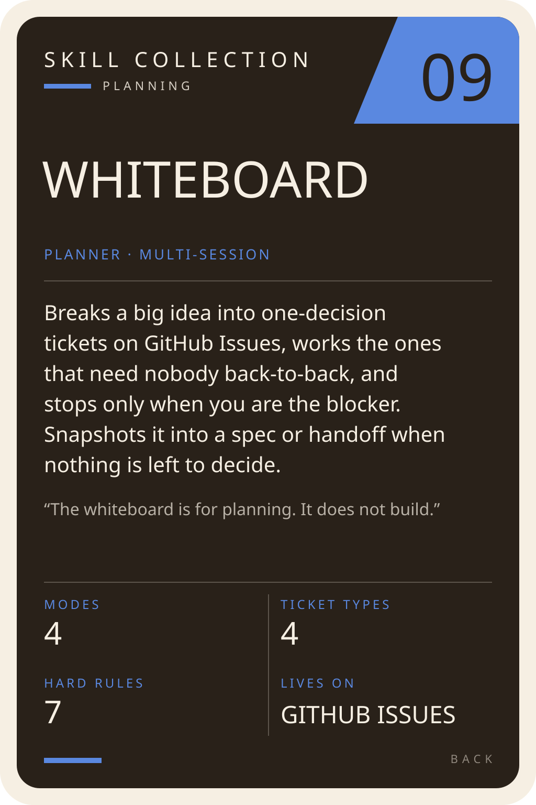
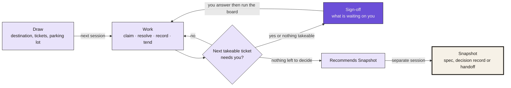

<p align="center">
  
  
</p>

> **TL;DR:** For an idea too big for one session, Claude puts every open decision on a GitHub Issues board as its own ticket, works the ones that don't need you, and stops with a short note when one does. Once nothing is left to decide, say "snapshot the board" and it writes it all up as a spec, decision record or handoff.

## Say this

`whiteboard` · `work the board` · `run the board` · `work one ticket` · `snapshot the board`

It only runs when you ask for it by name, or ask to draw, work, run, or snapshot a whiteboard or map. Ordinary planning requests don't trigger it.

## How it runs



The whiteboard plans; it doesn't build. Every ticket resolves a decision, and the board is done when nothing is left to decide.

## The four modes

| Mode | What happens | Ends with |
|---|---|---|
| **Draw** | Pins the destination, fans out breadth-first for open decisions, creates the board and its tickets, wires blockers in a second pass | A sign-off. Drawing is a full session's work |
| **Work** | Claims the next up-next ticket, loads the skill its type names, resolves it, records it, tends the board, then checks whether the next ticket needs you | A sign-off once you're the blocker |
| **Run** | Work mode with "I'm walking away" said up front. No behavioral difference | A queue of real questions, not a keystroke |
| **Snapshot** | Verifies nothing is open or parked, synthesizes every decision into the destination's artifact, links it, closes the board | The board closed, with the artifact linked |

## Which tickets run without you

| Ticket type | Runs alone? | What it does |
|---|---|---|
| **research** | Yes | Reads docs, APIs, knowledge bases; links a summary |
| **task** | Only if the body says `Runs: agent` | Executes it and records the facts later tickets need. No `Runs:` line means human |
| **napkin** | Builds, doesn't judge | Builds the sketch via [napkin](../napkin/), leaves the verdict to you |
| **hot-seat** | No | A question for you, asked through [hot-seat](../hot-seat/) |

## What you get

Every session that stops ends with a sign-off, so you never have to ask "what's next":

```markdown
**Board:** 2 closed / 3 open
**This session:** Pick the token lifetime strategy — 15-min access / 30-day rolling refresh
                  What does the mobile client use for auth — same cookie endpoint; migration breaks it
**Stopped because:** the human is the blocker
**Waiting on you:** Where do refresh tokens live — a call between httpOnly cookie and response body
                     Sign up for the Auth0 tenant — needs a card and an email
**Next up:** Where do refresh tokens live — it unblocks the revocation question still parked
**Say:** "run the board"
```

<sub>Illustrative example of a made-up JWT migration board, taken from <a href="references/example-board.md"><code>references/example-board.md</code></a>, which walks the same board through its full lifecycle.</sub>

Between tickets that need nobody it prints one line instead (`✓ <ticket> — <gist> · taking <next ticket>`) and keeps going.

## Stat sheet

| | |
|---|---|
| **Input** | An explicit request, a git repo with GitHub Issues and the `gh` CLI, and the board in later sessions |
| **Output** | A `whiteboard:map` board issue, one sub-issue ticket per open decision, resolution comments, a sign-off per stop, and a final snapshot artifact |
| **The board** | An index, not a store: one line per decision, linked to the ticket holding the detail |
| **Sticky test** | Could you write the question on one sticky note, precisely, right now? Yes means ticket; no means parking lot |
| **Stops when** | Nothing eligible is left, the board is done, more tickets were created than closed (fanout), the next ticket drifts from the destination, or context ran out |
| **Hard rules** | 7, including claim before work, names not numbers, never delete a claimed ticket, and split rather than swell |
| **Never, during a run** | Unclaim a stale ticket, answer your side of a hot-seat, guess a `Runs:` line, or roll into Snapshot |
| **Ships with** | `references/github-ops.md`, `templates.md`, `run-loop.md`, `example-board.md`; `platforms/chatgpt.md` (a version for ChatGPT's GitHub connector) |

## Plays well with

- **[hot-seat](../hot-seat/)**: runs every hot-seat ticket and governs every question the board asks
- **[napkin](../napkin/)**: builds napkin tickets when an option can only be judged by seeing it
- **[connotation-cop](../connotation-cop/)**: settles fighting terms and writes ADRs for decisions that clear its bar
- **[whiteboard-help](../whiteboard-help/)**: the cheat sheet for the whole system
- **[agent-smiths](../agent-smiths/)**: takes a whiteboard snapshot and splits it across parallel agents

## Not for

Building the work, or ordinary planning requests. If the whole journey fits one session and nothing needs parking, it says you don't need a board.

---

<sub><a href="../../README.md#skill-index">← All skills</a> · <a href="SKILL.md">Read the SKILL.md</a></sub>
