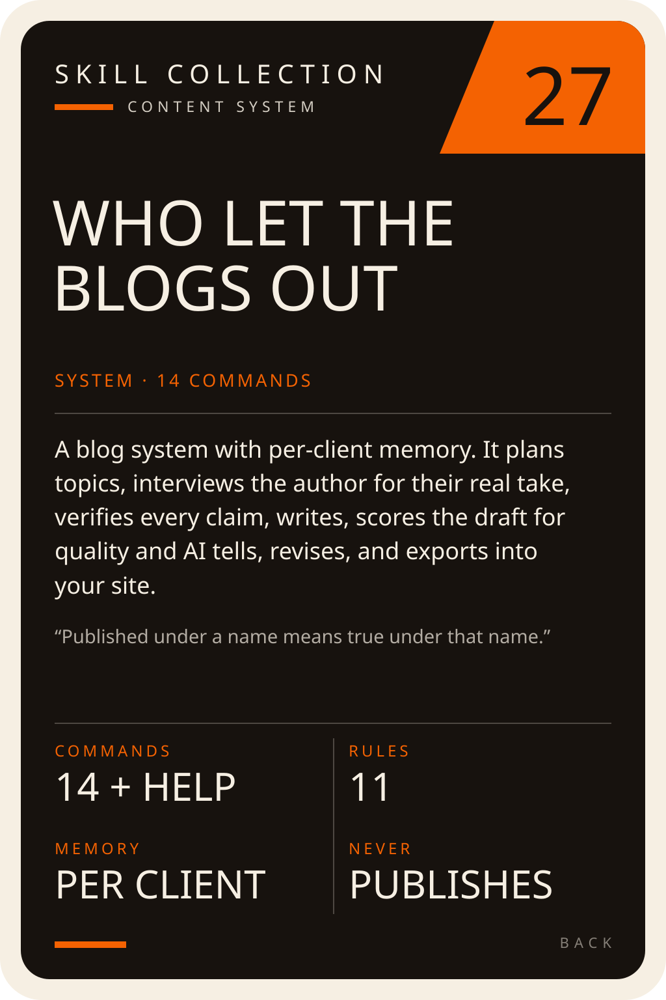
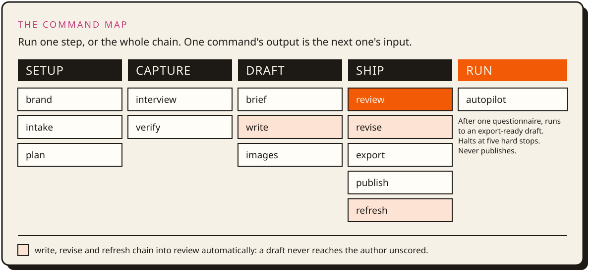
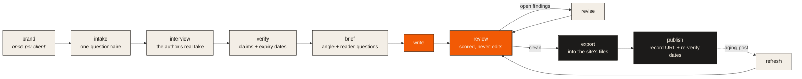

<p align="center">
  
  
</p>

<!-- skill-family:start -->
**The family:** these skills are parts of this one, each also installable on its own.

<p><a href="../../skills/blog-topic-interview/"></a><a href="../../skills/seo-blog-writer/"></a><a href="../../skills/ai-writing-detector/"></a></p>
<!-- skill-family:end -->

> **TL;DR:** A blog system that remembers each client. It interviews the real author, keeps every claim inside the evidence, scores every draft before you see it, and writes the finished post into your site's files. It never deploys or publishes on its own.

## Say this

`wltbo` · `wltbo write` · `write a blog post` · `refresh this post` · `it doesn't sound like us` · `it reads AI-written` · `the facts are made up` · `it's too thin`

A bare `wltbo` shows a menu built from what already exists for the client. It never auto-runs anything.

## The command map

<p align="center">
  
</p>

## How a post moves



Steps whose output already exists get skipped: pick a topic yourself and you're not sent back through `plan`. `autopilot` runs intake replies through to an export-ready draft with no input, stopping only at five hard stops.

## The rules it lives by

| | Rule |
|---|---|
| **1** | Your thesis is sticky. Research can support or qualify it, not replace it |
| **2** | Corrections win immediately, no defending the old reading |
| **3** | Evidence has three bands (explicit, implied, uncertain) and the article says which |
| **4** | Original value never means manufactured disagreement |
| **5** | No author stance is written from AI inference |
| **6** | Ordinary editorial calls get made without asking |
| **7** | Effort matches consequence |
| **8** | Confusion shortens the answer |
| **9** | The machinery stays internal: no IDs, scores or counts read aloud |
| **10** | The workflow adapts to what already exists |
| **11** | Research before asking; client questions go out once |

<details>
<summary><b>What it remembers, per client and per post</b></summary>

```text
.blog/
├── registry.json            what exists, two counts per post
├── clients/<client>/
│   ├── brand.md             voice and brand profile
│   ├── opinion-bank.md      the author's real positions, with provenance
│   └── facts.json           verified facts, each with an expiry date
└── posts/<slug>/
    ├── packet.md            the interview: stories and stances
    ├── brief.md             angle, intent, committed reader questions
    ├── claims.json          every claim and its evidence
    ├── media.json           image plan
    ├── draft-v1.md …        append-only: a new version, never an edit
    └── review-v1.json …
```

State lives in the project, never in the skill folder.

</details>

## Stat sheet

| | |
|---|---|
| **Input** | A client, a topic or command, and for `interview`, the author's real answers |
| **Output** | Scored drafts, then the post written into your site in the format its existing posts use |
| **Quality bar** | Something specific to this author or business, or it isn't done |
| **Truth rule** | Nothing is presented as first-hand experience unless it's in the interview or the fact vault |
| **Never** | Deploys, publishes on autopilot, or invents a disagreement to sound original |
| **Ships with** | One reference file per command, the governing rules, `scripts/check_wiring.py`, `scripts/tells_metrics.py`, acceptance tests |

## Plays well with

- **[blog-topic-interview](../blog-topic-interview/)** and **[seo-blog-writer](../seo-blog-writer/)**: the interview and writing steps as standalone skills, writing the same `.blog/` state
- **[ai-writing-detector](../ai-writing-detector/)**: the AI-tells scorer on its own, for any text
- **[case-study-builder](../case-study-builder/)**: for case studies, which this skill doesn't write

## Not for

Social posts, emails, case studies, site audits ([website-audit](../website-audit/)), or content calendars.

---

<sub><a href="../../README.md#skill-index">← All skills</a> · <a href="SKILL.md">Read the SKILL.md</a></sub>
